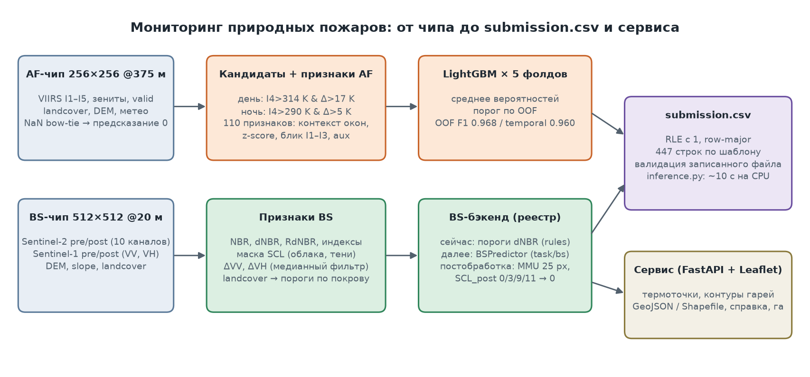

# Мониторинг природных пожаров — КосмоХакатон 2026

## 1. Кратко о решении

Решение кейса «Мониторинг природных пожаров» из пяти частей:

1. **AF (Active Fire)** — по чипу VIIRS 256×256 @375 м: бинарная маска пикселей природного горения. Пиксели-кандидаты
   (раздельные пороги день/ночь) → 110 признаков (контекст окон, z-score, признаки блика, landcover, метео) →
   среднее 5 фолд-моделей LightGBM → порог по OOF.
2. **BS (Burn Severity)** — по чипу 512×512 @20 м (Sentinel-2/1 pre/post + DEM/slope/landcover): маска степени поражения 0–3.
   Два UNet-resnet34 выбирают регион «своего» пожара → LightGBM 2-го уровня уточняет пиксели и степень (медианный dNBR,
   landcover, SCL, признаки локализации события) → пороги → постобработка (`BSPredictor`, бэкенд `unet`).
3. **`inference.py`** → `submission.csv` в формате RLE, одна команда, ~20 с на GPU / ~53 с на CPU, результат побайтно воспроизводим.
4. **Сервис** (FastAPI + Leaflet): термоточки, контуры гарей (GeoJSON/Shapefile), справка по площадям в га.
5. Отчёты в `reports/` (EDA, baseline, эксперименты, скорость, отправки).



Метрика: `Score = 0.35·F1_af + 0.35·IoU_burn + 0.30·mIoU_sev` (микро-усреднение по пикселям всех чипов).
Схема перерисовывается командой `python scripts/make_pipeline_figure.py`.

## 2. Результаты

| Модуль | Модель | OOF (GroupKFold-5) | Временной сплит (val = 2024) | Примечание |
|---|---|---|---|---|
| AF | правило-baseline `I4>320 K & I4−I5>15 K` | F1 0.2435 (весь train) | — | строка 0 `reports/experiments.md` |
| AF | **LightGBM по кандидатам (AF-17)** | **F1 0.9682** | **F1 0.9597** | `reports/af_module.md` |
| BS | baseline: dNBR 0.10/0.27/0.44 | IoU_burn 0.3706, mIoU_sev 0.3129 (весь train) | — | текущий бэкенд `rules` |
| BS | **2×UNet-resnet34 → стек-LGBM + постобработка (без TTA)** | **IoU_burn 0.7560, mIoU_sev 0.7554** | **IoU_burn 0.7723, mIoU_sev 0.7684** | `reports/bs_module.md` |

| Отправка на public-лидерборд | Состав | Score |
|---|---|---|
| `submission_stub.csv` | оба baseline-правила | 0.3117 (на train 0.3088) |
| `submission_af.csv` | AF LightGBM + BS baseline | **0.6035** → F1_af на public ≈ 0.93–0.99 |

Подробно: `reports/submissions.md`, `reports/experiments.md`, `reports/baseline_review.md`, `reports/eda.md`.

## 3. Требования к окружению

- ОС: Windows 10/11 или Linux x86_64 (glibc ≥ 2.28: Debian 11+, Ubuntu 20.04+). Разработка велась на Windows 10,
  Linux проверен в Docker (`python:3.12-slim`).
- Python **3.10–3.12** (`pyproject.toml`: `>=3.10,<3.13`); проверено на **3.12.7**. Версии пакетов зафиксированы.
- GPU **не требуется**: инференс целиком укладывается в ~10 с на CPU. CUDA 12.4 (драйвер ≥ 550) нужна только для
  обучения нейросетевой BS-модели.
- RAM: инференс ≤ 2 ГБ, обучение AF ≤ 4 ГБ. Диск: ~6 ГБ на окружение с CUDA-сборкой torch (~1.5 ГБ с CPU-сборкой),
  данные train + test ≈ 3 ГБ.

## 4. Установка

PowerShell (Windows):

```powershell
git clone <repo-url> fire-monitoring
cd fire-monitoring
py -3.12 -m venv .venv
.\.venv\Scripts\Activate.ps1
python -m pip install --upgrade pip
pip install -r requirements.txt          # с GPU (torch + CUDA 12.4)
# pip install -r requirements-cpu.txt    # без GPU: те же версии, torch CPU
$env:PYTHONIOENCODING = 'utf-8'          # кириллица в выводе скриптов
$env:PYTHONPATH = "$PWD\src"            # нужно только для команд вида `python -m firemon.…`
```

bash (Linux/macOS):

```bash
git clone <repo-url> fire-monitoring
cd fire-monitoring
python3.12 -m venv .venv
source .venv/bin/activate
python -m pip install --upgrade pip
pip install -r requirements-cpu.txt      # или requirements.txt при наличии GPU
export PYTHONPATH=$PWD/src               # нужно только для команд вида `python -m firemon.…`
```

`pip install -e .` **не нужен**: `inference.py`, `train.py`, скрипты и тесты сами добавляют `src/` в `sys.path`
(переменная `PYTHONPATH` требуется лишь для `python -m firemon.…`; альтернатива ей — `pip install -e .`).
Файлы зависимостей: `requirements-base.txt` (всё, кроме torch, точные версии) подключается из `requirements.txt`
(torch cu124) и `requirements-cpu.txt` (torch CPU); `requirements.lock.txt` — полный снимок окружения разработки.

## 5. Структура входных данных

Распаковка (внутри архивов уже лежат каталоги `train/` и `test/`):

```powershell
New-Item -ItemType Directory -Force data | Out-Null
tar -xf "C:\path\to\fire-train-renamed.tar" -C data
tar -xf "C:\path\to\fire-test-renamed.tar" -C data
python scripts/check_data.py                 # train: 420 AF × 3 файла, 224 BS × 6 файлов → «ВСЁ ОК»
python scripts/check_data.py --split test    # test: 180 AF × 2, 89 BS × 5, 447 строк шаблона → «ВСЁ ОК»
```

```bash
mkdir -p data && tar -xf /path/to/fire-train-renamed.tar -C data && tar -xf /path/to/fire-test-renamed.tar -C data
python scripts/check_data.py && python scripts/check_data.py --split test
```

Каталог теста (то, что передаётся в `--data-dir`):

```
data/test/
  meta.csv                 один на оба модуля: chip_id,kind,width,height,gsd,valid_frac,cloud_frac (180 af + 89 bs)
  sample_submission.csv    шаблон: 447 строк chip_id,class_id,rle (rle пустая) — AF по 1 строке, BS по 3
  af/viirs/AF_te_000001_VIIRS_I1-I5.tif      af/aux/AF_te_000001_AUX.tif
  bs/sentinel2_pre/BS_te_000001_Sentinel-2_pre.tif   bs/sentinel2_post/…   bs/sentinel1_pre/…   bs/sentinel1_post/…   bs/aux/…
```

- **Где `sample_submission.csv`:** ищется в порядке `--sample-submission` → `<data-dir>/sample_submission.csv` →
  `baseline/sample_submission.csv`. Шаблон определяет состав строк; чип из шаблона, которого нет на диске, получает пустую
  маску и warning. Без шаблона строки формируются по `meta.csv` / именам файлов.
- `meta.csv`: поддерживаются обе раскладки — `<data-dir>/<kind>/meta.csv` (как в train) и общий `<data-dir>/meta.csv`.
  Для инференса он не обязателен (нужен только для нестандартных размеров чипов).
- Train: `data/train/af/{meta.csv, viirs/, aux/, masks/}`, `data/train/bs/{meta.csv, sentinel2_pre/, …, aux/, masks/}`.
- Baseline и скрипты RLE/метрики организаторы не выдавали: формат реализован строго по тексту ТЗ (`tests/test_rle_spec.py`)
  и подтверждён первой отправкой на лидерборд.

> **Windows:** `aux` — зарезервированное имя устройства. Файлы внутри `aux/` читаются нормально, но сам каталог нельзя
> открыть в Проводнике/PowerShell или создать обычным `mkdir`. Код использует `firemon.io.win_path()` (префикс `\\?\`,
> на Linux — no-op); вручную с этим каталогом ничего делать не нужно. `tar -xf` распаковывает его без проблем.

## 6. Запуск инференса

Одна команда (PowerShell и bash одинаково):

```
python inference.py --data-dir data/test --output out/submission.csv
```

`submission.csv` появляется по пути `--output` (каталоги создаются). Без интерактива; в конце печатается полное время.

| Конфигурация (269 чипов теста) | Время |
|---|---|
| CPU, venv (i5-13600KF, 8 потоков) — AF LightGBM + BS baseline | **~10–11 с** (9.3–12.4) |
| CPU, Docker-образ `firemon` (включая запуск контейнера) | 11.1–11.5 с |
| CPU, один поток (`--workers 1`) | ~19–21 с |
| **GPU (RTX 4070), AF LightGBM + BS 2×UNet + стек-LGBM** — конфигурация по умолчанию | **~21–22 с** (BS ≈ 16 с; без TTA, fp32) |
| CPU (`--device cpu`), те же модели и настройки | ~52 с (BS 47 с); файл отличается от GPU на 1 пиксель из 23.3 млн |

Подробности, профиль этапов и проверки детерминизма — `reports/speed.md`.

Необязательные аргументы: `--sample-submission CSV`, `--config configs/inference.yaml`, `--device auto|cpu|cuda`
(для нейросетевых бэкендов; LightGBM и правила всегда на CPU), `--workers N` (потоки чтения/признаков, по умолчанию 8 —
на результат не влияет), `--profile` (таблица времени по этапам). Коды выхода: **0** — файл записан и прошёл валидацию;
**1** — записан, но не прошёл валидацию; **2** — нет входных данных/конфига (понятное сообщение вместо трассировки).

Воспроизводимость: повторный запуск даёт **побайтно тот же файл** при любом `--workers` и числе потоков LightGBM
(`tests/test_reproducibility.py`); результат в Docker (Linux) побайтно совпадает с Windows.

Проверка файла перед отправкой и оценка по известным маскам:

```
python scripts/check_submission.py out/submission.csv      # валидатор + сводка: пиксели по классам, пустые маски
python scripts/make_fake_test.py                           # 20 AF + 10 BS чипов train в data/test_fake
python inference.py --data-dir data/test_fake --output out/submission_fake.csv
python -m firemon.metrics --submission out/submission_fake.csv --masks-dir data/train --sample-submission data/test_fake/sample_submission.csv
```

### Как подключить модель

Модели подключаются в одном месте — реестрах `AF_BACKENDS` / `BS_BACKENDS` в `src/firemon/pipeline.py`; выбор — в
`configs/inference.yaml` (`af.model`, `bs.model`, запасной вариант `fallback`). Чтобы включить `BSPredictor` после слияния
`task/bs`: (1) добавить функцию-бэкенд в `BS_BACKENDS`, (2) положить веса в `weights/`, (3) выставить `bs.model`.
`inference.py`, Dockerfile и команды из этого README не меняются. Если бэкенд не поднялся (нет весов) — используется
`fallback` с ошибкой в логе: валидный submission важнее падения.

## 7. Docker

CPU-образ (проверен: собран и запущен на реальном `data/test`, результат побайтно совпал с запуском из venv):

```powershell
docker build -t firemon .
docker run --rm -v C:\path\to\test:/data:ro -v C:\path\to\out:/out firemon --data-dir /data --output /out/submission.csv
```

```bash
docker build -t firemon .
docker run --rm -v /path/to/test:/data:ro -v /path/to/out:/out firemon --data-dir /data --output /out/submission.csv
```

В образе: код, конфиги, веса из `weights/`, все зависимости (включая torch CPU для нейросетевого BS-бэкенда); сеть при
запуске не нужна. `ENTRYPOINT ["python", "inference.py"]` — все аргументы те же, что в разделе 6. Размер образа ≈ 2.8 ГБ,
сборка ≈ 5–6 мин (почти всё — загрузка колёс). Если в `/data` нет `sample_submission.csv`, передайте его явно:
`-v C:\path\to\sample_submission.csv:/sample.csv:ro … --sample-submission /sample.csv`.

GPU-образ: `docker build -f Dockerfile.gpu -t firemon:gpu .`, запуск с `--gpus all`. **Не тестировался** (в текущем
решении GPU на инференсе не используется); написан по тому же шаблону на базе `pytorch/pytorch:2.6.0-cuda12.4-cudnn9-runtime`.
Запасной путь без Docker — venv из раздела 4.

## 8. Веса

Веса лежат **в git** в `weights/` (AF ~5 МБ; BS ~101 МБ: два файла по 47 МБ — каждый меньше лимита 50 МБ) — отдельно скачивать ничего не нужно:

```
weights/
  af_lgbm_fold0.txt … af_lgbm_fold4.txt   5 фолд-моделей LightGBM (текстовый формат)
  af_lgbm_meta.json                        список признаков, порог по OOF, параметры кандидатов
  bs_unet_r34_cedice.pt, bs_unet_r34_v4.pt  два UNet-resnet34, fp16 (в .gitignore стоит weights/*.pt → `git add -f`)
  bs_stack.txt                             LightGBM 2-го уровня (основная модель BS)
  bs_lgbm.txt, bs_lc_medians.json          пиксельный LightGBM (режим use_lgbm, в финале выключен)
  bs_decode.json                           пороги декодирования и постобработка, подобранные по OOF
```

Нет весов AF → `inference.py` автоматически переходит на контекстное правило (OOF F1 0.8965) с ошибкой в логе.
Нет весов BS → бэкенд `unet` откатывается на `rules` (пороги dNBR) с ошибкой в логе.
Предобученные сторонние веса: энкодер resnet34 (ImageNet, torchvision BSD-3) через `segmentation_models_pytorch` (MIT) — только в BS-модели.

## 9. Обучение

```
python train.py --module af      # AF: признаки → data/cache/af_train.npz → 5 фолдов LightGBM → weights/af_lgbm_*
python train.py --module bs      # BS: правила → LGBM → 2×UNet (CV + full) → стек → декодирование (≈ 1.5 ч, GPU)
python train.py --module all     # af + bs
```

AF: ~1.5 мин с расчётом кэша признаков, ~30 с с готовым кэшем (8 потоков CPU, GPU не нужна). Печатает OOF F1
(GroupKFold по тайлу) и F1 на временном сплите (val = 2024), срезы по покрову/размеру очага; пишет
`reports/af_train_report.json` и строку в `reports/experiments.md` (`--no-log` — не писать; `--rebuild-cache` — пересчитать
кэш). **Детерминировано:** повторный запуск даёт OOF F1 0.9682 / temporal 0.9597 и веса, совпадающие по содержимому
байт-в-байт (проверено: `git diff` пуст; на Windows файлы пишутся с CRLF, в git хранятся с LF).

Валидация фиксирована: `configs/folds_af.csv` (5 групповых фолдов по тайлу), `configs/folds_bs.csv` (блоки 50×50 км),
колонка `temporal_split` (val = 2024). Пересоздание: `python -m firemon.splits --data-dir data/train` (seed 42).
Исследовательские скрипты AF (для воспроизведения сабмита не нужны): `scripts/af/*.py` — сетка правила, абляции,
постобработка, ансамбль, профиль, рисунки; EDA: `python eda/eda_af.py`, `python eda/eda_bs.py`, `python eda/test_vs_train.py`.

### Модуль BS (контур гари и степень поражения)

Схема: признаки (`src/firemon/features/bs_features.py`) → два UNet-resnet34 (среднее) выбирают регион гари → LightGBM 2-го уровня
уточняет пиксели и степень (по медианному dNBR, landcover, SCL и вероятностям UNet) → декодирование порогами →
постобработка. Подробности и все цифры — `reports/bs_module.md`.

```powershell
python train.py --module bs                          # всё: правила → LGBM → UNet (CV + full) → стек → декодирование
python train.py --module bs --bs-stages unet stack ensemble   # отдельные этапы: rules lgbm unet stack ensemble
python -m firemon.models.bs.lgbm --stage ablate      # абляции признаков (SAR / SCL / landcover / контекст / минимум / регрессия)
python scripts/bs_report_figures.py                  # рисунки и статистика для reports/bs_module.md
python scripts/bs_benchmark.py --device cuda         # время BS-инференса на 89 чипах (и --device cpu)
python scripts/bs_eda_checks.py --probs stack_avg14_event   # проверка фактов EDA об эталоне (буфер события, SCL, MMU, степень)
python scripts/bs_log_experiments.py                 # перенос результатов из data/cache/bs_oof/*.json в reports/experiments.md
```

Полный прогон на RTX 4070 ≈ 1.5 ч (UNet: 2 сети × (6 обучений × 5 мин + full); LGBM CV ≈ 15 мин; стек ≈ 15 мин; подбор
постобработки ≈ 10 мин). Промежуточные OOF-вероятности и выборки пикселей кэшируются в `data/cache/` (в git не входят,
нужно ≈ 8 ГБ диска и ≈ 16 ГБ RAM). Результат обучения — `weights/bs_unet_r34_cedice.pt` и `weights/bs_unet_r34_v4.pt`
(fp16, по 47 МБ; `encoder_weights="imagenet"` из smp — лицензия весов torchvision BSD-3; в git добавлены через `git add -f`),
`weights/bs_stack.txt`, `weights/bs_lgbm.txt`, `weights/bs_lc_medians.json`, `weights/bs_decode.json`.
Инференс настраивается в `configs/bs_inference.yaml` (`device: auto|cpu|cuda`, `use_stack`, `tta`, `tta_cpu`, `gpu_half`);
без GPU автоматически используется CPU-путь. **TTA выключен на всех устройствах, UNet на GPU считается в fp32**: прирост
от TTA на OOF всего +0.0043 / +0.0024 BS-части (< 0.005), зато результат не зависит от устройства — GPU- и CPU-файлы на
тесте отличаются 1 пикселем из 23.3 млн (`python scripts/compare_submissions.py a.csv b.csv`), повторные запуски на одном
устройстве побайтно одинаковы. Режим с TTA (чуть точнее, UNet ×4 по времени; результат GPU и CPU тогда различается
сильнее только если включить TTA не на обоих): `tta: true`, `tta_cpu: true`, `stack_weights: weights/bs_stack_tta.txt`,
`decode_file: weights/bs_decode_tta.json`. Проверка воспроизводимости обучения:
`python train.py --module bs --weights-dir weights_repro/` (свой кэш `data/cache/bs_weights_repro/`, основные веса не
затрагиваются) → `python scripts/bs_repro_compare.py` и инференс с `--config configs/inference_bs_repro.yaml`.

## 10. Сервис

Веб-карта + REST API: по полигону/bbox и интервалу дат — термоточки, контуры гарей (GeoJSON/Shapefile, атрибуты
id/класс/площадь) и справка по площадям (JSON/CSV). Подробности — `reports/service.md`, `service/README.md`.

```
python -m uvicorn service.app:app --host 0.0.0.0 --port 8000      # или: python service/run.py
```

Открыть: http://localhost:8000 — карта (кнопка «Демо-запрос»), http://localhost:8000/docs — OpenAPI,
http://localhost:8000/health — состояние. Сервис стартует сразу после клонирования из снимка эталонных слоёв
`service/data/*.geojson.gz`. Слой предсказаний моделей строится командой (нужен `data/train`, ~2 мин):
`python scripts/build_service_data.py --source both` (какие модели использованы — `service/data/manifest.json`).

```bash
# 1) справка по площадям (JSON; format=csv — таблица)
curl "http://localhost:8000/api/v1/summary?bbox=39.25,47.95,39.50,48.10&date_from=2024-09-15&date_to=2024-10-10"
# 2) контуры гарей в Shapefile (zip: shp+shx+dbf+prj+cpg)
curl -o burn_scars_shp.zip "http://localhost:8000/api/v1/burn-scars?bbox=39.25,47.95,39.50,48.10&format=shp"
# 3) всё одним запросом: термоточки + гари + справка (область — bbox или GeoJSON-полигон в поле geometry)
curl -X POST http://localhost:8000/api/v1/query -H "Content-Type: application/json" -d '{"bbox":[39.25,47.95,39.50,48.10],"date_from":"2024-09-15","date_to":"2024-10-10","source":"gt"}'
```

В PowerShell вместо `curl` — `curl.exe` (или `Invoke-RestMethod`).

## 11. Тесты

```
python -m pytest -q
```

Покрыто: I/O и обе раскладки meta, RLE по каждому правилу ТЗ, метрика, сборка/валидация submission, фолды, AF-модуль,
сервис, устойчивость инференса (NaN/нули/отсутствующие чипы, коды выхода), побайтная воспроизводимость. Тесты, которым нужны
данные, пропускаются, если нет `data/train`, `data/test` или `data/test_fake` (`python scripts/make_fake_test.py`).
На Windows тесты сами передают подпроцессам `PYTHONIOENCODING=utf-8`.

## 12. Структура репозитория

```
inference.py            единственная точка входа инференса (CLI)
train.py                обучение: python train.py --module af|bs|all
Dockerfile, Dockerfile.gpu, .dockerignore
requirements.txt (GPU) / requirements-cpu.txt / requirements-base.txt / requirements.lock.txt
configs/                inference.yaml, af_lgbm.yaml, folds_af.csv, folds_bs.csv (фиксированная валидация)
src/firemon/
  pipeline.py           конвейер инференса: реестры бэкендов AF/BS, потоки, профилировщик — МЕСТО ПОДКЛЮЧЕНИЯ МОДЕЛЕЙ
  io.py                 чтение чипов → dict массивов (C,H,W) + имена каналов, meta (обе раскладки), win_path
  rle.py                RLE encode / decode / validate (формат ТЗ)
  metrics.py            F1_af, IoU_burn, mIoU_sev, Score; evaluate_submission
  submission.py         сборка и валидация submission.csv по шаблону
  splits.py             групповые фолды (тайл / пространственный блок) + временной сплит
  features/             af_features.py (110 признаков AF)
  models/af/            predictor.py (AFPredictor), pipeline.py / train_lgbm.py / dataset.py (обучение), rules.py (правила)
  models/bs/            rules.py (baseline dNBR); BSPredictor — после слияния task/bs
  postprocess.py, utils.py
scripts/                check_data.py, check_submission.py, make_fake_test.py, build_service_data.py,
                        make_pipeline_figure.py, bench_inference_parallel.py, af/ (исследования AF)
service/                FastAPI-приложение, static/ (Leaflet), data/ (снимок слоёв)
eda/                    eda_af.py, eda_bs.py, test_vs_train.py, tables/
reports/                eda.md, baseline_review.md, af_module.md, service.md, experiments.md, submissions.md, speed.md,
                        test_vs_train.md, figures/, tasklog/
tests/                  pytest
weights/                веса моделей (в git)
docs/                   ТЗ и критерии (pdf + txt)
data/, baseline/, out/, submissions/*.csv     не в git
```

### Разработка в нескольких worktree

Модули делались параллельно в отдельных `git worktree` (`task/af`, `task/bs`, `task/eda`, `task/service`) рядом с основным:

- **Общий `.venv`** основного worktree, **без `pip install -e .`** — editable-установка привязала бы пакет `firemon` к одному
  worktree, и остальные молча импортировали бы чужой код.
- **`PYTHONPATH` = `<свой worktree>\src`** в каждой сессии: `$env:PYTHONPATH = "$PWD\src"` (bash: `export PYTHONPATH=$PWD/src`).
  Точки входа и тесты дополнительно сами добавляют свой `src/` в `sys.path`.
- **Junction-ы** `data`, `baseline`, `weights` в каждом worktree указывают на каталоги основного
  (`New-Item -ItemType Junction -Path data -Target ..\fire-monitoring\data`): данные не дублируются, веса сразу видны всем.
  Следствие: файл весов, записанный в одном worktree, появляется как неотслеживаемый во всех — перед слиянием ветки сверять
  его с веткой байт-в-байт.
- ⚠️ **Не удаляйте worktree с junction-ами через `Remove-Item -Recurse`** (и `rm -rf` из Git Bash): команда пройдёт по junction
  внутрь и **удалит общие `data/` и `weights/`**. Сначала снимите сами ссылки — `cmd /c rmdir data`, `cmd /c rmdir baseline`,
  `cmd /c rmdir weights` (удаляет только ссылку), затем `git worktree remove <путь>`.

## 13. Лицензии данных и моделей

- **Данные** предоставлены организаторами; источники открытые: VIIRS (NASA, открытые данные), Sentinel-1/2 (Copernicus, свободная
  лицензия), ESA WorldCover v200 (CC BY 4.0), ERA5-Land (Copernicus C3S). Данные о территориях/датах теста, продукты
  FIRMS/VNP14/MCD64A1/FireCCI и ручная разметка теста **не используются**; модели работают только с содержимым чипа.
- **Предобученные модели:** не используются — LightGBM обучен с нуля на train (при подключении BS-модели с предобученным
  энкодером лицензия будет указана здесь и в отчёте).
- **ПО** — только открытое: LightGBM (MIT), PyTorch (BSD-3), segmentation-models-pytorch (MIT), NumPy/SciPy/pandas (BSD),
  rasterio (BSD-3), GeoPandas/Shapely (BSD-3), FastAPI (MIT), Uvicorn (BSD-3), Leaflet (BSD-2), Leaflet.draw (MIT),
  Swagger UI (Apache-2.0); тексты лицензий Leaflet и Swagger UI — в `service/static/vendor/{leaflet,swagger}/LICENSE`.

## 14. Команда

{{TEAM}}
