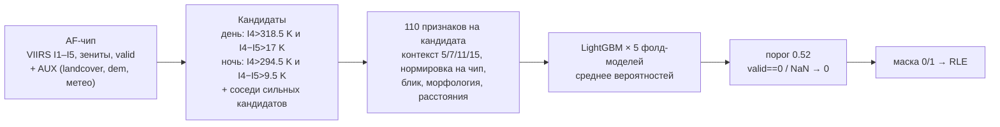
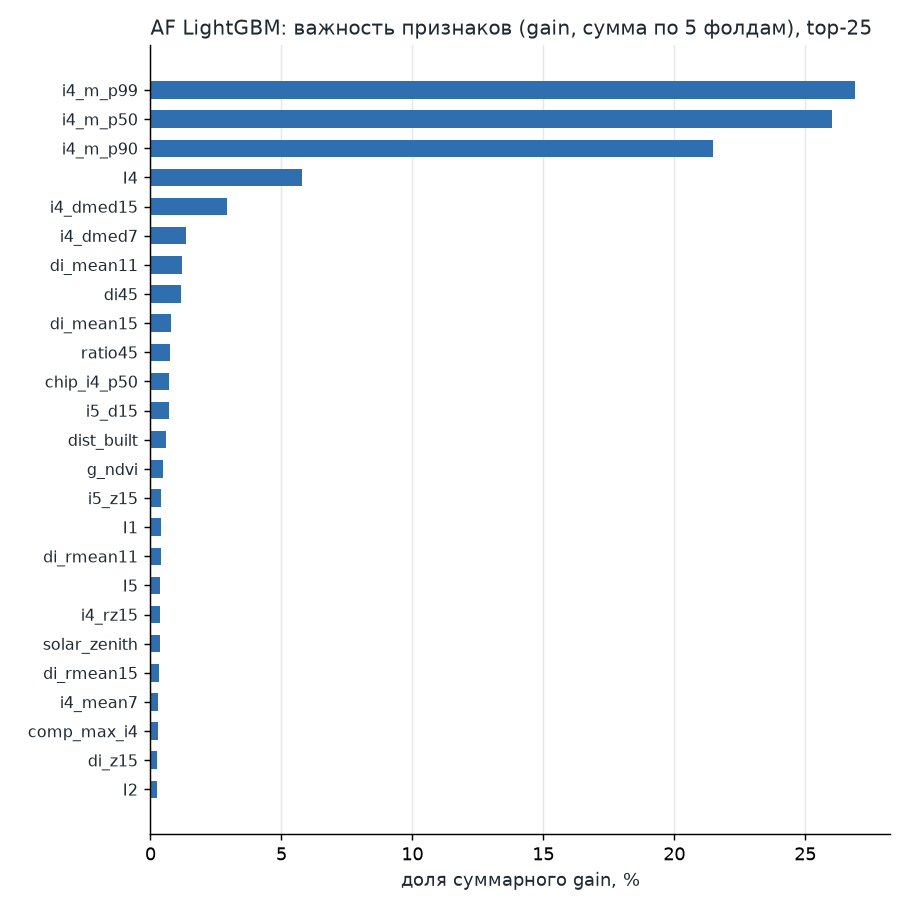
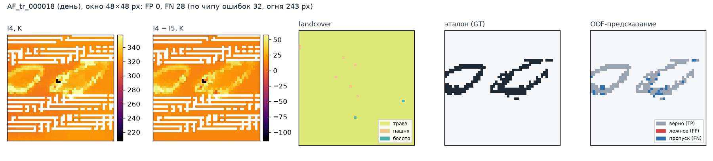
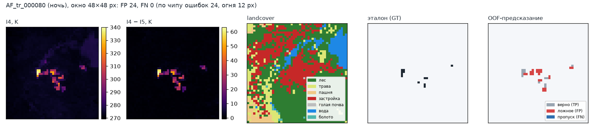
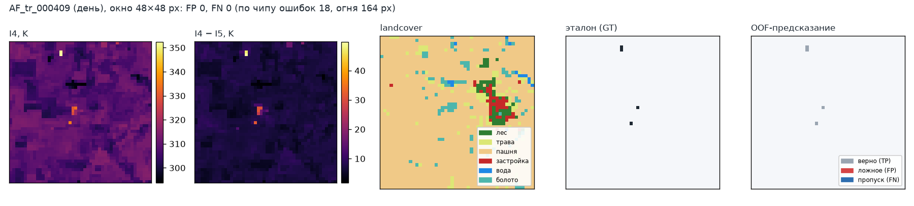
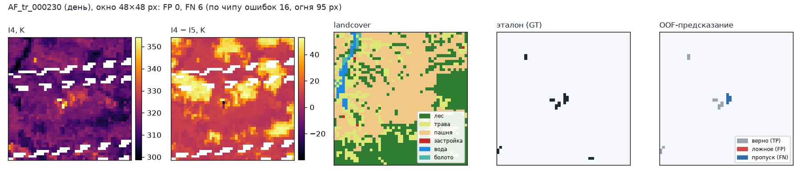

# Модуль AF: детекция активного горения и фильтрация техногенных термоаномалий

Все числа — OOF на фиксированной валидации (`configs/folds_af.csv`): GroupKFold-5 по тайлу и временной сплит
(train ≤ 2023 → val 2024; порог берётся с GroupKFold-OOF, к 2024 не подгоняется). Метрика — микро-F1 по пикселям огня.
Полный журнал — `reports/experiments.md` (строки AF-0 … AF-16). Воспроизведение: `python train.py --module af`.

## 1. Пайплайн

1. **Кандидаты** (`features/af_features.py::candidate_mask`). Ослабленное правило день/ночь. На train оно покрывает
   **100 % пикселей огня** (9 725 из 9 725) при 65 520 кандидатах из 27.5 млн пикселей (0.24 %). Модель обучается и
   применяется только на кандидатах: остальные 99.76 % пикселей заведомо 0. Это не ограничивает F1 сверху (recall
   кандидатов 100 %) и делает инференс дешёвым: в среднем ~165 строк на чип вместо 65 536.
   «Дорастание»: внутри крупных очагов I5 тоже растёт до 330–343 K и I4−I5 падает ниже порога (на train — 42 таких
   пикселя огня, все с соседями-огнём), поэтому соседи (3×3) сильного кандидата (I4−I5 > 25 K) добираются только по I4.
2. **Признаки** (`compute_af_features` — полная карта, `af_feature_rows` — только для выбранных пикселей, код расчёта
   один и тот же, тест сверяет). Оконные суммы — через интегральные изображения с нормировкой на число валидных
   пикселей окна (NaN не портят фон); суммы квадратов считаются по центрированным каналам в float64.
   Группы: сырые каналы и I4−I5, I4/I5; контекст окон 5/7/11/15 по I4 и I4−I5 (среднее, std, z-score, «робастный» фон
   без кандидатов как в VNP14, разность с максимумом и медианой окна, доля горячих соседей); контекст I5; нормировка на
   чип (I4 − p50/p90/p99 чипа); дневные признаки блика (I3, I3/I2, I1+I2+I3, NDVI — ночью 0); морфология (размер
   8-связной компоненты кандидатов, её max I4 / max I4−I5, число кандидатов в 3×3); расстояния до застройки, воды,
   невалидных пикселей; доли застройки/воды в окне 7; `was_nan`. NaN → медиана чипа.
3. **LightGBM**: binary, lr 0.05, 63 листа, `min_child_samples` 50, `feature_fraction` 0.8, `deterministic=True`,
   8 потоков, seed 42, early stopping по валидационному фолду (108–185 деревьев).
4. **Порог 0.52** подобран по OOF микро-F1 (перебор 0.05…0.95, шаг 0.01).

## 2. Результаты

| Этап | OOF F1 (GroupKFold) | P / R | Временной сплит (2024) |
|---|---|---|---|
| Заглушка `I4>320 & I4−I5>15` (весь train) | 0.2435 | 0.141 / 0.911 | — |
| Шаг 0: контекстное правило, пороги день/ночь (наш baseline) | 0.8965 | 0.874 / 0.920 | 0.9163 |
| **LightGBM, 110 признаков, кандидаты** | **0.9686** | 0.959 / 0.978 | **0.9560** |
| + гистерезис (лучший по OOF 0.5 / 0.4) | 0.9673 | | 0.9586 |
| + удаление одиночных p < 0.6 | 0.9684 | | 0.9557 |
| + обнуление «вода днём, I3 > 0.15» | 0.9683 | | 0.9565 |
| Стекинг на вероятностях соседей | 0.9651 | | 0.9591 |
| CNN (шаг 5) | не делалась | | |

Постобработка и стекинг не дали прироста одновременно на обоих сплитах (правило проекта) → в финале только порог.
CNN не обучалась: по условию задачи она допустима только при свободной GPU, а GPU была занята обучением BS
(5.4 ГБ, загрузка 48 %).

**Наблюдение → решение.** Заглушка давала precision 0.14, и 100 % её ложных срабатываний были дневными. Grid шага 0
показал, что почти весь выигрыш (0.24 → 0.90) даёт один дневной порог I4 > 330 K вместо 320 K: днём контекстная ветка
вырождается (оптимальный k = 8 — она почти выключена), ночью — работает (k = 3). Отсюда: дневной прогретый фон
отсекается уровнем I4 относительно чипа, а не z-score в окне, — и именно признаки «I4 минус перцентиль чипа» оказались
главными в модели (п. 4).

### Срезы (OOF, порог 0.52)

| Срез | F1 | TP / FP / FN |
|---|---|---|
| день | 0.971 | 8352 / 321 / 182 |
| ночь | 0.954 | 1161 / 83 / 30 |
| SNPP / NOAA20 / NOAA21 | 0.968 / 0.970 / 0.967 | |
| лес | 0.974 | 1307 / 46 / 25 |
| трава | 0.976 | 3533 / 86 / 89 |
| пашня | 0.969 | 4009 / 163 / 90 |
| застройка | 0.923 | 355 / 57 / 2 |
| болото | 0.917 | 254 / 40 / 6 |
| вода | 0.850 | 34 / 12 / 0 |

Полнота по размеру эталонной компоненты: 1 px — 0.974 (n = 1337), 2–5 px — 0.982 (4401), > 5 px — 0.975 (3987).
Малые очаги не являются слабым местом: одиночный пиксель огня в этих данных так же ярок, как и пиксель кластера.

## 3. Абляции

| Вариант | OOF F1 | Δ | Temporal | Δ |
|---|---|---|---|---|
| base | 0.9686 | | 0.9560 | |
| без hard negatives (негативы в кольце r = 2 у огня) | 0.9281 | −0.040 | 0.9072 | −0.049 |
| без контекстных признаков | 0.9591 | −0.010 | 0.9426 | −0.013 |
| без aux (landcover, dem, метео, расстояния) | 0.9609 | −0.008 | 0.9296 | −0.026 |
| контекст только в окне 7 | 0.9632 | −0.005 | 0.9497 | −0.006 |
| без дневных признаков блика | 0.9670 | −0.002 | 0.9560 | 0.000 |
| обучение на всех строках (+ 2 % фона) | 0.9628 | −0.006 | 0.9496 | −0.006 |
| две модели день / ночь | 0.9680 | −0.001 | 0.9631 | +0.007 |
| `scale_pos_weight` 5 / `is_unbalance` | 0.9661 / 0.9673 | | 0.9557 / 0.9585 | |
| 31 / 127 листьев | 0.9684 / 0.9682 | | 0.9564 / 0.9590 | |

Выводы: (1) главный источник ошибок — граница очага, поэтому hard negatives обязательны; (2) aux-признаки дают
устойчивость во времени (ночью без них F1 0.954 → 0.901); (3) различия между гиперпараметрами и схемой «день/ночь» —
в пределах шума ±0.003 и разнонаправлены по сплитам, поэтому оставлена самая простая конфигурация.

## 4. Важность признаков (gain, top-25)

`i4_m_p99` 26.9 %, `i4_m_p50` 26.0 %, `i4_m_p90` 21.5 %, `I4` 5.8 %, `i4_dmed15` 2.9 %, `i4_dmed7` 1.3 %,
`di_mean11` 1.2 %, `di45` 1.2 %, далее < 1 %: `di_mean15`, `ratio45`, `chip_i4_p50`, `i5_d15`, `dist_built`, `g_ndvi`, …
Три четверти gain — I4 относительно перцентилей чипа: это обученный аналог адаптивного порога «горячее фона сцены».

## 5. Разбор ошибок

Из 404 FP только 3 приходятся на чипы без огня, а 266 (66 %) лежат в кольце r = 2 вокруг эталонного огня; FN сидят
там же. То есть остаточная ошибка — это спор о границе очага, а не ложные тревоги по пустым сценам.

Крупный дневной пожар (243 px): в ядре I4 насыщается и «сворачивается» (до ~210 K), пропуски — на внутренней кромке
кольца огня, где I4 близок к фону.

Ночная сцена над застройкой: тёплые пиксели города с I4 − I5 до 60 K. В эталоне огонь — 12 px, остальное размечено 0
как техноген; модель часть из них принимает за огонь (24 FP). Это главный пример неустранимой по одному снимку ошибки.

## 6. Как модуль отделяет техногенные термоаномалии

По условию техноген (факелы, металлургия, ТЭЦ) размечен 0 по признаку **повторяемости** во времени. Этот признак мы
не используем: он требует знать тайл и дату, а геопривязки и дат в тесте нет, и восстанавливать их запрещено правилами.
Модель опирается только на содержимое чипа:

- `landcover` (категориальный) и `lc_built`, доля застройки в окне 7, расстояние до ближайшего пикселя застройки;
- изолированность и форма: размер компоненты кандидатов, число кандидатов в 3×3, max I4 / I4−I5 компоненты;
- тепловая «подпись»: I4/I5, контекст I5 (у устойчиво тёплых площадок фон I5 тоже повышен), метео-фон `t2m`;
- днём — признаки блика (I3, I3/I2, сумма видимых каналов, NDVI) для крыш, теплиц и воды.

Проверка на train (геопривязка использована только для анализа, не в модели): у FP тот же пиксель является кандидатом
в ≥ 3 съёмках тайла в 15.6 % случаев против 6.2 % у TP. Значит, устойчивые источники среди ложных есть, но их
меньшинство; на застройке F1 0.923 против 0.97 на природных покровах — это и есть цена отказа от повторяемости.

## 7. Время инференса

180 AF-чипов (копия train-чипов в тестовой структуре), CPU, `num_threads: 4`, замер при **100 % загрузке CPU** чужим
обучением (BS и др.), поэтому числа — оценка сверху:

| Этап | Время |
|---|---|
| AF целиком внутри `inference.py` (чтение + признаки в 4 потоках + LightGBM) | 4.96–5.9 с |
| чтение tif (viirs + aux), последовательно | 18 мс/чип |
| кандидаты + признаки, последовательно | 25 мс/чип (было 64 мс) |
| LightGBM, 5 моделей, один вызов на 29 771 кандидата | 0.5 с |
| загрузка 5 моделей (в фоновом потоке, параллельно с признаками) | 1.1 с |

Оптимизации: максимумы и медианы окон — одним сбором патчей 15×15 только в кандидатах вместо десятка полнокадровых
фильтров; интегральные изображения — по вырезке вокруг кандидатов; `np.maximum.at` вместо `ndimage.maximum`; чипы без
кандидатов (27 из 180) пропускаются; один вызов `predict` на все чипы. Цель ≤ 5 с выполняется на границе под нагрузкой;
на свободной машине замер нужно повторить (задача 05).
