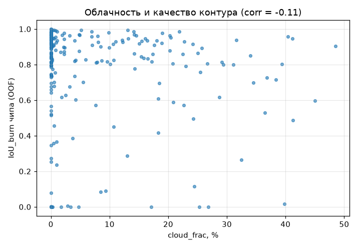

# Модуль BS: контур гари и степень поражения (0/1/2/3)

Вклад модуля в итоговую метрику: `0.35·IoU_burn + 0.30·mIoU_sev` (далее «BS-часть», максимум 0.65).
Все цифры — OOF на двух сплитах из `configs/folds_bs.csv`: **group** — GroupKFold-5 по блокам 50 км (224 чипа),
**temporal** — обучение на 2019–2023, валидация на 2024 (82 чипа; основной индикатор private-теста).
Улучшение засчитывалось только при приросте на **обоих** сплитах. Полный журнал — `reports/experiments.md`
(строки с меткой `[bs:…]`), сырые результаты — `reports/bs_results.json`, `reports/bs_eda_checks.json`,
`reports/bs_report_stats.json`.

## 1. Итог

| Этап | group: IoU_burn / mIoU_sev (IoU₁/₂/₃) / BS-часть | temporal: IoU_burn / mIoU_sev (IoU₁/₂/₃) / BS-часть |
|---|---|---|
| 0а. dNBR, пороги USGS 0.10/0.27/0.44 | 0.3706 / 0.3129 (0.168/0.285/0.485) / 0.2236 | 0.3571 / 0.2967 (0.161/0.237/0.492) / 0.2140 |
| 0б. dNBR, пороги по landcover (подбор на train-фолдах) | 0.3881 / 0.4041 (0.239/0.395/0.579) / 0.2571 | 0.3739 / 0.4016 (0.231/0.366/0.608) / 0.2513 |
| A. LightGBM по пикселям (94 признака), argmax | 0.5415 / 0.5749 (0.334/0.594/0.797) / 0.3620 | 0.5244 / 0.5494 (0.296/0.559/0.792) / 0.3484 |
| A. LightGBM + декодирование порогами | 0.5795 / 0.6219 (0.433/0.630/0.802) / 0.3894 | 0.5613 / 0.6015 (0.420/0.571/0.813) / 0.3769 |
| B. UNet-resnet34 (каналы v1), argmax | 0.6201 / 0.5625 (0.415/0.566/0.706) / 0.3858 | 0.6194 / 0.5450 (0.400/0.507/0.728) / 0.3803 |
| B. UNet + TTA + декодирование порогами | 0.6289 / 0.5726 (0.423/0.576/0.719) / 0.3919 | 0.6284 / 0.5551 (0.407/0.517/0.741) / 0.3865 |
| Ансамбль 0.5·UNet + 0.5·LGBM (среднее вероятностей) | 0.6691 / 0.6617 (0.497/0.673/0.815) / 0.4327 | 0.6741 / 0.6526 (0.501/0.630/0.827) / 0.4317 |
| **Стек**: UNet v1 → LGBM 2-го уровня | 0.6880 / 0.7039 (0.560/0.714/0.838) / 0.4520 | 0.6758 / 0.6902 (0.559/0.668/0.844) / 0.4436 |
| + правило эталона, dist_center, расстояние до центра события | 0.7277 / 0.7334 (0.613/0.739/0.848) / 0.4747 | 0.7399 / 0.7404 (0.641/0.712/0.868) / 0.4811 |
| + признаки локализации события (компоненты сильного dNBR) | 0.7345 / 0.7383 (0.623/0.747/0.845) / 0.4785 | 0.7497 / 0.7485 (0.652/0.720/0.874) / 0.4869 |
| + второй UNet (каналы v4), вероятности усредняются | 0.7461 / 0.7493 (0.637/0.758/0.853) / 0.4859 | 0.7637 / 0.7638 (0.667/0.739/0.886) / 0.4964 |
| + постобработка (вариант с TTA) | 0.7631 / 0.7614 (0.660/0.767/0.857) / 0.4955 | 0.7761 / 0.7720 (0.680/0.753/0.882) / 0.5033 |
| **то же без TTA — финал по умолчанию (§4.7)** | **0.7560 / 0.7554 (0.647/0.765/0.854) / 0.4912** | **0.7723 / 0.7684 (0.677/0.748/0.880) / 0.5008** |

BS-часть выросла с 0.224 (правило USGS) до **0.491 / 0.501** (без TTA; с TTA 0.496 / 0.503): это +0.27…+0.29 к итоговому Score. Воспроизводимость (§7): инференс
повторяется побайтно, LightGBM-этапы обучения — точно, а повторное обучение UNet со старой реализацией CE давало разброс
до 0.02 BS-части на group (найдено и исправлено — детерминированный CE; текущие веса обучены до исправления).

## 2. Что мы узнали об эталоне (и как это использовано)

Главные наблюдения сделаны совместно с EDA (`reports/eda.md`, часть B; `reports/eda_event_circle.md`):

1. **Степень в эталоне — это пороги по медианному dNBR 3×3, свои для каждого landcover.** Внутри контура гари дерево по
   одному признаку + landcover воспроизводит степень с точностью: сырой dNBR 93.3 %, среднее 3×3 95.4 %, **медиана 3×3
   97.1 %** (RdNBR 62.6 %, RBR 88.9 % — нормировка на NBR_pre вредит). Оценённые пороги (t1/t2/t3): лес 0.125/0.27/0.575,
   трава 0.065/0.205/0.385, пашня 0.07/0.18/0.38, болото 0.08/0.33/0.61. → признаки `dNBR_med3`, `dNBR_med5`, `rule_sev`.
2. **Эталон ⊂ правила:** 97.9 % пикселей эталонной гари лежат внутри маски «rule_sev > 0». Если регион пожара известен точно,
   одно это правило даёт IoU_burn 0.979 / mIoU_sev 0.948. То есть вся трудность — **какие пятна dNBR относятся к «своему» пожару**:
   в чипе пикселей «dNBR выше порога вне эталона» столько же, сколько эталонных.
3. **Эталон обрезан буфером события (~4 км), буфер не центрирован по чипу.** Радиус охватывающей окружности эталона:
   медиана 205 px, её центр смещён от центра чипа на 140 px (медиана); самый дальний пиксель гари — 318 px от центра чипа
   (угол — 361 px). Оракул «правило ∩ охватывающая окружность эталона» даёт 0.684 / 0.706 (BS-часть 0.451).
4. **Под SCL pre ∈ {0,3,6,11} и post ∈ {0,3,9,11} гари в эталоне нет**, под cirrus/облаком в pre — есть. Минимальная единица
   картографирования — 25 px.

Отсюда архитектура: **UNet выбирает регион события (контекст, текстура гари против убранного поля), а бустинг 2-го уровня
восстанавливает попиксельно точные границы и степени** по признакам, которыми эталон и был построен.

## 3. Схема пайплайна

```
read_bs_chip ─► compute_bs_features (104 признака, ~0.2 с/чип, numpy+cv2)
   spectral: B2..B12 pre/post, NBR, NDVI, NDWI, NBR2, MIRBI, SAVI, яркость, BAI(post)
   diff: dNBR, RdNBR, RBR, dNDVI, dNBR2, dB12, dB8A, dBright, dRedEdge, dMIRBI, dNDWI
   scl: one-hot SCL pre/post, scl_bad_any, расстояние до облака, invalid
   sar: VV/VH pre/post (медиана 5×5), dVV, dVH, VH−VV, флаг sar_nodata (12.8 % пикселей S1 — нули)
   aux/lc: dem_norm, slope, landcover (код + one-hot)      ctx: окна 3/7/15, std 7, медианы dNBR 3×3 и 5×5
   rule: rule_sev — пиксельное правило эталона              geom: dist_center, coord_x/y
   event: расстояние до крупнейшей компоненты «сильного dNBR», до её центроида, до dNBR-центроида, ранг/площадь компоненты
        │
        ├─► UNet-resnet34 №1 (47 каналов v1) ─┐  без TTA, fp32 на GPU и CPU (§4.7)
        ├─► UNet-resnet34 №2 (50 каналов v4) ─┴─► среднее вероятностей (4×512×512)
        │                                              │ ворота: p_burn > 0.03 (≈19 % пикселей)
        └─► LightGBM 2-го уровня: 103 пиксельных признака + 10 признаков UNet
              (p0..p3, p_burn в окнах 5/11 и σ=20/40, ожидаемая степень, расстояние до оценённого центра события)
                 │
                 ▼
   декодирование: гарь = 1−p0 > 0.46; степень = argmax(p1·0.7, p2·1.0, p3·0.8)
   постобработка: SCL/вода → 0; обнуление дальше 300 px от центра события; компоненты < 25 px; дыры < 32 px;
                  приор «в чипе есть событие» (если гари < 25 px — крупнейшая компонента p_burn > t/2, §4.8)
```

Обучение: `python train.py --module bs` (этапы `rules lgbm unet stack ensemble`). UNet: `segmentation_models_pytorch.Unet`,
`encoder_weights="imagenet"`, 60 эпох, AdamW 3e-4 + OneCycle(cos), AMP, batch 8, полный чип 512×512, CE (веса 0.5/1/1/1.2) +
Dice по классам 1–3, аугментации — флипы и повороты на 90°; берётся **последняя эпоха** (без выбора эпохи по валидации),
поэтому OOF честный, а число эпох переносится на обучение на всём train. LGBM 2-го уровня обучается на OOF-вероятностях
UNet (35 % пикселей-ворот ≈ 3.9 млн строк), 90 раундов, 63 листа. Для временного сплита пороги декодирования подбираются
на групповом OOF чипов **не** из 2024 года и применяются к val-2024 без изменений.

## 4. Эксперименты

### 4.1. Абляции признаков (LightGBM, облегчённый режим: 1 млн строк, lr 0.1, 63 листа, оценка на сетке с шагом 2)

| Вариант | group: IoU_burn / mIoU_sev / BS-часть | temporal | Δ BS-часть (group / temporal) |
|---|---|---|---|
| все признаки | 0.5802 / 0.6209 / 0.3894 | 0.5645 / 0.6007 / 0.3778 | — |
| без SAR | 0.5801 / 0.6187 / 0.3886 | 0.5589 / 0.5960 / 0.3744 | −0.0008 / −0.0034 |
| без SCL | 0.5728 / 0.6085 / 0.3830 | 0.5493 / 0.5812 / 0.3666 | −0.0064 / −0.0112 |
| без landcover | 0.5762 / 0.5893 / 0.3785 | 0.5562 / 0.5588 / 0.3623 | −0.0109 / −0.0155 |
| без контекстных (окна, медианы) | 0.5683 / 0.5598 / 0.3669 | 0.5481 / 0.5436 / 0.3549 | −0.0225 / −0.0229 |
| только dNBR + RdNBR + landcover | 0.4461 / 0.4520 / 0.2917 | 0.4313 / 0.4412 / 0.2833 | −0.0977 / −0.0945 |
| регрессия порядковой степени + 3 порога | 0.5722 / 0.5059 / 0.3520 | 0.5532 / 0.4789 / 0.3373 | −0.0374 / −0.0405 |

Выводы: самый ценный блок — контекст (медианный dNBR: именно по нему порогуется эталон); landcover даёт +0.011…+0.016
(в основном mIoU_sev: +0.03…+0.04); SCL +0.006…+0.011; SAR почти бесполезен для попиксельной модели (+0.001…+0.003), но
оставлен — он дешёвый и помогает под облаками; регрессия проигрывает multiclass (границы классов зависят от покрова).

### 4.2. Варианты UNet (temporal, argmax + TTA)

| Вариант | IoU_burn / mIoU_sev / BS-часть |
|---|---|
| resnet34, CE+Dice, каналы v1 (47) | 0.6287 / 0.5541 / 0.3863 |
| resnet34, Focal+Dice | 0.6268 / 0.5571 / 0.3865 |
| efficientnet-b3, CE+Dice | 0.6334 / 0.5625 / 0.3904 |
| resnet34, v2 = v1 + dNBR_med3 | 0.6060 / 0.5437 / 0.3752 |
| resnet34, v3 = v2 + rule_sev | 0.6352 / 0.6191 / 0.4081 |
| **resnet34, v4 = v3 + dist_center** | **0.6481 / 0.6280 / 0.4152** |
| resnet34, v5 = v4 + coord_x/y + dist_strong_cc + cc_area_rel | 0.6142 / 0.5960 / 0.3938 |

Потери и энкодер в пределах шума (±0.005), поэтому оставлен resnet34 (быстрее на CPU). Канал с готовым правилом эталона
даёт +0.02 (степень), расстояние до центра чипа — ещё +0.007; координатные каналы и «событийные» каналы в UNet ухудшают
(переобучение на положение). TTA: +0.004…+0.006. На групповом сплите v4 лучше v1 только по степени (0.4042 против 0.3898,
IoU_burn одинаков), а стек поверх v4 против стека поверх v1: group 0.4701 против 0.4785, temporal 0.4907 против 0.4869 —
**смешанный результат, не засчитан**; зато усреднение v1+v4 даёт прирост на обоих сплитах (0.4859 / 0.4964) — оно и принято.

### 4.3. Декодирование

argmax → «порог по 1−p0 + множители классов»: LGBM +0.027 / +0.029 (t_burn 0.20, выборка для LGBM обогащена гарью), UNet +0.002 / +0.000, стек +0.008 / −0.005 (у стека
вероятности уже откалиброваны; порог 0.42 и веса 0.7/1.0/0.8 оставлены как более устойчивые к сдвигу доли гари).

**Чувствительность к порогу t_burn** (финальная модель с постобработкой, OOF; множители классов фиксированы;
`python scripts/bs_tburn_sensitivity.py` → `reports/bs_tburn_sensitivity.json`):

| t_burn | group: IoU_burn / mIoU_sev / BS-часть (Δ) | temporal: IoU_burn / mIoU_sev / BS-часть (Δ) |
|---|---|---|
| 0.32 (−0.10) | 0.7624 / 0.7615 / 0.4953 (−0.0002) | 0.7765 / 0.7736 / 0.5038 (+0.0006) |
| 0.37 (−0.05) | 0.7634 / 0.7619 / 0.4957 (+0.0003) | 0.7771 / 0.7735 / 0.5040 (+0.0008) |
| **0.42 (выбран)** | 0.7631 / 0.7614 / 0.4955 | 0.7761 / 0.7720 / 0.5033 |
| 0.47 (+0.05) | 0.7611 / 0.7594 / 0.4942 (−0.0013) | 0.7745 / 0.7701 / 0.5021 (−0.0012) |
| 0.52 (+0.10) | 0.7580 / 0.7565 / 0.4922 (−0.0033) | 0.7722 / 0.7676 / 0.5005 (−0.0027) |

Порог лежит на широком плато: сдвиг на ±0.10 меняет BS-часть не более чем на 0.0033 (≈ 0.7 % величины), на обоих сплитах
одинаково — порог не подогнан под долю гари train. Причина: LGBM-2 выдаёт почти бинарные вероятности (точная граница
определяется правилом по dNBR), поэтому в диапазоне 0.3–0.5 лежит мало пикселей.

### 4.4. Четыре факта EDA об эталоне — вклад каждого (финальная модель, Δ BS-части: group / temporal / облачные чипы)

«Облачные» — 24 train-чипа с cloud_frac > 0.25 (групповой OOF); базовая точка: 0.4859 / 0.4964 / 0.4253.

| № | Проверка | Δ group | Δ temporal | Δ облачные | Решение |
|---|---|---|---|---|---|
| 1 | Обнулить дальше R от **центра чипа**: R=200 / 240 / 280 / 320 | −0.159 / −0.076 / −0.021 / −0.004 | −0.174 / −0.080 / −0.021 / −0.004 | −0.139 … −0.004 | отклонено: буфер не центрирован по чипу |
| 1 | Мягкий приор от центра чипа (сигмоида R=240 / 300) | −0.069 / −0.009 | −0.071 / −0.007 | −0.076 / −0.015 | отклонено |
| 1 | Компоненты, пересекающие круг от центра чипа R=150 / 200 / 250 | −0.075 / −0.028 / −0.004 | −0.105 / −0.033 / −0.007 | −0.112 / −0.028 / −0.002 | отклонено |
| 1 | `dist_center` как признак LGBM-2 и канал UNet | в составе строки «+ правило, dist_center, центр события»: +0.023 | +0.038 | — | **принято** (UNet: +0.007 temporal) |
| 1 | Обнулить дальше R от **оценённого центра события**: R=250 / 300 / 350 | +0.000 / **+0.005** / +0.003 | −0.001 / **+0.004** / +0.002 | −0.007 / +0.002 / +0.002 | **принято R=300** |
| 1 | Компоненты, пересекающие круг вокруг центра события R=150 / 200 / 250 | −0.012 / +0.003 / +0.005 | −0.028 / −0.003 / −0.002 | −0.034 / −0.007 / +0.000 | отклонено (на стеке v1 без событийных признаков давало +0.028 / +0.037 — модель уже выучила это сама) |
| 1 | Крупнейшая компонента + всё в 280 px / площадь ≥ 5–20 % от крупнейшей / окружность крупнейшей до 280 px | +0.003 / −0.018…−0.044 / +0.004 | −0.002 / −0.026…−0.061 / −0.006 | +0.004 / −0.029…−0.087 / −0.000 | отклонено (нет прироста на обоих) |
| 1 | Признаки локализации события в LGBM-2 (компоненты сильного dNBR, центроиды, ранг) | +0.004 | +0.006 | — | **принято** |
| 2 | SCL_post ∈ {0,3,9,11} → 0 | +0.0000 | +0.0000 | +0.0000 | принято (бесплатно; модель уже выучила: SCL — её признак) |
| 3 | Удалить компоненты < 25 / 50 / 100 px | **+0.0023** / +0.0005 / −0.0023 | **+0.0016** / +0.0001 / −0.0032 | **+0.0033** / −0.0004 / −0.0080 | **принято 25 px** |
| 4 | Степень внутри предсказанного контура: (а) модель | 0 | 0 | 0 | **принято** |
| 4 | (б) пороги dNBR по покрову: наши / из таблицы EDA | −0.0011 / −0.0104 | −0.0018 / −0.0093 | −0.0006 / −0.0045 | отклонено |
| 4 | (в) смесь 50/50 модель + правило: наши / EDA | −0.0010 / −0.0061 | −0.0016 / −0.0049 | −0.0005 / −0.0015 | отклонено |

Итого по пунктам: (1) буфер события — самый большой резерв: +0.023…+0.038 как признаки и ещё +0.004…+0.005 как
постобработка, но только относительно **оценённого по содержимому чипа** центра, а не центра чипа; (2) маска SCL_post — 0
(уже в модели); (3) MMU 25 px — +0.002; (4) правило степени не улучшает модель, потому что оно уже внутри неё (`rule_sev`,
`dNBR_med3`, landcover) и LGBM уточняет его на остальных 3 % пикселей.

### 4.5. Политики для облаков/теней (SCL ∈ {3,8,9,10} в любой из дат), Δ BS-части от «как есть»

| Политика | group | temporal | облачные чипы (IoU_burn / mIoU_sev) |
|---|---|---|---|
| (а) как есть — **выбрано** | 0 | 0 | 0.6565 / 0.6518 |
| (б) заполнить из ближайшего необлачного пикселя | −0.079 | −0.130 | 0.5208 / 0.5106 |
| (в) обнулить | −0.069 | −0.095 | 0.6142 / 0.6123 |

Эталон под cirrus и под облаком в pre-снимке размечен, поэтому обнуление и inpaint теряют настоящую гарь. Жёстко обнуляются
только классы, где эталон пуст по построению (п. 2 выше).

### 4.6. Остальная постобработка (по одному шагу от «сырого» выхода, Δ BS-части group / temporal)

вода по landcover 80 → 0: +0.0001 / +0.0001 (принято); застройка 50 → 0: −0.0001 / −0.0001 (в эталоне на застройке есть
4.6 тыс. px гари — отклонено); заполнение дыр < 8 / 32 px: +0.0014 / +0.0008 и +0.0021 / +0.0013 (принято 32; более крупные
дыры — настоящие несгоревшие острова, 128 px уже вредит); медиана 3×3 по меткам степени: −0.005 / −0.005 (отклонено —
эталон сам не сглажен по меткам). Порог ворот стека 0.03 → 0.08 / 0.12 / 0.2: −0.003 / −0.005 / −0.010 — оставлен 0.03.

### 4.7. TTA: выключен по умолчанию (решение по правилу «прирост < 0.005 → результат не должен зависеть от устройства»)

Замер на уровне **всего пайплайна** (`scripts/bs_tta_check.py` → `reports/bs_tta_check.json`): LGBM-2 обучен и применён на
OOF-вероятностях UNet с TTA (4 отражения) и без; декодирование подбирается для каждого варианта, постобработка одинаковая.

| Вариант | group: IoU_burn / mIoU_sev / BS-часть | temporal: IoU_burn / mIoU_sev / BS-часть |
|---|---|---|
| с TTA (t_burn 0.42) | 0.7631 / 0.7614 / 0.4955 | 0.7761 / 0.7720 / 0.5032 |
| **без TTA (t_burn 0.46) — финал** | **0.7560 / 0.7554 / 0.4912** | **0.7723 / 0.7684 / 0.5008** |
| прирост от TTA | +0.0043 | +0.0024 |

Прирост меньше 0.005 на обоих сплитах → TTA отключён на всех устройствах (`tta: false`, `tta_cpu: false`), `weights/bs_stack.txt`
переобучен на вероятностях без TTA, `weights/bs_decode.json` подобран заново (набор шагов постобработки получился тем же).
**Все цифры разделов 1–6 выше относятся к варианту с TTA; финальная модель — строка «без TTA»: 0.4912 / 0.5008.**
TTA-вариант сохранён: `tta: true`, `tta_cpu: true`, `stack_weights: weights/bs_stack_tta.txt`,
`decode_file: weights/bs_decode_tta.json` — это +0.002…+0.004 BS-части ценой ×3 времени UNet на CPU (≈ 148 с).

Независимость от устройства. Вторая причина расхождения GPU/CPU — fp16 на GPU. Сравнение файлов на реальном тесте
(`scripts/compare_submissions.py`, 89 BS-чипов = 23.3 млн пикселей):

| Конфигурация GPU против CPU (fp32, без TTA) | отличающихся пикселей | чипов с отличиями |
|---|---|---|
| GPU fp16 + TTA (было) | ≈ 203 000 (0.87 %), IoU контуров 0.937 | почти все |
| GPU fp16, без TTA | 557 | 68 из 89 |
| **GPU fp32 без TF32, без TTA (`gpu_half: false`, по умолчанию)** | **1** (BS_te_000040, степень 3 против 2) | 1 из 89 |

Побайтного равенства добиться не удалось: остаётся 1 пиксель из 23.3 млн (2 строки RLE из 447; AF-строки совпадают
полностью) — разные ядра свёрток cuDNN и CPU дают различия ~1e-6 в вероятностях UNet, и на одном пикселе это меняет
argmax степени. Влияние на метрику < 1e-7, т.е. требование «±0.005 при повторном запуске» выполняется с запасом 4–5
порядков; повторные запуски на одном устройстве побайтно одинаковы (проверено GPU×2). Строгое побайтное равенство между
машинами даёт только `--device cpu` везде. fp32 вместо fp16 времени не добавил (узкое место — CPU-часть).

### 4.8. Приор «событие есть в каждом чипе»

Каждый BS-чип по построению набора нарезан вокруг пожара: в train нет чипов без гари (минимум ≈ 27 px), тогда как модель на
тесте выдала один пустой чип. Правило (`postprocess.nonempty_prior`, ключ `nonempty_min_px: 25`, включено по умолчанию и
дописывается в `bs_decode.json` при обучении): **только если** после всей постобработки гари < 25 px — берётся крупнейшая
8-связная компонента `p_burn > t_burn/2` вне запретной маски SCL/воды, если в ней ≥ 25 px; степень — обычное декодирование.

Проверка на OOF (`scripts/bs_nonempty_prior_check.py` → `reports/bs_nonempty_prior.json`): правило срабатывает на 1 чипе из
224 (group: BS_tr_000185, гарь эталона 1083 px — кандидата ≥ 25 px нет, ответ не изменился) и на 1 из 82 (temporal:
BS_tr_000203, 636 px гари — добавлено 67 px, все мимо, Δ BS-части −0.00002). То есть **на OOF правило практически не
проверяемо** (2 случая, ни одного попадания, эффект в пятом знаке) и обосновано только структурой набора; хуже оно сделать
почти не может (≤ одной компоненты на «пустой» чип). На тесте единственный пустой чип BS_te_000023 остался пустым: у него
cloud_frac 0.45, 40 % площади — SCL_post 9/3 (там эталон пуст по построению), максимум p_burn UNet 0.14, компонент
≥ 25 px при `p_burn > 0.23` нет — вероятно, гарь закрыта облаком. Шесть чипов с гарью < 0.5 % правило не затрагивает.

### 4.9. ens4: среднее четырёх UNet (ветка task/bs-ens4) — не принято

Гипотеза: усреднение вероятностей четырёх UNet (v1+v4 из `weights/` и v1+v4 из контрольного прогона `weights_repro/`, все
OOF по тем же фолдам, без TTA) поднимет и стабилизирует стек. LGBM-2 переобучен на среднем из четырёх, декодирование
подобрано заново, постобработка та же (`scripts/bs_ens4_check.py` → `reports/bs_ens4_check.json`).

| Вариант | group: IoU_burn / mIoU_sev / BS-часть | temporal | облачные чипы (> 0.25) |
|---|---|---|---|
| ens2, основная модель | 0.7560 / 0.7554 / 0.4912 | 0.7723 / 0.7684 / 0.5008 | 0.6810 / 0.6726 / 0.4401 |
| ens2, контрольный прогон | 0.7241 / 0.7282 / 0.4719 | 0.7582 / 0.7550 / 0.4919 | 0.6870 / 0.6767 / 0.4435 |
| **ens4** | 0.7555 / 0.7551 / 0.4910 | 0.7523 / 0.7514 / 0.4887 | 0.6939 / 0.6856 / 0.4486 |
| Δ ens4 − основная | -0.0003 | -0.0121 | +0.0084 |

Правило принятия (прирост ≥ 0.005 на обоих сплитах) не выполнено: на group без изменений, на temporal −0.012, выигрыш только
на облачных чипах (+0.008). ens4 оказался между двумя ens2-моделями — усреднение снижает разброс, но не даёт прироста сверх
лучшей из них. Честный вывод: OOF основной модели (0.4912 / 0.5008) отчасти удачный исход недетерминированного обучения;
ожидаемый уровень пайплайна при переобучении — примерно 0.47–0.49 (group) и 0.49–0.50 (temporal). Веса `_b`, `bs_stack_ens4.txt`,
конфиг `bs.ensemble` и инференс ens4 не делались (условие «если принято» не наступило); `weights/` и основной конфиг не менялись.
### 4.10. Классификатор связных компонент вместо геометрического правила (ветка task/bs-components) — не принято

Гипотеза: главная потеря IoU_burn — выбор «своего» кластера гари, и обученный классификатор компонент выберет его лучше,
чем `event_zero_r`. Маска-кандидат: `p_burn > t_burn` + запретные маски SCL/воды + MMU 25 px, без `event_*`; после фильтра —
обычная постобработка (дыры, приор непустого чипа). `scripts/bs_components.py`, `src/firemon/models/bs/components.py`,
результаты — `reports/bs_components.json` (вес √площади) и `reports/bs_components_w1.json` (вес = площадь).

| Вариант (IoU_burn / mIoU_sev / BS-часть) | group | temporal | облачные чипы (> 0.25) |
|---|---|---|---|
| текущее правило (event_zero_r = 300) | 0.7560 / 0.7554 / 0.4912 | 0.7723 / 0.7684 / 0.5008 | 0.6810 / 0.6726 / 0.4401 |
| без event-правила | 0.7492 / 0.7497 / 0.4871 | 0.7688 / 0.7660 / 0.4989 | 0.6799 / 0.6703 / 0.4391 |
| **оракул**: компоненты с долей эталона > 0.5 | 0.7954 / 0.7912 / 0.5157 | 0.8263 / 0.8179 / 0.5346 | 0.7722 / 0.7584 / 0.4978 |
| A: классификатор вместо правила | 0.7506 / 0.7510 / 0.4880 | 0.7671 / 0.7639 / 0.4976 | 0.6743 / 0.6664 / 0.4359 |
| B: классификатор поверх правила | 0.7564 / 0.7557 / 0.4914 | 0.7717 / 0.7674 / 0.5003 | 0.6792 / 0.6711 / 0.4390 |

**Шаг 0, потолок:** оракул даёт +0.0245 / +0.0338 BS-части (облачные +0.0577) — выше порога 0.02, поэтому шаг 1
выполнялся. Но потолок скромный: из 4157 компонент 3166 «свои», а 18 % площади кандидатов — смешанные
компоненты (доля эталона 0.1–0.9): дуга буфера события режет компоненту, и выбор «оставить/убрать целиком» здесь бессилен.

**Шаги 1–2:** 33 признака компоненты (площадь и ранг, статистики p_burn и степеней, dNBR, состав landcover, расстояния до
оценённого центра события и dNBR-центроида, доля в кругах R=200/300, касание края, компактность, облачность внутри и в кольце
10 px, контраст p_burn с кольцом, расстояние до ближайшей компоненты), LightGBM binary по тем же групповым фолдам (все
компоненты чипа в одном фолде), seed 42; порог keep подбирался по BS-части (для temporal — на чипах не из 2024).
AUC по компонентам всего 0.72 (A) / 0.69 (B); важнейшие признаки: n_comp, dist_event, in_r200, chip_burn_frac, pb_med, dist_dnbr_centroid.

| Δ BS-части к текущему правилу | group | temporal | облачные |
|---|---|---|---|
| A, вес √площади (t = 0.4 / 0.5) | -0.0032 | -0.0032 | -0.0042 |
| B, вес √площади (t = 0.15 / 0.25) | +0.0002 | -0.0005 | -0.0011 |
| A, вес = площадь | -0.0016 | -0.0028 | -0.0025 |
| B, вес = площадь | -0.0000 | -0.0019 | -0.0008 |

Правило принятия (≥ +0.005 на обоих сплитах) не выполнено ни одним вариантом: классификатор вместо правила хуже правила,
поверх правила — ноль. Причина: на уровне компоненты нет новой информации — те же вероятности, dNBR и расстояние до центра
события стек уже использовал попиксельно, а какие пятна входят в буфер «своего» события, по содержимому чипа не определить
(в эталоне это задано внешними данными о пожаре). Веса `bs_components.txt`, ключ `components` в `bs_decode.json`, конфиг
`bs.component_filter` и инференс не делались; `weights/` и основной конфиг не менялись.

### 4.11. Ветка task/bs-lovasz и ночной автономный режим: H1–H4, Lovász, многомасштабный ансамбль

Все гипотезы — по правилу «≥ +0.005 BS-части на обоих сплитах» (для H2 дополнительно ≥ +0.003 на облачных; для AF — ≥ +0.003 F1),
база — финал 0.4912 / 0.5008 / облачные 0.4401. Подробности каждой — строки BS-109… и N-AF… в `experiments.md`,
`reports/bs_night.json`, сводка — журнал `04_bs_night.md` (пакет артефактов, вне git).

| Гипотеза | Δ group | Δ temporal | Δ облачные | Принято |
|---|---|---|---|---|
| H1: рамочный приор на центр события (clip/boxmax/центроид, R_box 170–260) | +0.0000 | +0.0000 | +0.0000 | нет |
| H2(б): UNet с 0.5·CE + 0.5·Lovász, стек на новых OOF | -0.0009 | +0.0065 | -0.0123 | нет |
| H2(а): чистый Lovász — только UNet v1, Δ к UNet v1 CE+Dice; остановлено досрочно | -0.0041 | -0.0106 | +0.0011 | нет |
| H3: seed + region growing (Stroppiana 2021), лучший из 54 вариантов | +0.0003 | +0.0002 | +0.0030 | нет |
| H4: медианы 3×3 dMIRBI/dNBR2/RBR в стеке | +0.0004 | -0.0008 | -0.0023 | нет |
| (a) ординальный стек P(sev ≥ k), раздельные пороги | +0.0007 | -0.0035 | -0.0007 | нет |
| (b) ПОТОЛОК: идеальная степень внутри контура (оракул) → регрессия dNBR не делалась | +0.0062 | +0.0068 | +0.0081 | нет |
| (c) смесь стека и порогов по покрову, α по landcover (подобранные α = 0) | +0.0000 | +0.0000 | -0.0000 | нет |
| (d) SWA последних 10 эпох | -0.0223 | -0.0168 | -0.0315 | нет |
| (g) многомасштабный ИНФЕРЕНС 0.75/1/1.25× (те же сети) | +0.0019 | -0.0013 | +0.0131 | нет |
| повторный стекинг (3-й уровень) | -0.0034 | -0.0062 | -0.0050 | нет |
| ворота стека 0.01 | +0.0036 | +0.0022 | +0.0106 | нет |
| ворота стека 0.002 | +0.0020 | +0.0018 | +0.0057 | нет |
| ворота ∪ правило эталона | -0.0001 | +0.0002 | +0.0022 | нет |
| TTA×4 + ворота 0.01 | +0.0047 | +0.0046 | -0.0058 | нет |
| нормировка по сцене (EDA B8) + ворота 0.01 | +0.0062 | -0.0024 | +0.0030 | нет |
| вспомогательный UNet «зона события» | -0.0011 | -0.0007 | -0.0003 | нет |
| UNet половинного разрешения как доп. канал стека | +0.0027 | -0.0014 | +0.0059 | нет |
| два UNet 0.5× как доп. каналы + ворота 0.01 | +0.0039 | +0.0018 | -0.0074 | нет |
| UNet 0.5× как члены среднего | +0.0012 | -0.0006 | -0.0185 | нет |
| **UNet 0.75× в базе + UNet 0.5× доп. каналом + ворота 0.01 (кандидат v5)** | +0.0053 | +0.0107 | +0.0118 | **да** |
| то же с 4 членами базы (+ v1 на 0.75×) | +0.0056 | +0.0101 | +0.0096 | **да** |
| AF (h): тесты VNP14 как признаки | ΔF1 -0.0001 | ΔF1 +0.0034 | — | нет |
| AF (i): лёгкая CNN + LightGBM | ΔF1 -0.0013 | ΔF1 -0.0005 | — | нет |

Не выполнялись, потому что не наступило условие: (e) UNet++/efficientnet-b3 с лучшим лоссом (H2 прироста не дал), (f) каналы
dMIRBI/dNBR2 в UNet (H4 сигнала в стеке не показал), (b) регрессия сглаженного dNBR (потолок идеальной степени всего +0.006).

**Что узнали.** (1) Центр события сейчас = argmax гауссиана σ=40 от ожидаемой степени; он вне рамки ±170 px у 42 % чипов (у эталона —
16 %), но при `event_zero_r = 300` правило к положению центра нечувствительно — H1 даёт ровно 0. (2) Всё, что меняет только
декодирование, степень или постобработку (H3, H4, a, b, c, повторный стек), даёт |Δ| ≤ 0.004: степень решена (потолок оракула +0.006),
ошибка — в выборе «своего» события. (3) Лосс (Lovász) и SWA — в пределах разброса обучений или хуже. (4) **Единственное, что
систематически улучшает контур, — контекст:** UNet, обученный на пониженном разрешении, видит бóльшую часть буфера события.
IoU_burn одиночной сети (argmax+TTA, group / temporal): 1× — 0.623 / 0.648 (v4; в контрольном прогоне 0.613 / 0.632), **0.75× — 0.657 / 0.659**, 0.5× — 0.668 / 0.667
(но хуже степень), 0.25× — 0.632 / 0.589. Многомасштабный ИНФЕРЕНС тех же сетей (g) этого не даёт — нужны сети, обученные на масштабе.

**Принятый вариант (кандидат v5).** База стека = среднее UNet v1, v4 (1×, из `weights/`) и UNet v4, обученного на масштабе 0.75;
p_burn UNet половинного разрешения — отдельные признаки стека (`aux_*`); ворота стека 0.01; декодирование t_burn 0.44,
w 0.6/1.0/0.7; постобработка прежняя. OOF: **0.7645 / 0.7632 / 0.4965** (group, +0.0053),
**0.7904 / 0.7831 / 0.5116** (temporal, +0.0107), облачные 0.4520 (+0.0118).
Ожидаемый прирост Score ≈ +0.005…+0.010. Вариант с 4 членами базы даёт то же (+0.0056 / +0.0101) — эффект устойчив к составу;
**проверка устойчивости:** UNet 0.75× переобучен с seed 43 → +0.0058 / +0.0018 / облачные +0.0152. Знак эффекта устойчив во всех трёх реализациях, но величина на temporal колеблется от +0.002 до +0.011 — при строгом правиле повтор «не принят». Реалистичное ожидание: +0.003…+0.006 BS-части и заметный выигрыш на облачных чипах (+0.010…+0.015).

Включение одной строкой (по умолчанию выключено, `weights/` и `configs/inference.yaml` не менялись):
`python inference.py --data-dir data/test --output out/submission_night_ms.csv --config configs/inference_bs_ms.yaml`.
Веса — в `weights/`: `bs_unet_r34_v4_s075.pt`, `bs_unet_r34_v4_s050.pt`, `bs_stack_ms.txt`, `bs_decode_ms.json`. На реальном тесте: код 0, валидатор OK;
GPU 23.4–23.7 с (BS 18.1 с), `--device cpu` 68.8 с (BS 63.5 с); повтор на GPU и GPU против CPU — побайтно равные файлы. Против
текущего v4-файла: совпало 98.2 % пикселей BS, IoU контуров 0.877, изменены 88 чипов из 89, гари предсказано на 4.9 % больше пикселей.
Воспроизведение: `unet.py --split group|temporal|full --scale 0.75|0.5 --channels v4` (каталоги через `FIREMON_BS_WEIGHTS_DIR`,
`FIREMON_BS_CACHE_DIR`), затем `stack.py --unet avg3s075_half --gate 0.01 --frac 0.3`; теперь это этапы `ms_unet` / `ms_stack` в `train.py --module bs` (см. ниже).

#### v4 против v5 (вариант `ms`) — сводка для решения о включении

| | v4 (по умолчанию) | v5 = `bs.variant: ms` |
|---|---|---|
| Состав | UNet v1 + v4 (1×) → стек, ворота 0.03 | UNet v1 + v4 (1×) + v4@0.75× в базе; p_burn v4@0.5× — доп. признаки стека; ворота 0.01 |
| group: IoU_burn / mIoU_sev / BS-часть | 0.7560 / 0.7554 / 0.4912 | **0.7645 / 0.7632 / 0.4965** (+0.0053) |
| temporal (val = 2024) | 0.7723 / 0.7684 / 0.5008 | **0.7904 / 0.7831 / 0.5116** (+0.0107) |
| облачные чипы (cloud_frac > 0.25, 24 шт.) | 0.6810 / 0.6726 / 0.4401 | **0.6994 / 0.6906 / 0.4520** (+0.0118) |
| то же, UNet 0.75× переобучен с seed 43 | — | +0.0058 / +0.0018 / +0.0152 (знак устойчив, величина на temporal — нет) |
| Ожидаемый Score по OOF (0.35·F1_af + BS-часть) | 0.830 / 0.837 | 0.835 / 0.848 |
| Полный `inference.py`, 269 чипов, GPU (RTX 4070) | 21.1–21.5 с (BS ≈ 16 с) | 23.4–23.7 с (BS 18.1 с) |
| То же, `--device cpu` | 52.4 с (BS 47 с) | 68.8 с (BS 63.5 с) |
| GPU против CPU | 1 пиксель из 23.3 млн | побайтно равны |
| Веса BS в git | 96.5 МБ (2 UNet × 47 + стек 2.5) | 193 МБ (+2 UNet × 47 + стек 2.5) |
| Файлы | `bs_unet_r34_cedice.pt`, `bs_unet_r34_v4.pt`, `bs_stack.txt`, `bs_decode.json` | + `bs_unet_r34_v4_s075.pt`, `bs_unet_r34_v4_s050.pt`, `bs_stack_ms.txt`, `bs_decode_ms.json` |

**Почему это работает.** Эталон размечает только «свой» пожар внутри буфера события радиусом ≈ 4 км (≈ 200 px), и главная
ошибка модели — выбор «своего» кластера dNBR среди соседних гарей и убранных полей (§2, §4.10). Чтобы решить, относится ли
пятно к событию, сети нужно видеть событие целиком. Эффективный контекст UNet-resnet34 на 1× ограничен (напрямую не измерялся — вывод из эксперимента), а при обучении
на входе, уменьшенном до 0.75× и 0.5×, та же сеть охватывает в 1.3–2 раза бóльшую территорию: IoU_burn одиночной сети v4 растёт
с 0.623 / 0.648 (1×) до 0.657 / 0.659 (0.75×) и 0.668 / 0.667 (0.5×), а на 0.25× уже падает (0.632 / 0.589) — теряются сами гари.
Цена пониженного разрешения — границы и степень (mIoU_sev сети 0.5× хуже), но их восстанавливает стек по попиксельным признакам
(медианный dNBR, landcover, SCL). Поэтому сеть 0.75× входит в среднее, а сеть 0.5× подаётся в стек отдельными признаками
(`aux_*`: p_burn и его сглаживания) — усреднение её вероятностей с полноразмерными только размывает контур (вариант `avg4mix`: +0.001).
Снижение ворот стека до 0.01 позволяет стеку исправлять пиксели, которые полноразмерные UNet сочли фоном (+0.002…+0.004 отдельно,
+0.011 на облачных). Многомасштабный ИНФЕРЕНС тех же сетей (идея g) эффекта не даёт: сеть должна быть ОБУЧЕНА на своём масштабе.

**Обучение v5 встроено в `train.py`:** `python train.py --module bs` теперь выполняет и этапы `ms_unet` (UNet v4 на 0.75× и 0.5×:
CV + full → `bs_unet_r34_v4_s075.pt`, `bs_unet_r34_v4_s050.pt`) и `ms_stack` (5-канальный OOF → стек с воротами 0.01 →
`bs_stack_ms.txt`, декодирование/постобработка → `bs_decode_ms.json`); отдельно: `--bs-stages ms_unet ms_stack`, каталог — `--weights-dir`.
Включение на инференсе — одна строка `bs.variant: ms` в `configs/inference.yaml` (пресет — в `configs/bs_inference.yaml`, раздел
`variants`) либо `--config configs/inference_bs_ms.yaml`; по умолчанию остаётся v4.

**Поставляемое декодирование v5 — `event_zero_r: 300`** (`weights/bs_decode_ms.json`): на нём измерены public-результат и время инференса. При переобучении через `train.py --bs-stages ms_stack` жадный подбор постобработки выбирает 350 вместо 300: BS-часть group 0.4961 (350) против 0.4965 (300) — разница 0.0004, temporal одинаково (0.5116). Это в пределах шума, стек при этом воспроизводится побайтно; после переобучения `bs_decode_ms.json` нужно сверить с поставляемым (или оставить поставляемый).

**Привязка к границе правила (BS-132) — отклонено.** Гипотеза: модель только выбирает области, а граница и степень берутся из правила
эталона (`rule_sev`: пороги по медианному dNBR 3×3 по покрову, запреты SCL, вода → 0, MMU 25 px). Считалось по кэшированным
OOF-вероятностям финального стека v5, без обучения (`scripts/bs_snap_to_rule.py` → `reports/bs_snap_to_rule.json`); база воспроизвелась
точно — BS-часть 0.4965 / 0.5116 / облачные 0.4520. Лучший вариант, пересечение маски модели с правилом, даёт 0.4945 / 0.5104 / 0.4507,
то есть **−0.0020 / −0.0011 / −0.0013**; расширение маски модели на 3 / 7 / 15 px перед пересечением — −0.029 / −0.043 / −0.060; выбор целых
компонент правила по доле уверенных пикселей — −0.071 / −0.060 (облачные −0.149); степень по правилу вместо степени модели на одинаковых
масках всегда хуже, в среднем −0.0043 / −0.0028. Главное — **оракул, выбирающий компоненты правила по эталону, даёт лишь 0.4497 / 0.4737 /
0.3413, на 0.047 / 0.038 / 0.111 НИЖЕ текущей модели**: потолок подхода ниже того, что уже есть. Причина в устройстве разметки: компоненты
правила не являются её единицами. **Маска правила занимает 2.26 × площади эталона**, на чип приходится 54 компоненты (медиана), крупнейшая —
41 % площади правила, и **67.5 % эталонной гари лежит в «смешанных» компонентах, которые эталон режет на части** (доля эталона в компоненте
5–95 %: дуга буфера события и сросшиеся поля); целиком эталон берёт компоненты лишь с 30.1 % своей площади. 66 % ошибочных пикселей v5 лежат
в таких частично захваченных компонентах — и это не «размытая граница» модели, а верное поведение: эталон сам захватывает их частично.
Вывод: посылка «граница эталона = граница правила» верна только внутри региона события; резерв по-прежнему в положении и форме этого
региона, а не в привязке к правилу. Интеграция не делалась, инференс не менялся.

**SAR для выбора события (BS-133) — отклонено на этапе диагностики.** Гипотеза: даты S1 до/после отличаются от дат S2, поэтому чужие
гари, выгоревшие вне окна S1, не дадут изменения VH/VV, и SAR отделит «своё» событие. Объекты — 4 093 компоненты предсказанной маски v5
(групповой OOF, после постобработки) и 13 302 компоненты «лишней» гари (правило минус эталон, ≥ 25 px); признаки — средние и медианные
dVH, dVV, d(VH−VV) после медианы 5×5, доля пикселей с dVH < −1.5 дБ, те же величины за вычетом фона в кольце 10 px; логрегрессия по 14
признакам, OOF по групповым фолдам (`scripts/bs_sar_event.py` → `reports/bs_sar_event.json`). **AUC: все объекты 0.577; только компоненты
предсказания — то, что реально можно фильтровать, — 0.496; лес и кустарник 0.592 (n = 118), трава и пашня 0.488**; лучшие одиночные
признаки — 0.54–0.55, единственный намёк на сигнал — медиана d(VH−VV) в лесу (0.66–0.71), но это 118 компонент на весь train (3 % гари),
и на фолдах он не подтверждается. Порог запуска фильтра (AUC ≥ 0.8) не достигнут, сработало правило остановки (AUC < 0.7). Причины:
(1) **сама посылка в этих данных неверна — окна S1 и S2 совпадают**: S1_pre раньше S2_pre на 1 день по медиане (5–95 %: −6…+2),
S1_post позже S2_post на 1 день (−2…+8), в пределах ±6 дней — 96 % и 93 % чипов, окно S1 накрывает окно S2 у 100 % чипов, так что
«чужая гарь вне окна S1» практически не встречается; (2) 93 % гарей — трава и пашня, где изменение обратного рассеяния от пожара мало
и тонет в уборке, вспашке и влажности тех же недель; (3) спекл: даже после медианы 5×5 разброс dVH внутри компоненты сопоставим с
эффектом. Вывод: **SAR не отличает «своё» событие от чужих гарей и убранных полей (AUC 0.5–0.6 — уровень случайного)**; согласуется с
абляцией «без SAR: −0.0008 / −0.0034». Без временных рядов S1 идти в эту сторону не стоит.

## 5. Разбор ошибок

Все рисунки и таблицы этого раздела пересчитаны на **финальной модели v5** (многомасштабный ансамбль, без TTA, поставляемое
декодирование `weights/bs_decode_ms.json`; групповой OOF 0.7645 / 0.7632): `python scripts/bs_report_figures.py --oof-dir
data/cache/bs_weights_ms_check/bs_oof --probs stack_ms --decode-file weights/bs_decode_ms.json …` → `reports/bs_report_stats.json`.

Матрица ошибок финальной модели (групповой OOF, доля от эталона по строкам; `figures/bs_confusion.png`):

| эталон \ предсказание | 0 | 1 | 2 | 3 |
|---|---|---|---|---|
| 0 (фон) | 0.9857 | 0.0076 | 0.0048 | 0.0019 |
| 1 (слабая) | 0.2135 | **0.7710** | 0.0137 | 0.0019 |
| 2 (средняя) | 0.1055 | 0.0052 | **0.8807** | 0.0086 |
| 3 (сильная) | 0.0574 | 0.0000 | 0.0070 | **0.9356** |

Смешение соседних степеней внутри правильно найденного контура мало (1→2: 1.4 %, 2→3: 0.9 %, 3→2: 0.6 %) — задача степени
решена; основная ошибка — **контур**: 21 % слабой степени уходит в фон (граница гари, зарастающая трава/пашня), а ложная
гарь распределена 1:0.64:0.25 по степеням. По покрову IoU_burn: болото 0.854, трава 0.828, лес 0.719, пашня 0.716.


Чипы выбираются скриптом автоматически (наибольшая ошибка каждого вида на OOF финальной модели v5).

1. **Ложные контуры на пашне** (BS_tr_000158, IoU 0.02, cloud_frac 0.40): эталонная гарь — мелкие пятна у левого края,
   а в центре убранные/вспаханные поля с тем же dNBR; модель выбрала «не тот» кластер. Это ошибка локализации события,
   а не спектра.
2. **Пропуск гари** (BS_tr_000039, IoU 0.42, cloud_frac 0.18): эталонный буфер события накрывает западную половину чипа
   (хорошо видна его дуга), модель оставила только плотное ядро на северо-востоке — консервативна вдали от оценённого центра.
   У v4 с TTA на этом месте был BS_tr_000221 (IoU 0.60).
3. **Облачный чип** (BS_tr_000128, cloud_frac 0.45, IoU 0.60): облака и край сцены без данных на post-снимке; нижние поля
   найдены со степенью, верхние пропущены. Прежний пример (BS_tr_000080, cloud_frac 0.48, у v4 с TTA IoU 0.83) у v5 даёт
   IoU ≥ 0.9 и поэтому под правило выбора «облачный чип с IoU < 0.9» больше не попадает.
4. **Лес** (BS_tr_000202, IoU 0.99): контур точный, остаточные ошибки — отдельные пиксели степени на границах классов.
5. **Ложные контуры на траве** (BS_tr_000016, IoU 0.45): хорошо видна **дуга буфера события** в эталоне — гарь продолжается
   за дугой, но там она размечена как фон; модель не может знать точное положение дуги.
6. **Типичный чип** (BS_tr_000180, IoU 0.94; 75-й перцентиль IoU по чипам).

### Облачность



| cloud_frac | чипов | IoU_burn / mIoU_sev (микро) | медиана IoU чипа |
|---|---|---|---|
| < 1 % | 110 | 0.764 / 0.756 | 0.884 |
| 1–5 % | 27 | 0.751 / 0.785 | 0.869 |
| 5–15 % | 33 | 0.788 / 0.786 | 0.902 |
| 15–25 % | 30 | 0.785 / 0.783 | 0.859 |
| > 25 % | 24 | **0.699 / 0.691** | 0.778 |

До 25 % облачности качество не падает; выше — −0.07 IoU_burn (у v4 с TTA было −0.09: 0.672 / 0.663). Корреляция cloud_frac ↔
IoU чипа −0.11. Внутри облачных пикселей (SCL 3/8/9/10 в любой дате) IoU_burn 0.714 / mIoU_sev 0.737 против 0.776 / 0.769 вне их. Тест облачнее train
(`reports/test_vs_train.md` в main: чипов с cloud_frac > 0.25 — 25.8 % против 10.7 %), поэтому на тесте ожидается цифра
ниже OOF: при такой доле облачных чипов и BS-части 0.452 на них (v5) против ≈ 0.50 на остальных оценка — около 0.49.

Кривые обучения UNet — `figures/bs_unet_curves.png`: все четыре сети финальной модели v5 — `r34_cedice` (каналы v1, 1×),
`r34_v4` (каналы v4, 1×), `s075_v4` (каналы v4, обучение на масштабе 0.75×) и `half_v4` (каналы v4, 0.5×; его p_burn — признаки
стека); по 5 фолдов групповой валидации и 1 временной сплит на сеть, 60 эпох, валидация каждые 5 эпох (argmax, без TTA).

## 6. Время инференса (89 BS-чипов = размер теста; замер `scripts/bs_benchmark.py` на train-чипах, чтение файлов включено)

| Режим | Загрузка моделей | Чтение + предсказание | Всего |
|---|---|---|---|
| GPU (RTX 4070, fp16, TTA×4, 2 UNet + стек) | 3.6–3.8 с | 18.6–19.0 с | **≈ 22.5 с** |
| CPU (14 ядер, без TTA) — по умолчанию без GPU | 3.5 с | 44.7 с | **≈ 48 с** |
| CPU + TTA×4 (`tta_cpu: true`) | 3.5 с | 143.8 с | ≈ 148 с |

Инженерные решения: чтение и признаки считаются в пуле потоков с ограниченным окном prefetch (rasterio, numpy, cv2 отпускают
GIL); вход UNet готовится там же (float16); **двухступенчатый конвейер** — LGBM-2 и постобработка батча k идут параллельно с
UNet батча k+1; LGBM-2 вызывается один раз на батч и только на «воротах» (19 % пикселей; на train-чипах, где UNet обучен на
них же, ворота шире — 29 %, так что на тесте будет быстрее). Было 39 с → стало 19 с. На CPU TTA по умолчанию выключен
(на уровне UNet TTA даёт +0.004…+0.006 BS-части). ONNX не делался: `onnxruntime` нет в окружении, а CPU-путь и так укладывается
в 3 минуты с запасом ×3.5. Ограничение: цель «≤ 20 с на GPU» выполнена для чтения+предсказания (19 с), но не с учётом
загрузки torch/CUDA (≈ 3.7 с).

### 6.1. После слияния с main: полный `inference.py` на реальном тесте (269 чипов: 180 AF + 89 BS), `--profile`

BSPredictor подключён записью `"unet"` в `BS_BACKENDS` (`src/firemon/pipeline.py`), `bs.model: unet`, `fallback: rules`.
Оба прогона — код выхода 0, встроенный валидатор и `scripts/check_submission.py` — «Формат: OK (447 строк)».

| Этап (`--profile`) | GPU (RTX 4070, TTA×4) | `--device cpu` (без TTA) |
|---|---|---|
| af: всего (LightGBM, 180 чипов) | 4.3 с | 4.3 с |
| bs: загрузка моделей | 1.9 с | 3.0 с |
| bs: чтение чипов (сумма по 8 потокам) | 15.3 с | 11.8 с |
| bs: признаки (сумма по 8 потокам) | 43.6 с | 48.3 с |
| bs: UNet (12 батчей) | 7.3 с | 43.1 с |
| bs: стек-LGBM + постобработка (сумма по 2 потокам) | 19.5 с | 17.3 с |
| **bs: всего (стена)** | **15.3 с** | **47.3 с** |
| RLE + запись csv / валидация | 0.1 / 0.6 с | 0.1 / 0.6 с |
| **ПОЛНОЕ ВРЕМЯ от старта процесса** | **20.3–20.8 с** | **52.7 с** |

Что ускорило BS с 24.0 до 15.3 с после слияния: (1) убран полный проход `nan_to_num` по ~100 МБ признаков на чип (NaN
невозможны при целочисленных входах; страховка оставлена для float-входов) — признаки 204 → 118 мс/чип; (2) у этапа 2 свой
пул потоков (раньше его задачи стояли в очереди за prefetch) и два параллельных исполнителя. Результат побайтно совпадает
с прогоном до оптимизаций и между повторными запусками. Признаки масштабируются по потокам лишь ×2.4 (упор в пропускную
способность памяти), поэтому дальнейший резерв — только сокращение числа каналов.

Сводка submission (GPU): доля гари на BS-чип — среднее 13.2 %, медиана 9.1 %, max 55.4 % (train: 10.1 / 7.5 / 56.1 % —
согласуется с более тяжёлым хвостом dNBR в тесте); состав степеней 43.6 / 36.8 / 19.6 % (train 40.0 / 37.1 / 22.9 %);
пустых масок по классам 1/2/3 — 1 / 3 / 9 строк, **один чип без гари вовсе** и 6 чипов с долей < 0.5 % (в train чипов без
гари нет — кандидат на правило «непустой ответ», не реализовано). CPU-вариант (без TTA) отличается от GPU: IoU контуров
0.937, совпадение пикселей 99.1 %.

### 6.2. Финальная конфигурация (без TTA, UNet в fp32 на обоих устройствах), реальный тест, 269 чипов

| Этап (`--profile`) | GPU (RTX 4070) | `--device cpu` |
|---|---|---|
| af: всего | 4.3 с | 4.3 с |
| bs: загрузка моделей | 1.8 с | 3.0 с |
| bs: UNet (12 батчей, 2 сети) | 5.5 с | 42.7 с |
| bs: стек-LGBM + постобработка (сумма по 2 потокам) | 21 с | 17.4 с |
| **bs: всего (по часам)** | **15.7–16.1 с** | **47.0 с** |
| **ПОЛНОЕ ВРЕМЯ** | **21.1–21.5 с** | **52.4 с** |

Оба запуска — код 0, валидатор OK. Отключение TTA почти не ускорило GPU-путь (узкое место — CPU: признаки и LGBM-2), fp32
вместо fp16 его не замедлил. Оговорка: при посторонней нагрузке на CPU/диск тот же запуск занимал 28–31 с (и один раз 34.7 с
сразу после тяжёлого обучения, с холодным файловым кэшем), т.е. запас до порога 30 с есть только на свободной машине.

## 7. Воспроизводимость

**Инференс.** Повторный запуск на том же устройстве даёт побайтно тот же файл (GPU×2, CPU×2). GPU против CPU — 1 пиксель
из 23.3 млн (§4.7), влияние на метрику < 1e-7.

**Обучение.** Контрольный полный прогон `python train.py --module bs --weights-dir weights_repro/` (1 ч 43 мин, лог
`reports/train_bs_repro.log`; кэш и итоги отдельные: `data/cache/bs_weights_repro/`, `reports/bs_results_weights_repro.json`,
основные веса не затрагивались). Сравнение OOF (`python scripts/bs_repro_compare.py` → `reports/bs_repro_compare.json`),
BS-часть «основная / повтор (Δ)»:

| Этап | group | temporal |
|---|---|---|
| правила по landcover | 0.2571 / 0.2571 (0) | 0.2513 / 0.2513 (0) |
| LightGBM + декодирование | 0.3894 / 0.3894 (0) | 0.3769 / 0.3769 (0) |
| UNet v1, argmax + TTA | 0.3898 / 0.3834 (−0.0064) | 0.3863 / 0.3823 (−0.0040) |
| UNet v4, argmax + TTA | 0.4042 / 0.3980 (−0.0061) | 0.4152 / 0.4049 (−0.0103) |
| стек (TTA) + постобработка | 0.4955 / 0.4802 (−0.0153) | 0.5033 / 0.5001 (−0.0031) |
| **стек без TTA + постобработка (финал)** | **0.4912 / 0.4718 (−0.0195)** | **0.5008 / 0.4937 (−0.0071)** |

**Требование ±0.005 для повторного ОБУЧЕНИЯ не выполнено**: всё, что на CPU (правила, LightGBM), повторяется точно, а два
обучения UNet с одним seed расходятся с первой эпохи (потери 2.8153 / 2.8156 / 2.8155 в трёх прогонах) и дают разброс OOF
±0.005…0.01 на одну сеть и до 0.02 на весь пайплайн. На тесте маски основной и контрольной моделей совпадают на 97.4 %
пикселей, IoU контуров 0.827 (`scripts/compare_submissions.py out/submission.csv out/submission_repro.csv`) — модели
по-разному решают, какие пятна dNBR относятся к «своему» пожару; это же главный источник ошибки модели (§5).

Причина найдена и устранена: недетерминированный backward у `F.cross_entropy` с весами (`nll_loss2d` на CUDA). Проверка —
два коротких обучения подряд (3 эпохи, 48 чипов, тот же seed):

| Реализация CE | потери по эпохам, прогон 1 / прогон 2 | веса побитно равны |
|---|---|---|
| `F.cross_entropy(weight=…)` (так обучены текущие веса) | 2.705321, 2.386918, 2.270857 / 2.705399, 2.379969, 2.261942 | нет (max abs Δw 3.8e-3) |
| one-hot CE (`unet.ce_loss`, теперь в коде) | 2.705520, 2.384425, 2.270983 / те же | **да**, в том числе между процессами |

Значение функции потерь то же (тест `test_deterministic_ce_matches_torch`), `torch.use_deterministic_algorithms` дополнительно
не требуется. Текущие веса в `weights/` обучены ещё старой реализацией и оставлены как есть (у них лучший OOF); следующий
полный прогон `train.py --module bs` уже воспроизводим побитно. Что НЕ сделано: полный прогон с новой реализацией (×2 для
доказательства на полном пайплайне) — это ещё ≈ 3.5 ч GPU. Практический вывод для качества: разброс между обучениями
сопоставим с приростами отдельных улучшений, поэтому усреднение большего числа UNet (например, четыре: `weights/` +
`weights_repro/`) — вероятный способ и поднять, и стабилизировать метрику; не проверялось.

## 8. Соответствие правилам

Модель использует только содержимое чипа: ни геопривязка, ни даты, ни поля meta не читаются предиктором (в `infer.py`
`transform`/`crs` обнуляются сразу после чтения). «Центр события» оценивается по вероятностям модели и dNBR внутри чипа.
Пороги `RULE_THR` в `bs_features.py` оценены по train (12 чисел) и зафиксированы.

Предобученные веса: энкодер resnet34 — ImageNet, через `segmentation_models_pytorch` 0.5.0 (MIT), веса torchvision
(BSD-3-Clause), опубликованы задолго до старта. LightGBM 4.7.0 — MIT.

## 9. Файлы

`src/firemon/features/bs_features.py`; `src/firemon/models/bs/`: `rules.py`, `lgbm.py`, `unet.py`, `stack.py`, `ensemble.py`,
`postprocess.py`, `predictor.py` (`BSPredictor`, `predict_bs`), `infer.py`, `pipeline.py`, `common.py`;
`configs/bs_inference.yaml`; `scripts/bs_report_figures.py`, `bs_eda_checks.py`, `bs_benchmark.py`, `bs_log_experiments.py`;
`tests/test_bs.py`; веса `weights/bs_*` (два UNet по 47 МБ fp16, `bs_stack.txt`, `bs_lgbm.txt`, `bs_decode.json`,
`bs_lc_medians.json`).
