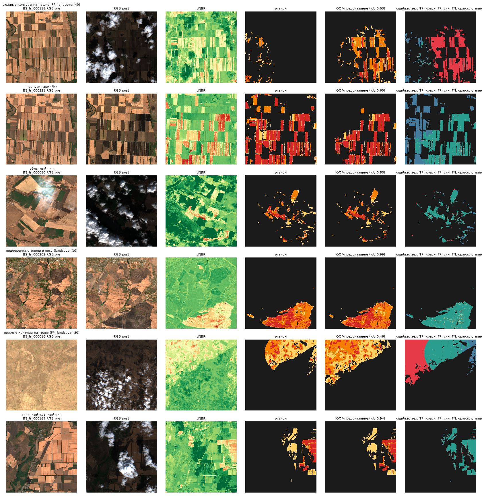

# Модуль BS: контур гари и степень поражения (0/1/2/3)

Вклад модуля в итоговую метрику: `0.35·IoU_burn + 0.30·mIoU_sev` (далее «BS-часть», максимум 0.65).
Все цифры — OOF на двух сплитах из `configs/folds_bs.csv`: **group** — GroupKFold-5 по блокам 50 км (224 чипа),
**temporal** — обучение на 2019–2023, валидация на 2024 (82 чипа; основной индикатор private-теста).
Улучшение засчитывалось только при приросте на **обоих** сплитах. Полный журнал — `reports/experiments.md`
(строки с меткой `[bs:…]`), сырые результаты — `reports/bs_results.json`, `reports/bs_eda_checks.json`,
`reports/bs_report_stats.json`.

## 1. Итог

| Этап | group: IoU_burn / mIoU_sev (IoU₁/₂/₃) / BS-часть | temporal: IoU_burn / mIoU_sev (IoU₁/₂/₃) / BS-часть |
|---|---|---|
| 0а. dNBR, пороги USGS 0.10/0.27/0.44 | 0.3706 / 0.3129 (0.168/0.285/0.485) / 0.2236 | 0.3571 / 0.2967 (0.161/0.237/0.492) / 0.2140 |
| 0б. dNBR, пороги по landcover (подбор на train-фолдах) | 0.3881 / 0.4041 (0.239/0.395/0.579) / 0.2571 | 0.3739 / 0.4016 (0.231/0.366/0.608) / 0.2513 |
| A. LightGBM по пикселям (94 признака), argmax | 0.5415 / 0.5749 (0.334/0.594/0.797) / 0.3620 | 0.5244 / 0.5494 (0.296/0.559/0.792) / 0.3484 |
| A. LightGBM + декодирование порогами | 0.5795 / 0.6219 (0.433/0.630/0.802) / 0.3894 | 0.5613 / 0.6015 (0.420/0.571/0.813) / 0.3769 |
| B. UNet-resnet34 (каналы v1), argmax | 0.6201 / 0.5625 (0.415/0.566/0.706) / 0.3858 | 0.6194 / 0.5450 (0.400/0.507/0.728) / 0.3803 |
| B. UNet + TTA + декодирование порогами | 0.6289 / 0.5726 (0.423/0.576/0.719) / 0.3919 | 0.6284 / 0.5551 (0.407/0.517/0.741) / 0.3865 |
| Ансамбль 0.5·UNet + 0.5·LGBM (среднее вероятностей) | 0.6691 / 0.6617 (0.497/0.673/0.815) / 0.4327 | 0.6741 / 0.6526 (0.501/0.630/0.827) / 0.4317 |
| **Стек**: UNet v1 → LGBM 2-го уровня | 0.6880 / 0.7039 (0.560/0.714/0.838) / 0.4520 | 0.6758 / 0.6902 (0.559/0.668/0.844) / 0.4436 |
| + правило эталона, dist_center, расстояние до центра события | 0.7277 / 0.7334 (0.613/0.739/0.848) / 0.4747 | 0.7399 / 0.7404 (0.641/0.712/0.868) / 0.4811 |
| + признаки локализации события (компоненты сильного dNBR) | 0.7345 / 0.7383 (0.623/0.747/0.845) / 0.4785 | 0.7497 / 0.7485 (0.652/0.720/0.874) / 0.4869 |
| + второй UNet (каналы v4), вероятности усредняются | 0.7461 / 0.7493 (0.637/0.758/0.853) / 0.4859 | 0.7637 / 0.7638 (0.667/0.739/0.886) / 0.4964 |
| **+ постобработка (финал)** | **0.7631 / 0.7614 (0.660/0.767/0.857) / 0.4955** | **0.7761 / 0.7720 (0.680/0.753/0.882) / 0.5033** |

BS-часть выросла с 0.224 (правило USGS) до **0.496 / 0.503**: это +0.27…+0.29 к итоговому Score. Воспроизводимость: повторное
обучение UNet v1 на временном сплите дало BS-часть 0.3863 против 0.3863 (argmax 0.3798 против 0.3803) — в пределах ±0.005;
LightGBM детерминирован (`deterministic=True`, фиксированные seed и число потоков).

## 2. Что мы узнали об эталоне (и как это использовано)

Главные наблюдения сделаны совместно с EDA (`reports/eda.md`, часть B; `reports/eda_event_circle.md`):

1. **Степень в эталоне — это пороги по медианному dNBR 3×3, свои для каждого landcover.** Внутри контура гари дерево по
   одному признаку + landcover воспроизводит степень с точностью: сырой dNBR 93.3 %, среднее 3×3 95.4 %, **медиана 3×3
   97.1 %** (RdNBR 62.6 %, RBR 88.9 % — нормировка на NBR_pre вредит). Оценённые пороги (t1/t2/t3): лес 0.125/0.27/0.575,
   трава 0.065/0.205/0.385, пашня 0.07/0.18/0.38, болото 0.08/0.33/0.61. → признаки `dNBR_med3`, `dNBR_med5`, `rule_sev`.
2. **Эталон ⊂ правила:** 97.9 % пикселей эталонной гари лежат внутри маски «rule_sev > 0». Если регион пожара известен точно,
   одно это правило даёт IoU_burn 0.979 / mIoU_sev 0.948. То есть вся трудность — **какие пятна dNBR относятся к «своему» пожару**:
   в чипе пикселей «dNBR выше порога вне эталона» столько же, сколько эталонных.
3. **Эталон обрезан буфером события (~4 км), буфер не центрирован по чипу.** Радиус охватывающей окружности эталона:
   медиана 205 px, её центр смещён от центра чипа на 140 px (медиана); самый дальний пиксель гари — 318 px от центра чипа
   (угол — 361 px). Оракул «правило ∩ охватывающая окружность эталона» даёт 0.684 / 0.706 (BS-часть 0.451).
4. **Под SCL pre ∈ {0,3,6,11} и post ∈ {0,3,9,11} гари в эталоне нет**, под cirrus/облаком в pre — есть. Минимальная единица
   картографирования — 25 px.

Отсюда архитектура: **UNet выбирает регион события (контекст, текстура гари против убранного поля), а бустинг 2-го уровня
восстанавливает попиксельно точные границы и степени** по признакам, которыми эталон и был построен.

## 3. Схема пайплайна

```
read_bs_chip ─► compute_bs_features (104 признака, ~0.2 с/чип, numpy+cv2)
   spectral: B2..B12 pre/post, NBR, NDVI, NDWI, NBR2, MIRBI, SAVI, яркость, BAI(post)
   diff: dNBR, RdNBR, RBR, dNDVI, dNBR2, dB12, dB8A, dBright, dRedEdge, dMIRBI, dNDWI
   scl: one-hot SCL pre/post, scl_bad_any, расстояние до облака, invalid
   sar: VV/VH pre/post (медиана 5×5), dVV, dVH, VH−VV, флаг sar_nodata (12.8 % пикселей S1 — нули)
   aux/lc: dem_norm, slope, landcover (код + one-hot)      ctx: окна 3/7/15, std 7, медианы dNBR 3×3 и 5×5
   rule: rule_sev — пиксельное правило эталона              geom: dist_center, coord_x/y
   event: расстояние до крупнейшей компоненты «сильного dNBR», до её центроида, до dNBR-центроида, ранг/площадь компоненты
        │
        ├─► UNet-resnet34 №1 (47 каналов v1) ─┐  TTA 4 отражения, fp16 на GPU
        ├─► UNet-resnet34 №2 (50 каналов v4) ─┴─► среднее вероятностей (4×512×512)
        │                                              │ ворота: p_burn > 0.03 (≈19 % пикселей)
        └─► LightGBM 2-го уровня: 103 пиксельных признака + 10 признаков UNet
              (p0..p3, p_burn в окнах 5/11 и σ=20/40, ожидаемая степень, расстояние до оценённого центра события)
                 │
                 ▼
   декодирование: гарь = 1−p0 > 0.42; степень = argmax(p1·0.7, p2·1.0, p3·0.8)
   постобработка: SCL/вода → 0; обнуление дальше 300 px от центра события; компоненты < 25 px; дыры < 32 px
```

Обучение: `python train.py --module bs` (этапы `rules lgbm unet stack ensemble`). UNet: `segmentation_models_pytorch.Unet`,
`encoder_weights="imagenet"`, 60 эпох, AdamW 3e-4 + OneCycle(cos), AMP, batch 8, полный чип 512×512, CE (веса 0.5/1/1/1.2) +
Dice по классам 1–3, аугментации — флипы и повороты на 90°; берётся **последняя эпоха** (без выбора эпохи по валидации),
поэтому OOF честный, а число эпох переносится на обучение на всём train. LGBM 2-го уровня обучается на OOF-вероятностях
UNet (35 % пикселей-ворот ≈ 3.9 млн строк), 90 раундов, 63 листа. Для временного сплита пороги декодирования подбираются
на групповом OOF чипов **не** из 2024 года и применяются к val-2024 без изменений.

## 4. Эксперименты

### 4.1. Абляции признаков (LightGBM, облегчённый режим: 1 млн строк, lr 0.1, 63 листа, оценка на сетке с шагом 2)

| Вариант | group: IoU_burn / mIoU_sev / BS-часть | temporal | Δ BS-часть (group / temporal) |
|---|---|---|---|
| все признаки | 0.5802 / 0.6209 / 0.3894 | 0.5645 / 0.6007 / 0.3778 | — |
| без SAR | 0.5801 / 0.6187 / 0.3886 | 0.5589 / 0.5960 / 0.3744 | −0.0008 / −0.0034 |
| без SCL | 0.5728 / 0.6085 / 0.3830 | 0.5493 / 0.5812 / 0.3666 | −0.0064 / −0.0112 |
| без landcover | 0.5762 / 0.5893 / 0.3785 | 0.5562 / 0.5588 / 0.3623 | −0.0109 / −0.0155 |
| без контекстных (окна, медианы) | 0.5683 / 0.5598 / 0.3669 | 0.5481 / 0.5436 / 0.3549 | −0.0225 / −0.0229 |
| только dNBR + RdNBR + landcover | 0.4461 / 0.4520 / 0.2917 | 0.4313 / 0.4412 / 0.2833 | −0.0977 / −0.0945 |
| регрессия порядковой степени + 3 порога | 0.5722 / 0.5059 / 0.3520 | 0.5532 / 0.4789 / 0.3373 | −0.0374 / −0.0405 |

Выводы: самый ценный блок — контекст (медианный dNBR: именно по нему порогуется эталон); landcover даёт +0.011…+0.016
(в основном mIoU_sev: +0.03…+0.04); SCL +0.006…+0.011; SAR почти бесполезен для попиксельной модели (+0.001…+0.003), но
оставлен — он дешёвый и помогает под облаками; регрессия проигрывает multiclass (границы классов зависят от покрова).

### 4.2. Варианты UNet (temporal, argmax + TTA)

| Вариант | IoU_burn / mIoU_sev / BS-часть |
|---|---|
| resnet34, CE+Dice, каналы v1 (47) | 0.6287 / 0.5541 / 0.3863 |
| resnet34, Focal+Dice | 0.6268 / 0.5571 / 0.3865 |
| efficientnet-b3, CE+Dice | 0.6334 / 0.5625 / 0.3904 |
| resnet34, v2 = v1 + dNBR_med3 | 0.6060 / 0.5437 / 0.3752 |
| resnet34, v3 = v2 + rule_sev | 0.6352 / 0.6191 / 0.4081 |
| **resnet34, v4 = v3 + dist_center** | **0.6481 / 0.6280 / 0.4152** |
| resnet34, v5 = v4 + coord_x/y + dist_strong_cc + cc_area_rel | 0.6142 / 0.5960 / 0.3938 |

Потери и энкодер в пределах шума (±0.005), поэтому оставлен resnet34 (быстрее на CPU). Канал с готовым правилом эталона
даёт +0.02 (степень), расстояние до центра чипа — ещё +0.007; координатные каналы и «событийные» каналы в UNet ухудшают
(переобучение на положение). TTA: +0.004…+0.006. На групповом сплите v4 лучше v1 только по степени (0.4042 против 0.3898,
IoU_burn одинаков), а стек поверх v4 против стека поверх v1: group 0.4701 против 0.4785, temporal 0.4907 против 0.4869 —
**смешанный результат, не засчитан**; зато усреднение v1+v4 даёт прирост на обоих сплитах (0.4859 / 0.4964) — оно и принято.

### 4.3. Декодирование

argmax → «порог по 1−p0 + множители классов»: LGBM +0.027 / +0.029 (t_burn 0.20, выборка для LGBM обогащена гарью), UNet +0.002 / +0.000, стек +0.008 / −0.005 (у стека
вероятности уже откалиброваны; порог 0.42 и веса 0.7/1.0/0.8 оставлены как более устойчивые к сдвигу доли гари).

### 4.4. Четыре факта EDA об эталоне — вклад каждого (финальная модель, Δ BS-части: group / temporal / облачные чипы)

«Облачные» — 24 train-чипа с cloud_frac > 0.25 (групповой OOF); базовая точка: 0.4859 / 0.4964 / 0.4253.

| № | Проверка | Δ group | Δ temporal | Δ облачные | Решение |
|---|---|---|---|---|---|
| 1 | Обнулить дальше R от **центра чипа**: R=200 / 240 / 280 / 320 | −0.159 / −0.076 / −0.021 / −0.004 | −0.174 / −0.080 / −0.021 / −0.004 | −0.139 … −0.004 | отклонено: буфер не центрирован по чипу |
| 1 | Мягкий приор от центра чипа (сигмоида R=240 / 300) | −0.069 / −0.009 | −0.071 / −0.007 | −0.076 / −0.015 | отклонено |
| 1 | Компоненты, пересекающие круг от центра чипа R=150 / 200 / 250 | −0.075 / −0.028 / −0.004 | −0.105 / −0.033 / −0.007 | −0.112 / −0.028 / −0.002 | отклонено |
| 1 | `dist_center` как признак LGBM-2 и канал UNet | в составе строки «+ правило, dist_center, центр события»: +0.023 | +0.038 | — | **принято** (UNet: +0.007 temporal) |
| 1 | Обнулить дальше R от **оценённого центра события**: R=250 / 300 / 350 | +0.000 / **+0.005** / +0.003 | −0.001 / **+0.004** / +0.002 | −0.007 / +0.002 / +0.002 | **принято R=300** |
| 1 | Компоненты, пересекающие круг вокруг центра события R=150 / 200 / 250 | −0.012 / +0.003 / +0.005 | −0.028 / −0.003 / −0.002 | −0.034 / −0.007 / +0.000 | отклонено (на стеке v1 без событийных признаков давало +0.028 / +0.037 — модель уже выучила это сама) |
| 1 | Крупнейшая компонента + всё в 280 px / площадь ≥ 5–20 % от крупнейшей / окружность крупнейшей до 280 px | +0.003 / −0.018…−0.044 / +0.004 | −0.002 / −0.026…−0.061 / −0.006 | +0.004 / −0.029…−0.087 / −0.000 | отклонено (нет прироста на обоих) |
| 1 | Признаки локализации события в LGBM-2 (компоненты сильного dNBR, центроиды, ранг) | +0.004 | +0.006 | — | **принято** |
| 2 | SCL_post ∈ {0,3,9,11} → 0 | +0.0000 | +0.0000 | +0.0000 | принято (бесплатно; модель уже выучила: SCL — её признак) |
| 3 | Удалить компоненты < 25 / 50 / 100 px | **+0.0023** / +0.0005 / −0.0023 | **+0.0016** / +0.0001 / −0.0032 | **+0.0033** / −0.0004 / −0.0080 | **принято 25 px** |
| 4 | Степень внутри предсказанного контура: (а) модель | 0 | 0 | 0 | **принято** |
| 4 | (б) пороги dNBR по покрову: наши / из таблицы EDA | −0.0011 / −0.0104 | −0.0018 / −0.0093 | −0.0006 / −0.0045 | отклонено |
| 4 | (в) смесь 50/50 модель + правило: наши / EDA | −0.0010 / −0.0061 | −0.0016 / −0.0049 | −0.0005 / −0.0015 | отклонено |

Итого по пунктам: (1) буфер события — самый большой резерв: +0.023…+0.038 как признаки и ещё +0.004…+0.005 как
постобработка, но только относительно **оценённого по содержимому чипа** центра, а не центра чипа; (2) маска SCL_post — 0
(уже в модели); (3) MMU 25 px — +0.002; (4) правило степени не улучшает модель, потому что оно уже внутри неё (`rule_sev`,
`dNBR_med3`, landcover) и LGBM уточняет его на остальных 3 % пикселей.

### 4.5. Политики для облаков/теней (SCL ∈ {3,8,9,10} в любой из дат), Δ BS-части от «как есть»

| Политика | group | temporal | облачные чипы (IoU_burn / mIoU_sev) |
|---|---|---|---|
| (а) как есть — **выбрано** | 0 | 0 | 0.6565 / 0.6518 |
| (б) заполнить из ближайшего необлачного пикселя | −0.079 | −0.130 | 0.5208 / 0.5106 |
| (в) обнулить | −0.069 | −0.095 | 0.6142 / 0.6123 |

Эталон под cirrus и под облаком в pre-снимке размечен, поэтому обнуление и inpaint теряют настоящую гарь. Жёстко обнуляются
только классы, где эталон пуст по построению (п. 2 выше).

### 4.6. Остальная постобработка (по одному шагу от «сырого» выхода, Δ BS-части group / temporal)

вода по landcover 80 → 0: +0.0001 / +0.0001 (принято); застройка 50 → 0: −0.0001 / −0.0001 (в эталоне на застройке есть
4.6 тыс. px гари — отклонено); заполнение дыр < 8 / 32 px: +0.0014 / +0.0008 и +0.0021 / +0.0013 (принято 32; более крупные
дыры — настоящие несгоревшие острова, 128 px уже вредит); медиана 3×3 по меткам степени: −0.005 / −0.005 (отклонено —
эталон сам не сглажен по меткам). Порог ворот стека 0.03 → 0.08 / 0.12 / 0.2: −0.003 / −0.005 / −0.010 — оставлен 0.03.

## 5. Разбор ошибок

Матрица ошибок финальной модели (групповой OOF, доля от эталона по строкам; `figures/bs_confusion.png`):

| эталон \ предсказание | 0 | 1 | 2 | 3 |
|---|---|---|---|---|
| 0 (фон) | 0.9852 | 0.0077 | 0.0052 | 0.0019 |
| 1 (слабая) | 0.2077 | **0.7764** | 0.0141 | 0.0018 |
| 2 (средняя) | 0.1068 | 0.0055 | **0.8788** | 0.0089 |
| 3 (сильная) | 0.0570 | 0.0000 | 0.0065 | **0.9365** |

Смешение соседних степеней внутри правильно найденного контура мало (1→2: 1.4 %, 2→3: 0.9 %, 3→2: 0.6 %) — задача степени
решена; основная ошибка — **контур**: 21 % слабой степени уходит в фон (граница гари, зарастающая трава/пашня), а ложная
гарь распределена 1:0.7:0.25 по степеням. По покрову IoU_burn: трава 0.806, болото 0.851, пашня 0.715, лес 0.706.



1. **Ложные контуры на пашне** (BS_tr_000158, IoU 0.03, cloud_frac 0.40): эталонная гарь — мелкие пятна у левого края,
   а в центре убранные/вспаханные поля с тем же dNBR; модель выбрала «не тот» кластер. Это ошибка локализации события,
   а не спектра.
2. **Пропуск гари** (BS_tr_000221, IoU 0.60): сгоревшие поля по всему чипу, эталонный буфер захватывает верхний левый угол,
   модель оставила только плотное ядро — консервативна вдали от оценённого центра.
3. **Облачный чип** (BS_tr_000080, cloud_frac 0.48, IoU 0.83): под облаками post-снимка модель опирается на pre/SAR/контекст,
   контуры сохраняются; теряются мелкие фрагменты под тенью.
4. **Лес** (BS_tr_000202, IoU 0.99): контур точный, остаточные ошибки — отдельные пиксели степени на границах классов.
5. **Ложные контуры на траве** (BS_tr_000016, IoU 0.46): хорошо видна **дуга буфера события** в эталоне — гарь продолжается
   за дугой, но там она размечена как фон; модель не может знать точное положение дуги.
6. **Типичный чип** (BS_tr_000163, IoU 0.94).

### Облачность


| cloud_frac | чипов | IoU_burn / mIoU_sev (микро) | медиана IoU чипа |
|---|---|---|---|
| < 1 % | 110 | 0.762 / 0.753 | 0.877 |
| 1–5 % | 27 | 0.765 / 0.795 | 0.879 |
| 5–15 % | 33 | 0.791 / 0.789 | 0.883 |
| 15–25 % | 30 | 0.781 / 0.783 | 0.845 |
| > 25 % | 24 | 0.672 / 0.663 | 0.786 |

До 25 % облачности качество не падает; выше — −0.09 IoU_burn. Корреляция cloud_frac ↔ IoU чипа −0.11. Внутри облачных
пикселей (SCL 3/8/9/10 в любой дате) IoU_burn 0.712 / mIoU_sev 0.739 против 0.774 / 0.767 вне их. Тест облачнее train
(`reports/test_vs_train.md` в main: чипов с cloud_frac > 0.25 — 25.8 % против 10.7 %), поэтому на тесте ожидается цифра
ниже OOF: при такой доле облачных чипов и BS-части 0.434 на них против ≈ 0.50 на остальных оценка — около 0.48.

Кривые обучения UNet: `figures/bs_unet_curves.png`.

## 6. Время инференса (89 BS-чипов = размер теста; замер `scripts/bs_benchmark.py` на train-чипах, чтение файлов включено)

| Режим | Загрузка моделей | Чтение + предсказание | Всего |
|---|---|---|---|
| GPU (RTX 4070, fp16, TTA×4, 2 UNet + стек) | 3.6–3.8 с | 18.6–19.0 с | **≈ 22.5 с** |
| CPU (14 ядер, без TTA) — по умолчанию без GPU | 3.5 с | 44.7 с | **≈ 48 с** |
| CPU + TTA×4 (`tta_cpu: true`) | 3.5 с | 143.8 с | ≈ 148 с |

Инженерные решения: чтение и признаки считаются в пуле потоков с ограниченным окном prefetch (rasterio, numpy, cv2 отпускают
GIL); вход UNet готовится там же (float16); **двухступенчатый конвейер** — LGBM-2 и постобработка батча k идут параллельно с
UNet батча k+1; LGBM-2 вызывается один раз на батч и только на «воротах» (19 % пикселей; на train-чипах, где UNet обучен на
них же, ворота шире — 29 %, так что на тесте будет быстрее). Было 39 с → стало 19 с. На CPU TTA по умолчанию выключен
(на уровне UNet TTA даёт +0.004…+0.006 BS-части). ONNX не делался: `onnxruntime` нет в окружении, а CPU-путь и так укладывается
в 3 минуты с запасом ×3.5. Ограничение: цель «≤ 20 с на GPU» выполнена для чтения+предсказания (19 с), но не с учётом
загрузки torch/CUDA (≈ 3.7 с).

## 7. Соответствие правилам

Модель использует только содержимое чипа: ни геопривязка, ни даты, ни поля meta не читаются предиктором (в `infer.py`
`transform`/`crs` обнуляются сразу после чтения). «Центр события» оценивается по вероятностям модели и dNBR внутри чипа.
Пороги `RULE_THR` в `bs_features.py` оценены по train (12 чисел) и зафиксированы.

Предобученные веса: энкодер resnet34 — ImageNet, через `segmentation_models_pytorch` 0.5.0 (MIT), веса torchvision
(BSD-3-Clause), опубликованы задолго до старта. LightGBM 4.7.0 — MIT.

## 8. Файлы

`src/firemon/features/bs_features.py`; `src/firemon/models/bs/`: `rules.py`, `lgbm.py`, `unet.py`, `stack.py`, `ensemble.py`,
`postprocess.py`, `predictor.py` (`BSPredictor`, `predict_bs`), `infer.py`, `pipeline.py`, `common.py`;
`configs/bs_inference.yaml`; `scripts/bs_report_figures.py`, `bs_eda_checks.py`, `bs_benchmark.py`, `bs_log_experiments.py`;
`tests/test_bs.py`; веса `weights/bs_*` (два UNet по 47 МБ fp16, `bs_stack.txt`, `bs_lgbm.txt`, `bs_decode.json`,
`bs_lc_medians.json`).
