# EDA: наблюдения по данным и принятые решения

Все числа, таблицы и фигуры этого раздела пересчитываются двумя скриптами (seed 42, ~3 мин AF и ~9 мин BS, повторный запуск — из кэша `eda/cache/`):

```powershell
$env:PYTHONIOENCODING='utf-8'
.\.venv\Scripts\python.exe eda\eda_af.py      # → eda/tables/af_*.csv, af_numbers.json, reports/figures/eda_af_*.png
.\.venv\Scripts\python.exe eda\eda_bs.py      # → eda/tables/bs_*.csv, bs_numbers.json, reports/figures/eda_bs_*.png
```

Данные: train, 420 AF-чипов (27.5 млн пикселей) и 224 BS-чипа (58.7 млн пикселей). Геопривязка и даты использованы **только** для анализа и построения валидации; ни один из предложенных признаков от них не зависит (в тестовом `meta.csv` их нет, восстанавливать их запрещено правилами).

## Главное за одну минуту

1. **AF: эталон почти воспроизводится двумя парами порогов, раздельно для дня и ночи.** Днём `I4 > 329 K и I4−I5 > 25 K`, ночью `I4 > 295 K и I4−I5 > 10 K` дают F1 = 0.921 против 0.244 у единого порога-заглушки. Всё, что остаётся модели, — 668 дневных и 583 ночных ложных пикселя и 350 пропусков.
2. **AF: ночные ложные срабатывания — это техноген.** 52 % из них лежат на застройке (у огня — 20 %), четверть — на пикселях, горячих в нескольких ночных пролётах и ни разу не размеченных огнём; их контраст вдвое слабее (медиана I4−I5 15.6 K против 28.1 K).
3. **BS: степень поражения в эталоне — это пороги dNBR, зависящие от покрова.** При известном контуре гари один dNBR с порогами по landcover даёт mIoU_sev = 0.877 (точность 93.5 %); для леса и болота пороги в 1.5–2 раза выше, чем для травы и пашни.
4. **BS: узкое место — контур, а не степень.** Порог dNBR по всему чипу даёт IoU_burn всего 0.36: эталон размечает только «свой» пожар внутри круглого буфера события, а такие же по спектру убранные поля вне буфера — фон. Ограничение предсказания окружностью события поднимает IoU_burn до 0.62, а с учётом облачных классов SCL — до 0.67.
5. **Сдвиг во времени важнее пространственной утечки.** Случайный и групповой KFold дают одинаковые оценки (AF 0.913 / 0.913, BS 0.502 / 0.496), а временной сплит (val = 2024) стабильно ниже (AF 0.877, BS 0.487) — он и остаётся главным индикатором private.

---

## Часть A. Активное горение (AF)

### A1. Дисбаланс
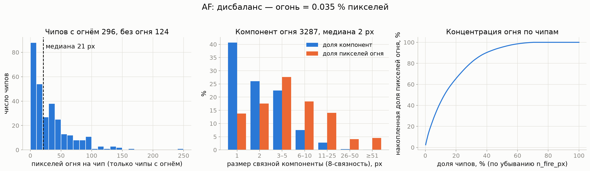

**Наблюдение:** огонь — 9 725 пикселей из 27.5 млн (0.035 %; 0.039 % от валидных). Огонь есть на 296 чипах из 420; на позитивном чипе медиана 21 px (IQR 8–43, max 243), 10 % чипов содержат 43 % всего огня. 3 287 связных компонент, медиана размера 2 px; 40.7 % компонент — одиночные пиксели, но в них лишь 13.7 % огня; компоненты ≤ 2 px — 31 % огня (`af_a1_components.csv`).
**Решение для модели/пайплайна:** обучаться не на всех пикселях, а на кандидатах (п. A2) + случайном фоне: это убирает дисбаланс с 1 : 2 800 до ≈ 1 : 60 без потери полноты. Метрика микро-усреднённая, поэтому порог подбирается по пулу OOF-пикселей, а не по чипам. Постобработку «удалить одиночные пиксели» **не применять** — она стоит 13.7 % полноты; 124 пустых чипа требуют, чтобы модель умела выдавать пустую маску (штраф только за FP).

### A2. Сигнал I4, I5, I4−I5 и пороговое правило
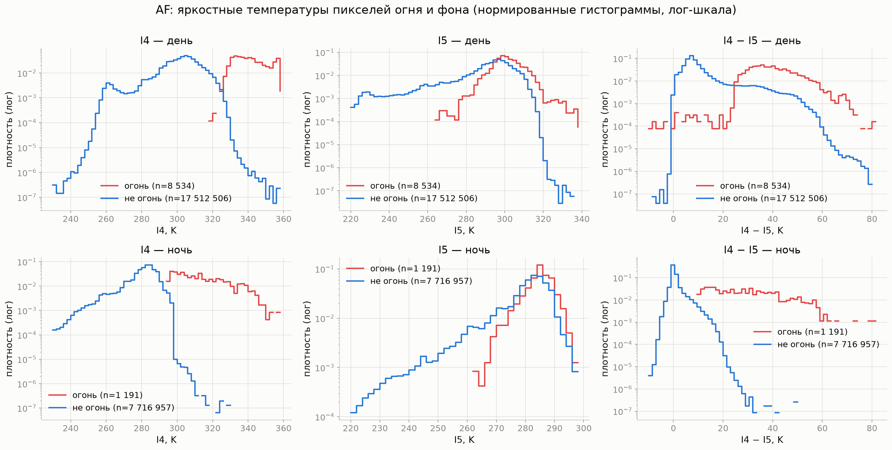
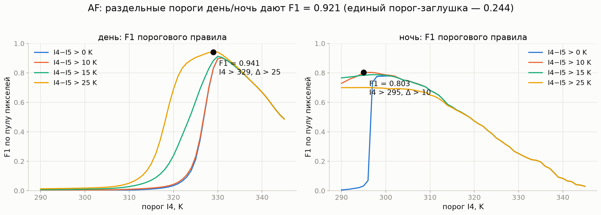

**Наблюдение:** днём огонь: I4 медиана 340.3 K (1-й перцентиль 327.0), I4−I5 медиана 39.0 K (1-й перцентиль 25.3); фон: медиана 303.3 K, 99-й перцентиль 322.9 K. Ночью огонь начинается ровно с I4 = 295.04 K и I4−I5 = 10.04 K (минимумы), фон: медиана 282.3 K, 99-й перцентиль 294.9 K. Насыщения 367 K в данных нет: максимум I4 = 358.2 K, доля пикселей огня ≥ 367 K равна 0 (≥ 355 K — 9.9 %). 33 пикселя огня имеют I4−I5 < 10 K (15 — отрицательную разность): все дневные, I5 = 323–349 K — ядра крупных пожаров, где греется и I5. «Горячих, но не огонь» (`I4 > 320 и I4−I5 > 20`): 13 126 днём и 6 ночью; 52 % на пашне, 36 % на траве (обогащение ×1.8), голая почва ×7 — это прогретый солнцем грунт, а не техноген. Перебор порогов (`af_a2b_rule_grid.csv`): день `I4 > 329, Δ > 25` → F1 0.941 (P 0.925, R 0.959); ночь `I4 > 295, Δ > 10` → F1 0.803 (P 0.671, R 1.000); вместе **F1 = 0.921** против 0.244 у заглушки `I4 > 320, Δ > 15`. Минимумы ночного огня (295.04 K и 10.04 K) и 1-й перцентиль дневного (327 K и 25.3 K) совпадают с порогами отбора кандидатов алгоритма VNP14IMG (ночь 295 K / 10 K, день 325 K / 25 K; `I4 > 325, Δ > 25` днём даёт полноту 0.993 при точности 0.83): эталон устроен как «абсолютные пороги кандидатов → контекстные тесты → вычеркнутый техноген».
**Решение для модели/пайплайна:** (1) новое правило-baseline — раздельные пороги день/ночь, оно же генератор кандидатов: день `I4 > 310 и Δ > 15`, ночь `I4 > 295 и Δ > 8` покрывают 99.6 % огня при 599 тыс. кандидатов (2.2 % пикселей) — инференс ускоряется в ~45 раз; (2) признак «день/ночь» обязателен, абсолютные I4 и I4−I5 — главные признаки; (3) абсолютные пороги оставляем **только на этапе кандидатов** (они повторяют логику разметки и потому переносимы), а отсев ложных — на относительных признаках: в тесте дневной фон теплее на 6–7 K в хвосте (часть D), и правило вида «I4 выше константы» без контекста даёт там в 5 раз больше ложных; (4) признак насыщения не нужен, но нужен `I5` и флаг `I4−I5 < 10 при I4 > 320` для ядер крупных пожаров (заполнение дыр внутри кластера огня).

### A3. Контекстные признаки
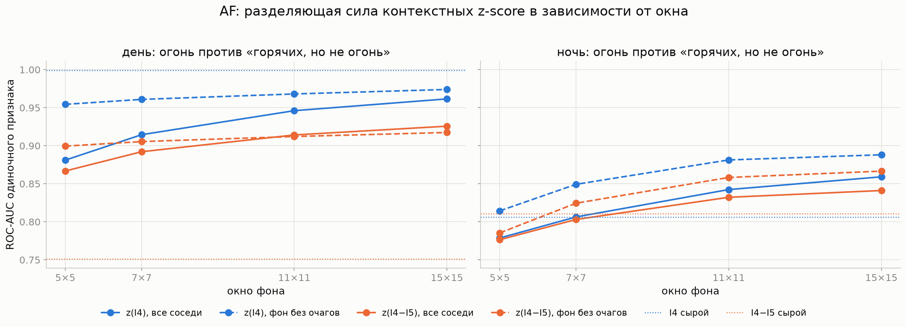

**Наблюдение:** ROC-AUC одиночных признаков, огонь против «горячих, но не огонь» (589 571 кандидат-негатив), `af_a3_context_auc.csv`. Днём сырой I4 даёт 0.9993 — контекст его не улучшает (лучший контекстный `I4 − фон 11×11` — 0.996; z-score 0.88–0.97; сырой I4−I5 — 0.75). Ночью наоборот: сырые I4 и I4−I5 дают 0.81, а контекст — до 0.89 (`I4−I5 − фон 7×7`: 0.891; `z(I4) 15×15` с «чистым» фоном: 0.888). Исключение потенциальных очагов из фоновой статистики (как в VNP14) поднимает AUC z-score на 0.02–0.07. AUC растёт с окном: 5×5 → 15×15 на +0.05…0.08.
**Решение для модели/пайплайна:** в признаки берём окна **7×7, 11×11 и 15×15** (5×5 не нужен), две формы — разность с фоном и z-score, фон считаем без пикселей-кандидатов, std снизу ограничиваем 0.5 K. Контекст критичен ночью (разделение огонь/техноген), днём работает абсолютный I4. Реализация — интегральные суммы (`uniform_filter`), 420 чипов × 16 карт за ~25 с на CPU.

### A4. День и ночь
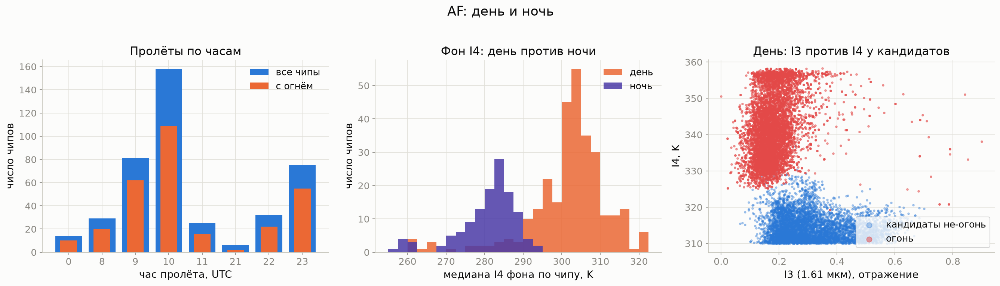

**Наблюдение:** 293 дневных чипа (207 с огнём, 8 534 px, 0.49 ‰) и 127 ночных (89 с огнём, 1 191 px, 0.15 ‰; медиана 9 px на чип против 34 днём). Фон I4: 303.3 K днём, 282.6 K ночью. Правило-заглушка даёт 54 195 ложных пикселей днём и 6 ночью. 6 чипов содержат терминатор (часть пикселей с `solar_zenith > 90`). Ночью каналы I1–I3 — **100 % NaN**. Днём у кандидатов-негативов I3 выше, чем у огня (AUC I3 = 0.11, т. е. 0.89 в обратную сторону; I3/I2 — 0.82): 152 876 кандидатов-негативов имеют `I3 > 0.3 и I1 > 0.3` (яркая сухая почва/блик) против 270 пикселей огня.
**Решение для модели/пайплайна:** флаг ночи считаем **попиксельно** по `solar_zenith > 90`, не по чипу. Ночью I1–I3 заменяем константой (−1) и добавляем флаг; днём признаки `I3`, `I3/I2`, `I1` — фильтр яркого грунта и блика. Пороги кандидатов и финальный порог вероятности — раздельные для дня и ночи.

### A5. Повторяющиеся термоаномалии (техноген)
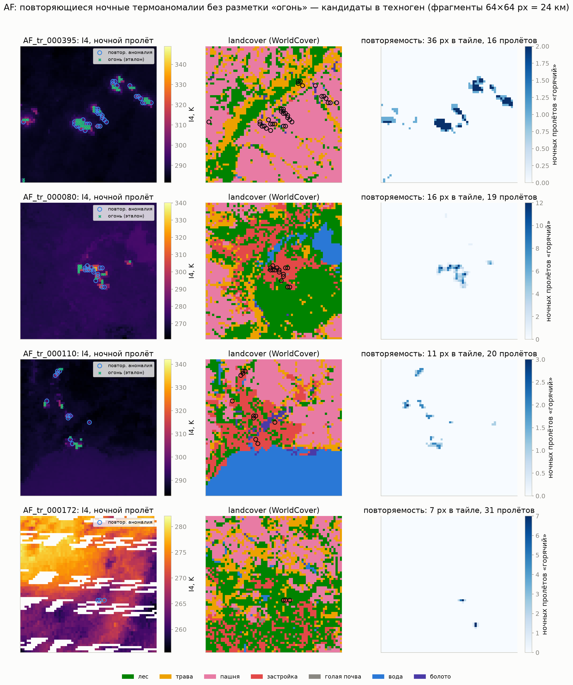

**Наблюдение:** 70 тайлов, медиана 3.5 пролёта на тайл (1–31). Пикселей «горячий (`I4 > 310, Δ > 15`) в ≥ 3 пролётах, огонь — ни разу» — 8 618, но 80 % из них — пашня: это дневной прогрев, и они объясняют лишь 2 504 из 54 201 FP заглушки (4.6 %). Настоящий техноген виден ночью: 77 пикселей в 7 тайлах горячие (`I4 > 295, Δ > 8`) в ≥ 2 ночных пролётах без единой разметки огнём; 49 % из них — застройка при 1.3 % площади (обогащение **×38.6**). Ночные ложные срабатывания порогового правила — 654 px на 64 чипах: 51.5 % на застройке (у ночного огня — 19.8 %), медиана I4−I5 15.6 K против 28.1 K у огня, 25 % лежат на «повторяющихся» пикселях. На примерах видно, что такие пиксели примыкают к пикселям, размеченным огнём (промплощадка размечена частично) — граница огонь/техноген в эталоне шумная. Повторное горение: 570 из 8 955 уникальных положений огня (6.4 %) горели в ≥ 2 пролётах.
**Решение для модели/пайплайна:** признаки «доля застройки в окне 3×3/7×7», «landcover центра», «размер кластера кандидатов», «контраст к фону» и «I4−I5» — по ним модель отличает стабильный слабый источник на застройке от пожара. **Карту повторяемости переносить на тест нельзя**: она строится по координатам тайла, а в тесте геопривязки нет и восстанавливать её запрещено (§7 правил); кроме того, тест отделён по территории — тайлы не совпадут. Карта используется только как аналитическое подтверждение того, что нулевая разметка на застройке — это техноген, и как источник весов: ночные негативы на застройке получают повышенный вес при обучении.

### A6. Landcover и метео
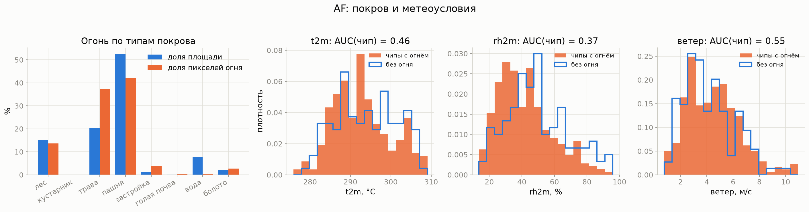

**Наблюдение:** огонь по покрову: пашня 42.1 %, трава 37.2 % (обогащение ×1.84), лес 13.7 %, застройка 3.7 % (×2.87), вода 0.35 % (×0.04). Метео почти постоянно внутри чипа (std t2m 0.4 K, ветра 0.34 м/с) — это признаки уровня чипа: AUC «на чипе есть огонь» — dem 0.72, rh2m 0.37 (т. е. 0.63 для сухости), wind 0.55, t2m 0.46; попиксельно — 0.51–0.64. `t2m` записан **в кельвинах** (медиана 292 K), а не в °C, как в описании. NaN: landcover — 124 тыс. px, метео — 418 тыс. px.
**Решение для модели/пайплайна:** landcover — one-hot + доли классов в окне (вода → почти гарантированный ноль, застройка → подозрение на техноген). Метео и dem в модель берём с осторожностью: они не описывают пиксель, а «паспортизуют» сцену; их вклад проверяется только на временном сплите (см. A9: +0.015 F1). NaN в aux заполняем медианой чипа.

### A7. valid и NaN
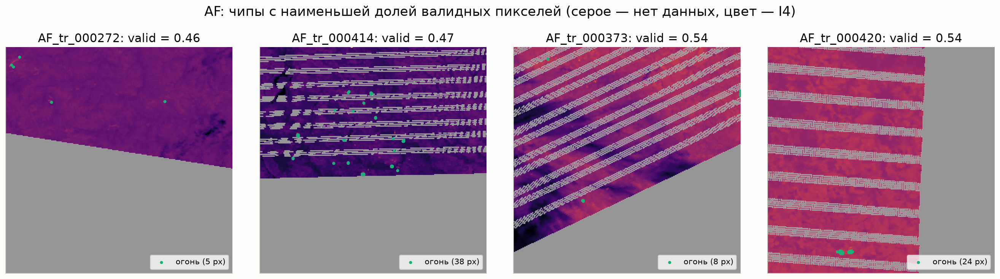

**Наблюдение:** по каналу `valid` невалидно 0.65 % пикселей (15 чипов, min 0.46 — совпадает с meta). Но **NaN в I4/I5 при `valid = 1` — ещё 2.1 млн px (7.6 %)**: неполных чипов на самом деле 227, а не 14; только 22 % невалидных пикселей лежат в компонентах, касающихся края чипа, — это внутренние полосы, а не край сцены (их природа — п. A7b). Днём I1–I3 отсутствуют в 9.1 % пикселей. Огня на невалидных пикселях нет (0), но 890 пикселей огня (9.2 %) лежат вплотную к невалидным, 2 143 (22 %) — в пределах 3 px: огонь соседствует с дымом/облаком.
**Решение для модели/пайплайна:** маска валидности = `valid == 1 и isfinite(I4, I5)` (так уже делает `firemon.io`); на невалидных пикселях предсказание = 0. Фоновая статистика считается только по валидным соседям с нормировкой на их число (не заполнять NaN нулём или средним до свёртки); добавляем признаки «расстояние до невалидного пикселя» и «доля валидных в окне».

### A7b. Откуда NaN в I4/I5: строки bow-tie на краю полосы обзора
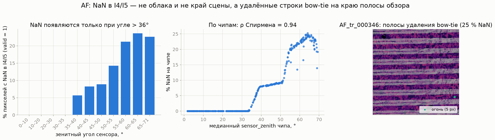

**Наблюдение:** NaN в I4 и I5 всегда совпадают, стоят при `valid = 1` и есть на 223 чипах из 420 (53 %); на затронутых чипах это в среднем 14.4 % пикселей, по выборке 7.65 % (в тесте 9.4 %). Проверены три гипотезы (`af_a7b_nan_by_sensor_zenith.csv`). *Край сцены* — нет: только 22 % невалидных пикселей связаны с краем чипа, а углы сенсора и Солнца в этих пикселях заполнены. *Облака* — нет: соседи NaN-пикселей не холоднее остальных (медиана I5 289.2 K против 288.7 K). *Bow-tie* — да: при `sensor_zenith < 36.2°` нет **ни одного** NaN (173 чипа с медианным углом < 30° чисты на 100 %), дальше доля растёт монотонно — 5.7 % при 35–40°, 8.9 % при 45–50°, 21–24 % при 55–70°; по чипам зависимость ступенчатая — плато ≈ 8–9 % при 38–50° и ≈ 20–25 % при > 55°, ровно две зоны агрегации VIIRS; корреляция Спирмена «угол чипа — доля NaN» = 0.94; все 154 чипа с углом > 45° затронуты. Геометрия — короткие горизонтальные штрихи (медиана длины 2 px, 95-й перцентиль 8 px; по вертикали 1 px), идущие периодическими пачками строк: это строки, удаляемые на борту VIIRS в зонах агрегации у края полосы обзора, после перепроецирования на сетку 375 м. День и ночь затронуты одинаково (8.2 % и 6.4 %). Огонь от полос не защищён: 1 077 пикселей огня (11.1 %) — прямые соседи NaN, 489 из 1 272 компонент огня на затронутых чипах касаются NaN; 40 % всего огня снято под углом > 36°.
**Решение для модели/пайплайна:** (1) NaN — это «нет наблюдения»: предсказание на них 0 (в эталоне огня на NaN нет), но **соседние пиксели оцениваются как обычно** — никакой эрозии маски у NaN; (2) фоновая статистика и свёртки считаются с нормировкой на число валидных соседей (partial convolution); заполнять NaN нулём или средним до свёртки нельзя; при 20 % пропусков окно 5×5 теряет ~5 пикселей, поэтому минимальное число валидных соседей = 3, а окна 11×11 и 15×15 предпочтительнее; (3) для CNN — заполнение NaN медианой валидных соседей + отдельный канал-маска; (4) признаки: `sensor_zenith` (он же описывает рост пикселя к краю полосы и размытие очага), доля валидных в окне, расстояние до NaN; (5) при оценке моделей отдельно отчитывать F1 на чипах с углом > 45° (37 % чипов).

### A8. Спутники
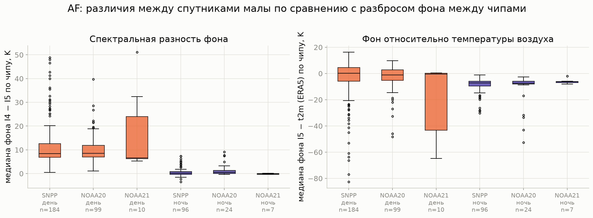

**Наблюдение:** медиана фона I4−I5: днём SNPP 8.40 K, NOAA-20 8.56 K, NOAA-21 6.60 K (всего 10 чипов); ночью 0.08 / 0.48 / −0.12 K. Разность «фон I5 − t2m» между SNPP и NOAA-20 статистически не различается (Манн–Уитни p = 0.27 днём, 0.95 ночью). Разброс фона между чипами на порядок больше: std медианы I4 10.4 K днём и 8.1 K ночью, размах 245–323 K.
**Решение для модели/пайплайна:** калибровочной поправки по спутнику не делаем и спутник в признаки не берём (в тестовом meta его нет). Нормализация нужна не по спутнику, а по сцене: признаки «I4 − медиана I4 чипа», «I4−I5 − медиана чипа» плюс локальный контекст из A3.

### A9. Валидация
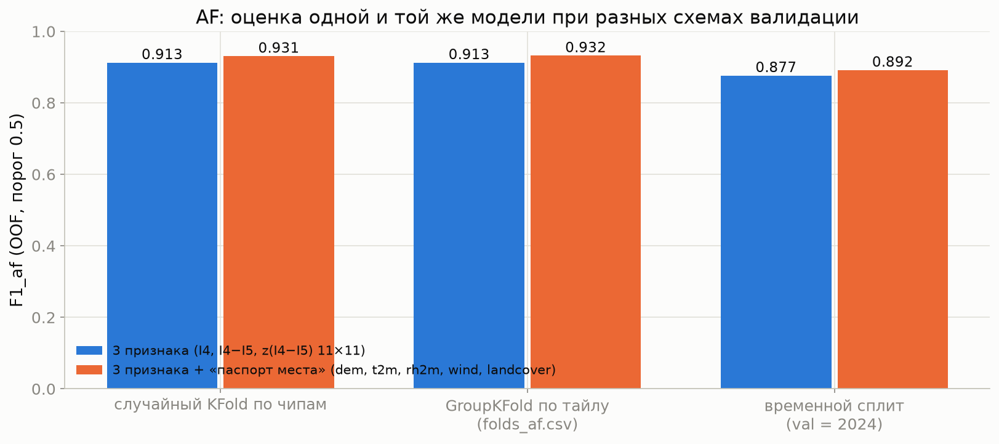

**Наблюдение:** 420 чипов = 70 тайлов × в среднем 6 пролётов и всего 78 уникальных пролётов (каждый пролёт режется на несколько тайлов). В `configs/folds_af.csv` ни один тайл не разделён между фолдами; фолды сбалансированы (84 чипа, 1 920–1 953 px огня). LightGBM на кандидатах (`af_a9_kfold_vs_group.csv`): 3 физических признака — F1 0.9127 при случайном KFold и 0.9127 при GroupKFold; с «паспортом места» (dem, метео, landcover) — 0.9309 и 0.9322. То есть утечка через тайл для локальных физических признаков **не измерима** (< 0.002). Зато временной сплит (val = 2024: 78 чипов, 2 458 px огня) даёт 0.8765 и 0.8917 — на 0.036–0.040 ниже, а оптимальный порог вероятности съезжает с 0.45 до 0.10–0.20.
**Решение для модели/пайплайна:** GroupKFold по тайлу остаётся основной схемой OOF (страховка от утечки для пространственных/CNN-моделей, где она возможна), временной сплит — главный индикатор private; улучшение засчитывается только при росте на обоих. Порог вероятности выбираем не по максимуму на GroupKFold, а компромиссный между двумя схемами — кривая F1(порог) на 2024 годе смещена.

---

## Часть B. Гари и степень поражения (BS)

### B1. Классы и геометрия
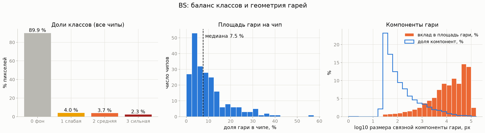

**Наблюдение:** пиксели: фон 89.94 %, слабая 4.02 %, средняя 3.73 %, сильная 2.31 % (внутри гари 40.0 / 37.1 / 22.9 %). Доля гари на чип: среднее 10.1 %, медиана 7.5 %, max 56.1 %, min 0.01 %; чипов без гари нет, но 22 чипа без класса 3 и 2 без класса 2. nodata (255) в масках отсутствует. 4 997 компонент, медиана 18 на чип; **компонент мельче 25 px практически нет (4 шт.)** — в эталоне применена минимальная единица картографирования 25 px = 1 га; компоненты ≥ 1 000 px держат 89.4 % площади. Дырки внутри гари: 2 431 шт., 4.0 % от площади гари, медиана 9 px. Чипов с cloud_frac > 25 % — 24, > 10 % — 69.
**Решение для модели/пайплайна:** постобработка: удалять компоненты гари < 25 px (в эталоне их нет — чистый выигрыш по FP); дырки **не заливать** — они есть в эталоне (несгоревшие острова). Веса классов в loss ≈ обратные частоты с корнем (0.3 / 1 / 1 / 1.3), sev-классы дают 30 % Score при 10 % пикселей. Стратификация фолдов — по пикселям классов (уже сделано в `folds_bs.csv`).

### B2. Индексы против классов
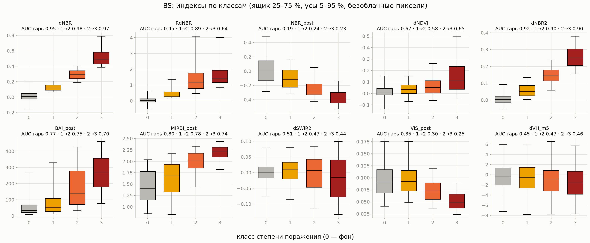

**Наблюдение:** AUC «гарь/фон» на безоблачных пикселях (`bs_b2_index_auc.csv`): RdNBR 0.950, dNBR 0.946, dNBR2 0.924, dMIRBI 0.919, dNIR 0.887 (обратный), dBAI 0.870, MIRBI_post 0.80, BAI_post 0.77, dNDVI 0.67; с облачными пикселями AUC dNBR падает до 0.931. Разделимость степеней — почти только dNBR: 1→2 0.976, 2→3 0.972 (dNBR2 0.90 / 0.90; RdNBR 0.89 / 0.64 — нормировка на NBR_pre вредит). Медианы dNBR по классам: 0.008 / 0.117 / 0.291 / 0.489. SAR и рельеф — AUC 0.45–0.55.
**Решение для модели/пайплайна:** ядро признаков — dNBR, dNBR2, dMIRBI, dNIR, NBR_post, BAI_post, MIRBI_post + яркость видимых (B4); RdNBR оставляем только для задачи «гарь/фон». Для степеней главное — точный dNBR и landcover (B3), поэтому степень можно выдавать отдельной «головой»/правилом поверх бинарного контура.

### B3. Пороги по типу покрова (ключевой пункт)
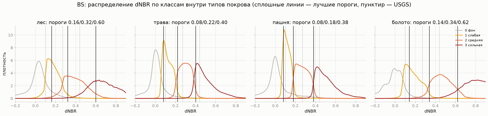

| Покров | Доля гари | Состав 1/2/3, % | Медиана dNBR кл. 1 / 2 / 3 | Лучшие пороги t1/t2/t3 | mIoU: USGS → глоб. опт. → по покрову |
|---|---|---|---|---|---|
| лес (10) | 3.0 % | 51/38/11 | 0.175 / 0.385 / 0.675 | **0.16 / 0.32 / 0.60** | 0.205 → 0.130 → **0.320** |
| трава (30) | 40.5 % | 37/39/24 | 0.115 / 0.295 / 0.475 | 0.08 / 0.22 / 0.40 | 0.400 → 0.500 → 0.501 |
| пашня (40) | 52.9 % | 42/36/22 | 0.115 / 0.265 / 0.485 | 0.08 / 0.18 / 0.38 | 0.291 → 0.366 → 0.374 |
| болото (90) | 3.5 % | 38/27/35 | 0.165 / 0.465 / 0.815 | **0.14 / 0.34 / 0.62** | 0.354 → 0.268 → **0.537** |
| все (пул) | 100 % | 40/37/23 | 0.117 / 0.291 / 0.489 | 0.08 / 0.20 / 0.40 | 0.310 → 0.368 → **0.391** |

**Наблюдение:** распределения dNBR внутри классов имеют **резкие ступенчатые края** — эталон построен порогами dNBR, и эти пороги разные для покровов: лес 0.16/0.32/0.60, болото 0.14/0.34/0.62, трава 0.08/0.22/0.40, пашня 0.08/0.18/0.38 (USGS: 0.10/0.27/0.44). Один глобальный набор порогов улучшает пул (mIoU 0.310 → 0.368), но **ухудшает** лес (0.205 → 0.130) и болото; пороги по покрову дают 0.391. Если контур гари известен точно («оракул»), один dNBR с порогами по покрову даёт **mIoU_sev = 0.877** (точность по пикселям 93.5 %; с глобальными порогами 0.829).
**Решение для модели/пайплайна:** landcover — обязательный признак; для бустинга добавляем взаимодействия «dNBR − t_k(landcover)» с опорными порогами из таблицы. Архитектура «контур отдельно, степень отдельно»: степень внутри предсказанного контура определяется dNBR и покровом почти детерминированно, поэтому ресурс обучения тратим на контур (см. B4). Baseline с одним порогом USGS заведомо плох — это же объясняет его IoU₁ = 0.17.

### B4. Ложные положительные и зона события
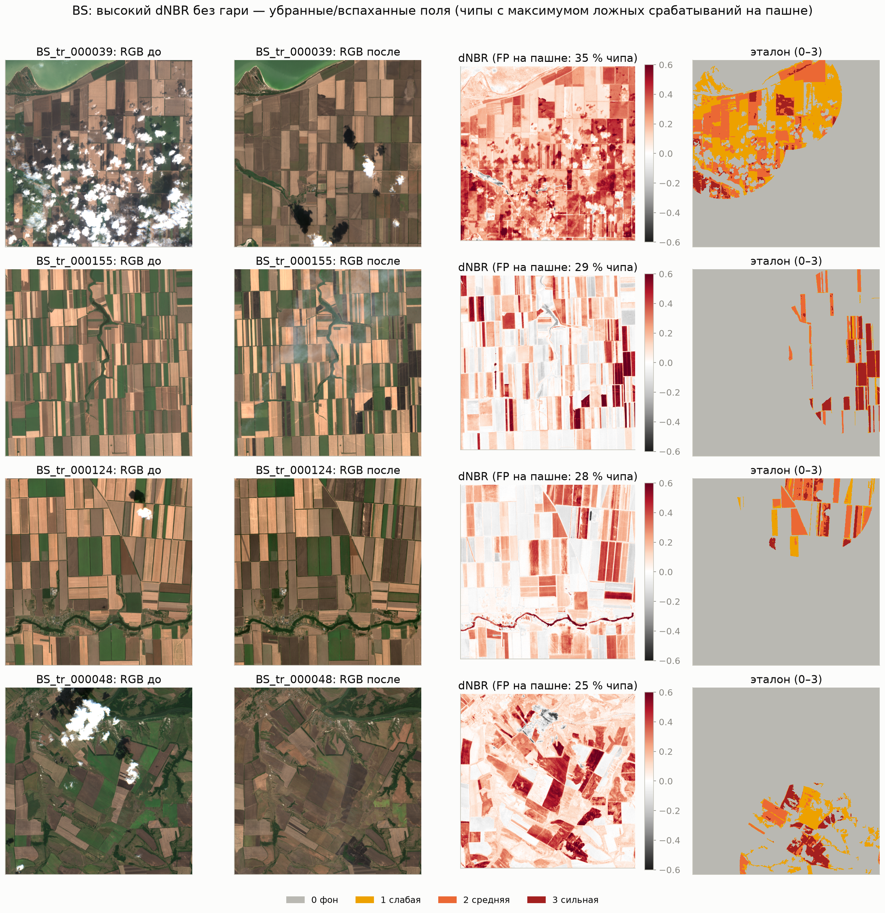

**Наблюдение:** правило `dNBR > 0.10`: полнота 0.861, но точность 0.395 — ложные срабатывания занимают 14.9 % всего фона. По покрову: пашня 54 %, трава 22 %, лес 11 %, вода 10 %; точность на лесе 0.17, на воде 0.0006; 39 % FP — под облаком/тенью по SCL. На пашне гарь от «не-гари с высоким dNBR» отличают (AUC): MIRBI_post 0.73, NBR_post 0.72, dVIS 0.71 (гарь темнеет на −0.044, поле не меняется: −0.004), BAI_post 0.70, NDVI_pre 0.62; SAR — 0.51–0.53. **Но главная причина FP — не спектр.** На примерах видно, что эталон обрезан дугой окружности: размечен только «свой» пожар (один `fire_event_id` на чип) внутри буфера события, а соседние поля с тем же dNBR — фон. Оракул (`bs_b4b_event_zone_oracle.csv`): те же пороги dNBR, но только внутри охватывающей окружности гари — IoU_burn **0.355 → 0.619**, mIoU_sev 0.369 → 0.554; плюс исключение SCL 0/3/9/11 — 0.673 и 0.599.
**Решение для модели/пайплайна:** попиксельной модели недостаточно (потолок IoU_burn ≈ 0.50, см. B9) — нужна **пространственная модель** (U-Net с большим рецептивным полем либо двухэтапно: попиксельная вероятность → признаки объекта/расстояния до ядра гари), которая локализует событие: крупнейший компактный кластер сильного dNBR и его окрестность. Попиксельные признаки против полей: `dVIS`, `VIS_post`, `MIRBI_post`, `BAI_post`, `NDVI_pre`, landcover; вода (landcover 80 / SCL 6) → 0. Радиус охватывающей окружности — 2.1–5.6 км (медиана 4.1 км, 43 % площади чипа), её центр смещён от центра чипа на 1.1–4.3 км (медиана 2.8 км), у 88 чипов на дуге лежит ≥ 30 пикселей гари; вне окружности находится 69 % ложных срабатываний порога (`bs_b4b_event_zone.csv`), поэтому «обрезать по центру чипа» нельзя.

### B4c. Окружность события относительно чипа: годится ли центр чипа как приор
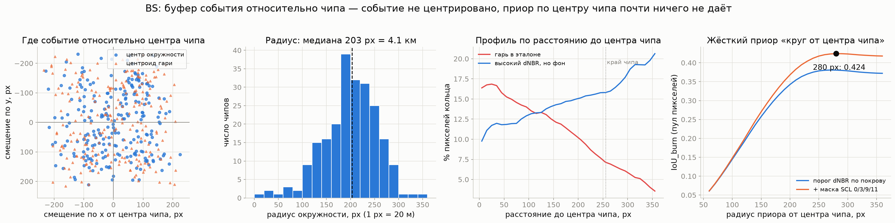
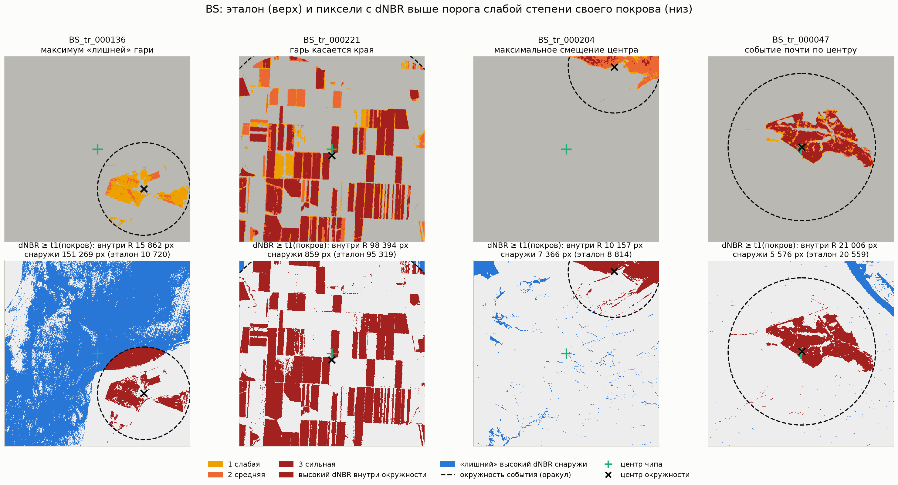

Все 224 чипа; окружность — минимальная охватывающая окружность эталонной гари (оракул), центр чипа — (255.5, 255.5). Таблицы: `bs_b4c_event_circle_summary.csv`, `bs_b4c_event_circle_per_chip.csv`, `bs_b4c_center_prior_radius.csv`, `bs_b4c_burn_profile_by_distance.csv`. Быстрый пересчёт: `python eda/eda_bs.py --only-b4c` (~1.5 мин).

| Величина | q05 | q25 | медиана | q75 | q95 | max |
|---|---|---|---|---|---|---|
| Центр окружности, смещение по x, px | −166 | −77 | +6 | +84 | +154 | 228 (по модулю) |
| Центр окружности, смещение по y, px | −173 | −94 | −3 | +100 | +155 | 231 (по модулю) |
| Центр окружности, модуль смещения, px | 37 | 98 | **140** | 175 | 230 | 287 |
| Центроид гари, модуль смещения, px | 50 | 115 | 159 | 193 | 264 | 297 |
| Радиус окружности, px | 105 | 166 | **203** | 236 | 280 | 349 |
| Радиус окружности, км | 2.1 | 3.3 | **4.1** | 4.7 | 5.6 | 7.0 |
| Самый дальний пиксель гари от центра чипа, px | 244 | 291 | 318 | 350 | 361 | 361 (угол чипа) |

| Радиус приора от центра чипа | 150 px | 200 px | 250 px | **280 px** | 300 px | без приора |
|---|---|---|---|---|---|---|
| Доля площади чипа внутри | 27 % | 48 % | 75 % | 88 % | 94 % | 100 % |
| Доля эталонной гари внутри | 37 % | 61 % | 84 % | 94 % | 97 % | 100 % |
| IoU_burn (порог dNBR по покрову + маска SCL) | 0.270 | 0.368 | 0.418 | **0.424** | 0.423 | 0.418 |

**Наблюдение:** (1) событие **не центрировано**: смещение центра окружности по x и y симметрично вокруг нуля (медианы +6 и −3 px) и почти равномерно заполняет ±170 px; модуль смещения — медиана 140 px (2.8 км), 95-й перцентиль 230 px, максимум 287 px; у 43 % чипов центр сдвинут больше чем на четверть чипа хотя бы по одной оси. Центр чипа лежит внутри окружности у 74 % чипов, но сам является гарью только у 17 %. (2) Радиус: медиана 203 px = 4.1 км, 5–95 % = 105–280 px (2.1–5.6 км); у 29 чипов радиус больше полуширины чипа (256 px), у 9 — меньше 100 px. Целиком в чип окружность помещается лишь у **6 %** чипов. (3) Эталонная гарь **касается края чипа у 194 чипов из 224 (86.6 %)**, у 105 чипов — двух и более сторон: чип вырезает часть события, поэтому видимая окружность — нижняя оценка настоящего буфера, а гарь доходит до самых углов (медиана самого дальнего пикселя гари — 318 px от центра чипа). (4) «Лишняя» гарь — пиксели с dNBR не ниже порога слабой степени своего покрова дальше R от центра окружности — есть на **всех 224 чипах** (на 214 — больше 1 000 px, медиана 19 тыс. px на чип); в сумме **6.10 млн px против 5.91 млн px эталона (×1.03)**, после маски SCL 0/3/9/11 — 5.18 млн (×0.88); на 110 чипах лишних пикселей больше, чем эталонных. Это и есть главный источник штрафа по IoU_burn. (5) Слабая связь с центром чипа всё же есть: доля гари в кольце 0–50 px от центра — 16.5 %, в углах (> 300 px) — 4.7 %; доля ложного высокого dNBR, наоборот, растёт от 10 % к 20 %. Но жёсткий приор «круг от центра чипа» почти бесполезен: лучший радиус 280 px даёт IoU_burn 0.424 против 0.418 без приора (+0.006, срезаются только углы), а радиус 200 px теряет 39 % эталона и роняет IoU до 0.368. Для сравнения, оракул-окружность события даёт 0.673 (B4).
**Решение для модели/пайплайна:** жёсткий приор по центру чипа **не использовать** — ни обрезку кругом, ни центральный кроп: событие смещено на 140 px при радиусе 203 px, 87 % гарей уходят за край чипа. Допустим только мягкий вариант — «расстояние до центра чипа» как один из входных признаков (в бустинге — признак, в CNN — координатный канал): профиль 16.5 % → 4.7 % даёт небольшой выигрыш, максимум того, что можно из него извлечь жёстким порогом, — +0.006 IoU при радиусе 280 px (обрезка углов), и эту обрезку можно применять как дешёвую постобработку. Основной ресурс (+0.25 IoU_burn) — локализация **самого события** по содержимому: модель должна находить компактное ядро сильного dNBR и подавлять высокий dNBR вдали от него. Для CNN: обучение на полных чипах 512×512 без случайных кропов, ломающих геометрию «ядро + буфер» (или кропы ≥ 384 px), рецептивное поле ≥ 200 px (радиус буфера); аугментации поворотами/отражениями допустимы (распределение смещений симметрично), сдвиги — нет смысла ограничивать. Для двухэтапной схемы: признаки «расстояние до крупнейшей компоненты сильного dNBR» и «расстояние до взвешенного центроида dNBR чипа» вместо расстояния до центра чипа; радиус отсечения от найденного центра события — 280 px (95-й перцентиль R), а не медианные 203 px, чтобы не терять полноту.

### B5. Облака, тени, SCL
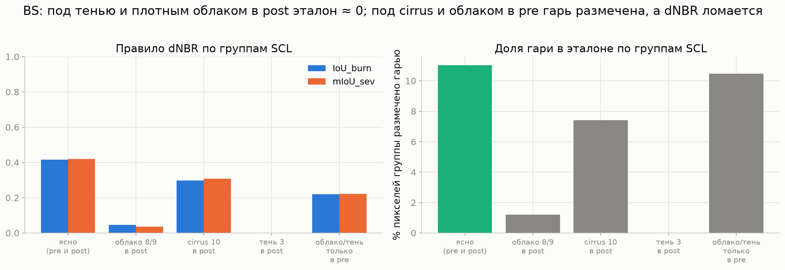

**Наблюдение:** облачные классы SCL {3, 8, 9, 10}: 12.4 % пикселей pre, 15.1 % post, 25.0 % хотя бы в одном. Эталон под частью классов **обнулён**: тень (SCL_post = 3) — 0 % гари, высокое облако (9) — 0.004 %, nodata (0) и снег (11) — 0 %, среднее облако (8) — 1.7 % при 11.0 % на ясных пикселях. Под cirrus (10) гарь размечена (7.4 %), под облаком **в pre** — тоже (10.5 %; SCL_pre = 8 → 13.5 %), но dNBR там ломается: AUC 0.804 против 0.944, IoU_burn правила 0.22 против 0.42. Классы «dark» (2) и «unclassified» (7) — наоборот, индикаторы гари: 30 % и 32 % пикселей сгоревшие, из них 57–72 % — сильная степень (SCL принимает свежую гарь за тёмную поверхность). По чипам: cloud_frac ≤ 5 % — IoU_burn 0.401, 5–25 % — 0.352, > 25 % — 0.181.
**Решение для модели/пайплайна:** жёсткая маска только там, где эталон пуст: `SCL_post ∈ {0, 3, 9, 11}` → предсказание 0 (SCL_post = 8 — решает модель). Остальной SCL — **признак** (one-hot pre и post), не маска: под cirrus и под облаком в pre гарь размечена, и модель должна опираться там на post-признаки (NBR_post, BAI_post, MIRBI_post) и SAR, а не на dNBR. Облачные чипы из оценки не исключаются, поэтому в аугментации не вырезаем их из обучения.

### B6. Sentinel-1
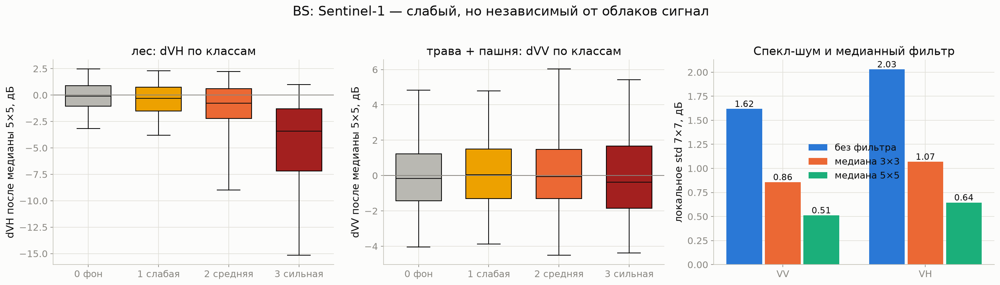

**Наблюдение:** спекл: локальное std на однородном фоне VV 1.62 дБ → 0.86 (медиана 3×3) → 0.51 (5×5); VH 2.03 → 1.07 → 0.64; разность dVH 2.76 → 0.83 дБ. Сигнал слабый и зависит от покрова: AUC dVH (5×5) «гарь/фон» — лес 0.41, трава 0.42, пашня 0.48, болото 0.27 (значения < 0.5 = падение рассеяния); в лесу медиана dVH по классам −0.08 / −0.32 / −0.76 / **−3.39 дБ**, AUC «средняя→сильная» 0.74. dVV на траве/пашне — 0.48–0.53 (сигнала нет). **12.8 % пикселей без S1** (нули): 31 чип пуст более чем наполовину, 47 — частично.
**Решение для модели/пайплайна:** SAR используем только после медианного фильтра 5×5 (шум падает в 3.3 раза), как разности dVH, dVV и VH/VV; ждать от него пользы стоит для леса/болота и для сильной степени, а также под облаками. Обязательны флаг «S1 отсутствует» и устойчивость модели к пропуску (NaN для бустинга; для CNN — нулевой канал + канал-маска, dropout канала S1 в аугментации). В отчёте: SAR — независимая от облачности верификация контуров сильных лесных гарей, а не основной детектор.

### B7. Рельеф

**Наблюдение:** slope принимает всего 10 целых значений, на 175 чипах из 224 он константа (степь); медиана 2°, 95-й перцентиль 6°. AUC slope: гарь/фон 0.47, 1→2 0.49, 2→3 0.53 (в лесу 0.62); dem — 0.49 / 0.46 / 0.55. Экспозиции в данных нет (`bs_b7_relief_quantiles.csv`).
**Решение для модели/пайплайна:** в CNN рельеф не подаём (экономия каналов и времени чтения AUX: нужен только landcover). В бустинге slope оставляем как дешёвый признак для леса; dem исключаем — информации о гари нет, а как «паспорт места» он провоцирует переобучение.

### B8. Даты и фенология
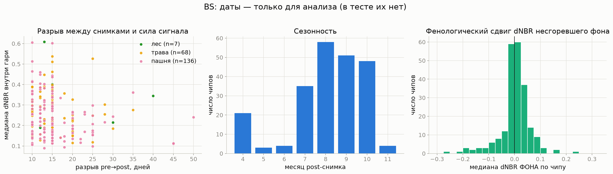

**Наблюдение:** разрыв pre→post 10–50 дней, медиана 15. Чем он больше, тем слабее сигнал: ρ Спирмена (разрыв, медиана dNBR гари) = −0.17 (p = 0.011), на пашне −0.23 (p = 0.007); медиана dNBR гари 0.273 при разрыве ≤ 15 дней против 0.228 при > 25. С площадью гари связи нет (ρ = 0.09, p = 0.20). Фон тоже «плывёт» по сезону: медиана dNBR **несгоревшего** фона по чипу от −0.106 до +0.089 (5–95 %; std 0.059), в апреле и ноябре −0.05, в июне +0.05 — это сопоставимо с порогом слабой степени 0.08. Годы: 2020 — 71 чип, 2024 — 82, остальные 11–31.
**Решение для модели/пайплайна:** даты в тесте недоступны и как признак не используются. Вместо них — **нормировка по сцене**: признаки `dNBR − медиана dNBR чипа` и робастный z-score dNBR по чипу компенсируют фенологический сдвиг и разный разрыв между снимками без знания дат. Вывод в отчёт: травяные гари зарастают за 2–4 недели, поэтому слабая степень на траве/пашне — самый трудный класс (IoU₁ 0.22–0.25 у всех вариантов).

### B9. Валидация
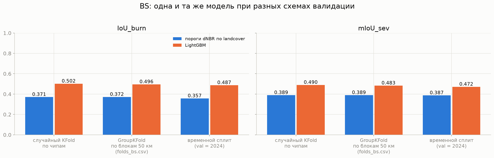

**Наблюдение:** 224 чипа = 224 разных пожара, 96 блоков 50×50 км; bbox чипов не пересекаются ни в одной паре, ни один блок не разделён между фолдами; фолды сбалансированы (44–45 чипов, доля гари 9.9–10.3 %). Ближайший чип из другого фолда: медиана 22.9 км при групповой схеме против 14.5 км при случайной. Оценки (`bs_b9_kfold_vs_group.csv`): пороги dNBR по покрову — IoU_burn 0.371 (случайный) / 0.372 (групповой) / 0.357 (2024), mIoU_sev 0.389 / 0.389 / 0.387; LightGBM на 16 попиксельных признаках — IoU_burn 0.502 / 0.496 / 0.487, mIoU_sev 0.490 / 0.483 / 0.472. Валидация 2024: 82 чипа, гари меньше (8.1 % против 10.1 %).
**Решение для модели/пайплайна:** пространственная утечка мала (−0.006), временной сдвиг заметнее (−0.015…−0.018) — подтверждает политику «GroupKFold по блокам + временной сплит, улучшение засчитывается при росте на обоих». Попиксельный бустинг — нижняя планка для BS-моделей (BS-часть Score 0.318 на GroupKFold против 0.247 у порогов).

---

## Часть D. Сдвиг test vs train

Источник: `reports/test_vs_train.md` (скрипт `eda/test_vs_train.py`, ветка main, коммит c66d481). Сравнивается только содержимое чипов и поля тестового `meta.csv`; геопривязка и даты теста не используются и не восстанавливаются. Train: 420 AF + 224 BS, test: 180 AF + 89 BS.

| Показатель | train | test | Δ |
|---|---|---|---|
| AF: доля ночных чипов | 30.2 % | 38.3 % | +8.1 п.п. |
| AF: I4 день, p99 / p99.9, K | 323.0 / 327.7 | 329.8 / 334.1 | +6.8 / +6.4 |
| AF: I4−I5 день, p99, K | 48.8 | 44.9 | −3.9 |
| AF: I4−I5 ночь, p99.9, K | 16.9 | 21.3 | +4.4 |
| AF: срабатываний заглушки `I4>320, Δ>15` на дневной чип (среднее / медиана) | 214 / 45 | 1 141 / 67 | ×5.3 / ×1.5 |
| AF: доля NaN в I4 / чипов с NaN | 8.3 % / 54.0 % | 9.4 % / 57.8 % | +1.1 / +3.7 п.п. |
| AF: покров — пашня / трава / болото / лес, % | 52.6 / 20.6 / 2.0 / 15.2 | 45.5 / 28.0 / 6.1 / 9.5 | −7.1 / +7.4 / +4.1 / −5.7 |
| BS: чипов с cloud_frac > 0.25 | 10.7 % | 25.8 % | +15.1 п.п. |
| BS: SCL-облака pre / тени post, % пикселей | 10.9 / 1.5 | 14.8 / 2.1 | +4.0 / +0.6 |
| BS: valid_frac, среднее | 0.919 | 0.879 | −0.040 |
| BS: dNBR p95 / p99 | 0.351 / 0.564 | 0.420 / 0.659 | +0.069 / +0.095 |
| BS: доля пикселей dNBR > 0.10 | 22.2 % | 27.0 % | +4.9 п.п. |
| BS: покров — пашня / трава / болото, % | 50.4 / 33.8 / 3.5 | 38.4 / 43.1 / 7.3 | −12.1 / +9.4 / +3.8 |

Структура файлов, dtype и имена каналов в тесте идентичны train; насыщения I4 нет ни там, ни там.

**Наблюдение 1 (AF, тёплый дневной фон):** хвост дневного I4 в тесте на 6–7 K выше, а хвост I4−I5 — ниже; заглушка срабатывает в 5.3 раза чаще в среднем, но лишь в 1.5 раза по медиане — сдвиг создают несколько очень жарких сцен. В train тот же эффект уже виден: 13 126 «горячих, но не огонь» пикселей, 88 % — пашня и трава (A2).
**Решение:** порог по I4 без контекста непереносим. Абсолютные пороги — только генератор кандидатов (A2), решение принимают относительные признаки: разность и z-score к фону окна (A3), I4 минус медиана чипа (A8), I3/I2 против яркого грунта (A4). Порог вероятности выбирается с оглядкой на временной сплит, где он уже «съезжает» (A9).

**Наблюдение 2 (AF, больше ночи и больше NaN):** ночных чипов 38 % против 30 %, хвост ночного I4−I5 тяжелее (+4.4 K на p99.9), NaN чуть больше.
**Решение:** вес ночной ветки в итоговом F1 на тесте выше, чем в train, а именно ночью сосредоточены ложные срабатывания на техногене (A5) и максимальна польза контекста (AUC 0.81 → 0.89, A3) — ночная модель/калибровка отдельная. Обработка NaN по A7b обязательна: это 9.4 % пикселей теста.

**Наблюдение 3 (покров смещён от пашни к траве и болоту)** в обоих модулях; болота в тесте в 2–3 раза больше.
**Решение:** landcover — признак, а не фильтр. Для BS это критично: пороги dNBR для болота (0.14/0.34/0.62) почти вдвое выше, чем для пашни (B3), и глобальные пороги на болоте теряют половину mIoU (0.537 → 0.268). Болото в train — всего 3.5 % гари, поэтому при обучении ему даём повышенный вес, а метрики отчитываем по покровам.

**Наблюдение 4 (BS, тест облачнее):** облачных чипов (> 25 %) в 2.4 раза больше. В train правило dNBR на таких чипах даёт IoU_burn 0.181 против 0.401 на ясных (B5).
**Решение:** политика SCL из B5 (жёсткий ноль под SCL_post 0/3/9/11, остальной SCL — признак, опора на post-индексы и SAR под cirrus и при облаке в pre) на тесте весит больше, чем показывает train-валидация; в экспериментах метрики на чипах с cloud_frac > 25 % отчитываются отдельной строкой, такие чипы получают повышенный вес при обучении.

**Наблюдение 5 (BS, хвост dNBR тяжелее):** dNBR > 0.10 у 27 % пикселей теста при ~10 % гари в эталоне train.
**Решение:** ложной «гари» от глобальных порогов в тесте будет ещё больше; помогают нормировка dNBR на медиану чипа (B8), признаки против полей (B4) и, главное, локализация события пространственной моделью (B4: вне буфера события лежит 69 % ложных срабатываний порога).

---

## Часть C. Сводная таблица «наблюдение → решение»

| # | Модуль | Наблюдение (число) | Решение |
|---|---|---|---|
| 1 | AF | Огонь — 0.035 % пикселей; 40.7 % компонент одиночные, в них 13.7 % огня | Обучение на кандидатах + случайном фоне; одиночные пиксели не удалять; порог по пулу OOF |
| 2 | AF | Раздельные пороги день (`I4>329, Δ>25`) / ночь (`I4>295, Δ>10`): F1 0.921 против 0.244 у единого порога | Новый rule-baseline и генератор кандидатов (99.6 % полноты на 2.2 % пикселей); флаг день/ночь обязателен |
| 3 | AF | Насыщения нет: max I4 = 358.2 K, 0 % пикселей ≥ 367 K; 33 px огня с I4−I5 < 10 K (ядра пожаров) | Признак насыщения не нужен; добавить I5 и заполнение ядра кластера |
| 4 | AF | Контекст: ночью AUC 0.81 → 0.89, днём сырой I4 уже 0.999; «чистый» фон +0.02–0.07 AUC | Окна 7/11/15, разность и z-score, фон без кандидатов; 5×5 не берём |
| 5 | AF | Ночью I1–I3 = NaN в 100 % пикселей; днём I3/I2 даёт AUC 0.82 против яркого грунта | Ночью отражательные каналы не использовать (константа + флаг); днём — признаки блика/грунта |
| 6 | AF | Ночные FP: 52 % на застройке (огонь — 20 %), Δ 15.6 K против 28.1 K; повторяющиеся ночные аномалии ×38.6 обогащены застройкой | Признаки доли застройки в окне, размера кластера, контраста; карту повторяемости на тест не переносить (нет геопривязки, запрещено) |
| 7 | AF | NaN в I4/I5 при valid = 1 — 7.6 % пикселей, 227 неполных чипов (не 14); 22 % огня в 3 px от невалидных | Маска = valid и isfinite; фон только по валидным соседям; признак расстояния до невалидного |
| 7b | AF | NaN в I4/I5 — строки bow-tie: 0 % при sensor_zenith < 36°, 21–24 % при 55–70° (ρ = 0.94); 11.1 % огня — соседи NaN | NaN → 0 без эрозии соседей; свёртки с нормировкой на валидных; канал-маска и sensor_zenith в признаках; F1 отдельно для угла > 45° |
| 8 | AF | Спутники не различаются (p = 0.27 / 0.95), разброс фона между чипами 10 K | Без поправок по спутнику; нормировка на медиану чипа |
| 9 | AF | KFold 0.913 = GroupKFold 0.913; временной сплит 0.877, порог съезжает 0.45 → 0.10 | Временной сплит — главный индикатор; порог выбирать компромиссно |
| 10 | BS | Компонент гари < 25 px нет (4 из 4 997); дырки — 4 % площади гари | Удалять компоненты < 25 px; дырки не заливать |
| 11 | BS | Пороги dNBR в эталоне зависят от покрова: лес 0.16/0.32/0.60, пашня 0.08/0.18/0.38; глобальные пороги ухудшают лес 0.205 → 0.130 | landcover — обязательный признак; признаки «dNBR − порог(landcover)» |
| 12 | BS | При известном контуре один dNBR даёт mIoU_sev 0.877; по всему чипу IoU_burn лишь 0.36 | Раздельно: контур (основные усилия) и степень (dNBR × landcover) |
| 13 | BS | Эталон обрезан буфером события: оракул-окружность поднимает IoU_burn 0.355 → 0.619 (→ 0.673 с SCL) | Пространственная модель (U-Net / двухэтапная), локализующая событие; попиксельной недостаточно |
| 13b | BS | Событие не центрировано: смещение центра окружности — медиана 140 px при радиусе 203 px; гарь касается края у 86.6 % чипов; «лишнего» высокого dNBR вне окружности 6.10 млн px против 5.91 млн px эталона; приор-круг от центра чипа даёт максимум +0.006 IoU (280 px) | Жёсткий приор по центру чипа не использовать; расстояние до центра — только мягкий признак; локализовать ядро события по dNBR, рецептивное поле ≥ 200 px, радиус отсечения от найденного центра 280 px |
| 14 | BS | FP `dNBR>0.1`: 54 % пашня; гарь темнеет (dVIS −0.044), убранное поле нет (−0.004); AUC dVIS 0.71, MIRBI_post 0.73 | Признаки dVIS, VIS_post, MIRBI_post, BAI_post, NDVI_pre; вода → 0 |
| 15 | BS | Под SCL_post 0/3/9/11 гари в эталоне 0 %; под cirrus 7.4 % и под облаком в pre 10.5 % — размечена | Жёсткая маска только {0, 3, 9, 11}; остальной SCL — признак; под облаком опираться на post-индексы и SAR |
| 16 | BS | Спекл VH 2.03 → 0.64 дБ после медианы 5×5; в лесу dVH сильной степени −3.4 дБ; 12.8 % пикселей без S1 | SAR только после фильтра 5×5; флаг отсутствия S1, dropout канала |
| 17 | BS | Фон dNBR по чипу от −0.106 до +0.089 (фенология), ρ(разрыв, dNBR гари) = −0.17 | Нормировка dNBR на медиану чипа вместо дат |
| 18 | BS | slope — константа на 175 из 224 чипов, AUC 0.47–0.53 | Рельеф в CNN не подавать; из AUX читать только landcover (быстрее инференс) |
| 19 | AF+BS | Тест: дневной I4 p99 +6.8 K (заглушка ×5.3 FP), ночных чипов 38 % против 30 %, облачных BS-чипов 25.8 % против 10.7 %, болота в 2–3 раза больше | Решения на относительных признаках; отдельная ночная ветка; политика SCL; вес болота и облачных чипов; метрики по покровам |
| 20 | BS | Случайный KFold 0.502 → GroupKFold 0.496 → 2024 год 0.487 (IoU_burn, LightGBM) | Оба сплита в каждом эксперименте; попиксельный бустинг — нижняя планка |

## Замечания к данным и описанию

- `t2m` в AF AUX хранится в кельвинах, а не в °C (CLAUDE.md §4).
- «14 чипов с valid_frac < 1» верно только для канала `valid`; NaN в I4/I5 при `valid = 1` есть на 223 чипах (строки bow-tie при sensor_zenith > 36°), всего неполных чипов 227.
- Насыщение I4 ≈ 367 K в выборке не встречается (max 358.2 K).
- Каналы I1–I3 ночью не «бессмысленны», а полностью отсутствуют (NaN).
- В BS-масках нет значения 255; в S1 12.8 % пикселей — нули (нет съёмки).
