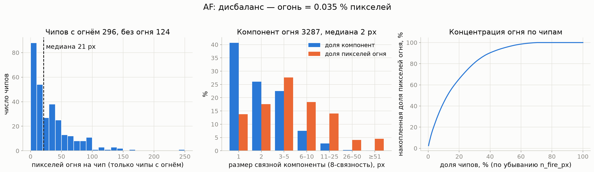
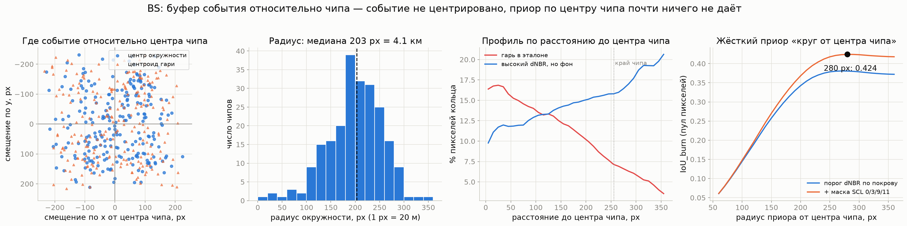
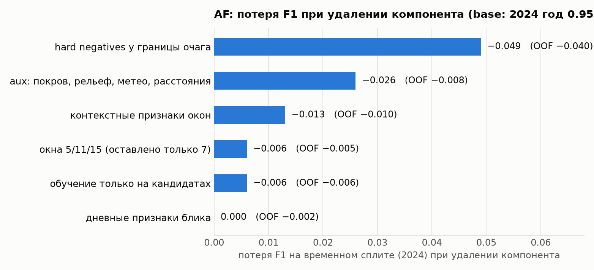
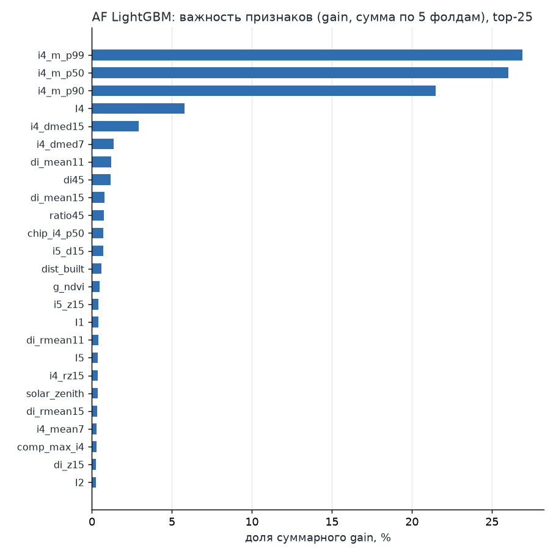
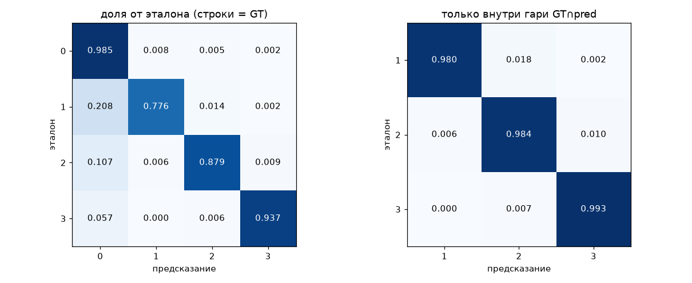
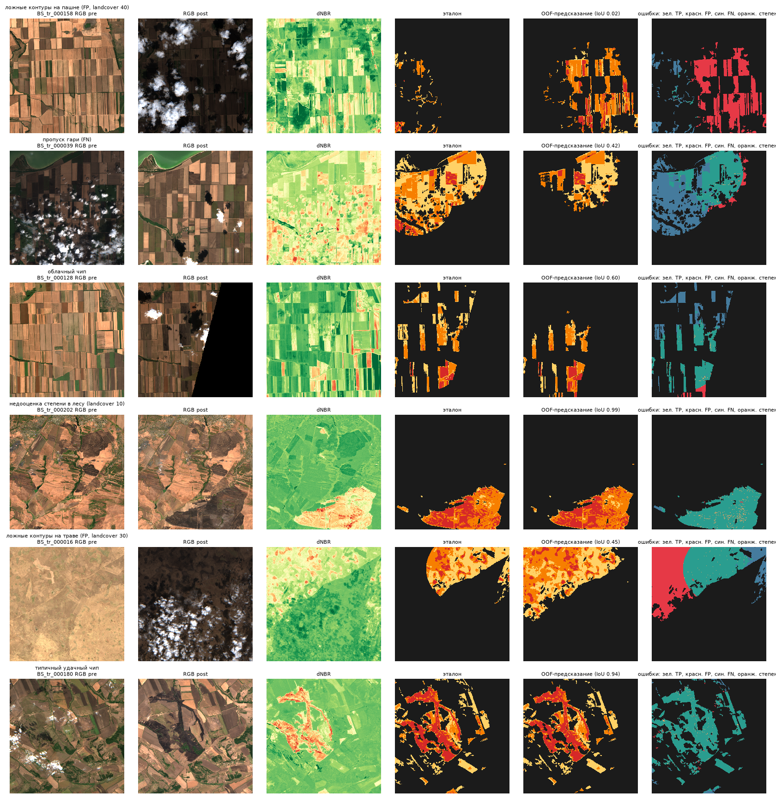
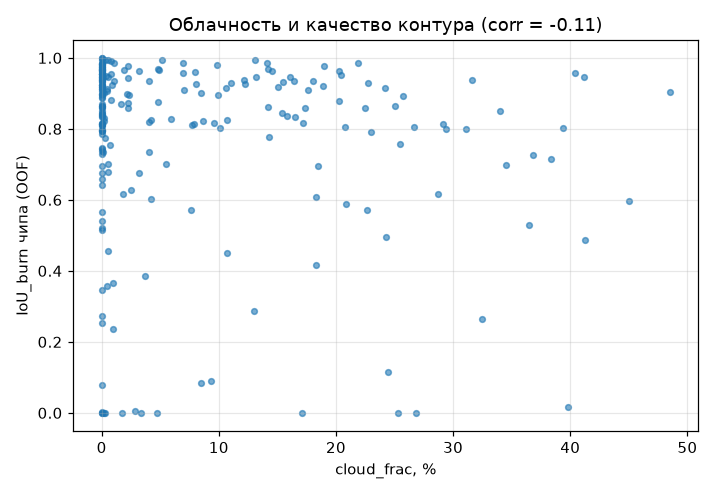
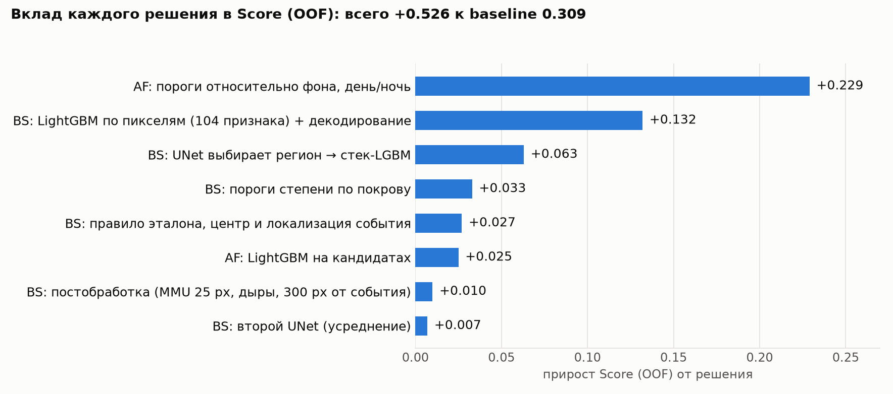
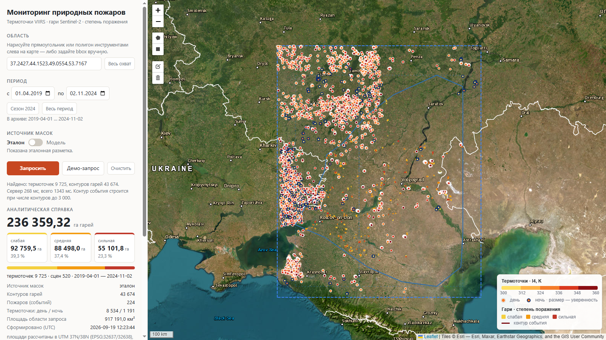
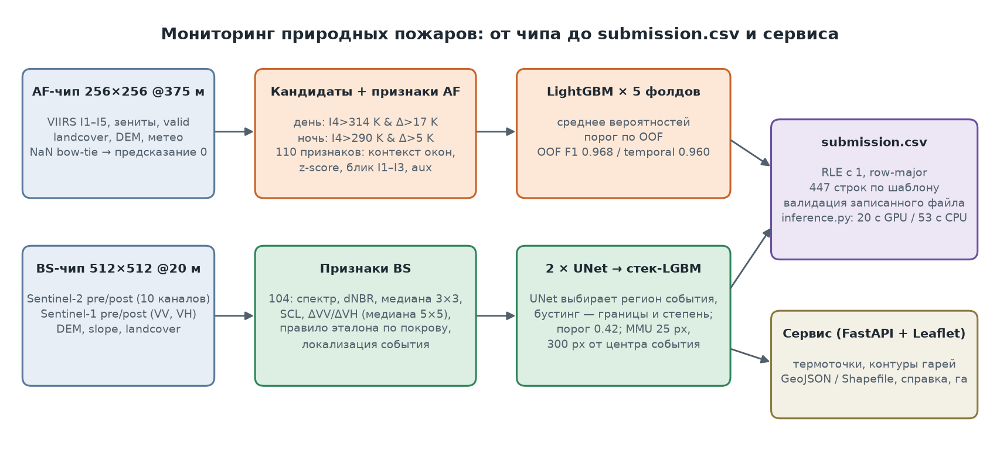

# Мониторинг природных пожаров: активное горение и степень поражения

**КосмоХакатон 2026, кейс «Мониторинг природных пожаров». Команда: SAMARKAND — Кашин Глеб Игоревич, Закон Марк Михайлович, Панин Матвей Евгеньевич, Ожигов Егор Сергеевич, Ведерников Фёдор Яковлевич**

> Все числа документа берутся из `reports/final_numbers.md` (единый источник для отчёта, README и слайдов).
> Итог: **Score 0.8344** на групповой валидации и **0.8392** на временной (baseline 0.3088); public — {{FINAL:SCORE_PUBLIC}}.

Содержание: 1. Постановка и протокол оценки · 2. Разбор данных · 3. Baseline и отправная точка · 4. Модуль AF ·
5. Модуль BS · 6. Эксперименты и сравнения · 7. Инженерные и предметные решения · 8. Сервис · 9. Итоговое решение ·
10. Выводы и развитие · 11. Воспроизводимость · 12. Лицензии и источники

---

## 1. Постановка и протокол оценки

### 1.1. Две задачи

| | AF — активное горение | BS — степень поражения |
|---|---|---|
| Вход | чип VIIRS 256×256 @375 м: I1–I5, зенитные углы Солнца и сенсора, `valid`; AUX: landcover, DEM, t2m, rh2m, ветер | чип 512×512 @20 м: Sentinel-2 до/после (10 каналов + SCL), Sentinel-1 до/после (VV, VH), DEM, slope, landcover |
| Выход | маска 0/1: пиксель **природного** горения; техногенные термоаномалии (факелы, ТЭЦ, металлургия) — 0 | маска 0/1/2/3: фон / слабая / средняя / сильная степень |
| Train | 420 чипов, 70 тайлов, 2019–2024 | 224 чипа = 224 пожара |
| Test | 180 чипов | 89 чипов |

Результат — `submission.csv` из 447 строк (по одной на AF-чип и по три на BS-чип) в формате RLE: нумерация пикселей с 1,
построчно; серии по возрастанию, не пересекаются и не соприкасаются; пустая маска — `""`. Официальных скриптов RLE и
метрики организаторы не выдавали — формат реализован строго по тексту ТЗ, каждое правило покрыто тестом на ручных примерах
(`tests/test_rle_spec.py`) и подтверждено первой же отправкой на лидерборд.

### 1.2. Метрика

Пиксели всех чипов объединяются в общий пул (микро-усреднение):

```
F1_af    = 2PR/(P+R) по пикселям класса 1 на AF-чипах
IoU_burn = TP/(TP+FP+FN) бинарной маски (pred>0 vs gt>0) на BS-чипах
mIoU_sev = (IoU(1) + IoU(2) + IoU(3)) / 3 на BS-чипах
Score    = 0.35·F1_af + 0.35·IoU_burn + 0.30·mIoU_sev
```

Следствия микро-усреднения: крупные пожары весят больше мелких; порог модели нужно подбирать по пулу пикселей всех
чипов, а не усреднять по чипам; пустой чип с одним ложным пикселем почти ничего не стоит, а ложный контур на пол-чипа — дорого.

### 1.3. Почему валидация групповая и временная

Public и private разделены **одновременно по территории и по времени**, а в train только 2019–2024 годы при заявленных
сезонах 2019–2025 — в private почти наверняка есть 2025 год. При этом один тайл AF снят в среднем 6 раз, и случайное
разбиение положило бы одну и ту же местность и в обучение, и в проверку. Протокол зафиксирован до начала экспериментов:

- `configs/folds_af.csv` — GroupKFold-5, группа = тайл (70 тайлов, ни один не разделён между фолдами; в каждом фолде 84 чипа
  и 1 920–1 953 пикселя огня);
- `configs/folds_bs.csv` — GroupKFold-5, группа = пространственный блок 50×50 км (96 блоков; ближайший чип из другого
  фолда — медиана 22.9 км против 14.5 км при случайном разбиении);
- временной сплит: обучение ≤ 2023, проверка — 2024; порог и гиперпараметры берутся с GroupKFold-OOF и к 2024 году не подгоняются;
- seed 42 везде, LightGBM `deterministic=True`, фиксированное число потоков.

**Улучшением считается только прирост на обоих сплитах сразу.** Это правило отсеяло несколько «побед» размером в шум (п. 4.4).
EDA подтвердила расстановку приоритетов: случайный и групповой KFold дают одинаковые оценки (AF 0.913 и 0.913; BS 0.502 и
0.496), а временной сплит стабильно ниже (AF 0.877, BS 0.487) — сдвиг во времени важнее пространственной утечки, поэтому
временной сплит считается основным индикатором private.

---

## 2. Разбор данных (EDA)

Полная версия с 20 рисунками и 46 таблицами — `reports/eda.md`, `eda/tables/`; всё пересчитывается скриптами
`eda/eda_af.py`, `eda/eda_bs.py`, `eda/test_vs_train.py`. Здесь — факты, которые изменили решение.

### 2.1. AF

**Дисбаланс.** Огонь — 9 725 пикселей из 27.5 млн (0.035 %); 124 чипа из 420 пустые; на позитивном чипе медиана 21 px.
40.7 % связных компонент — одиночные пиксели, в них 13.7 % всего огня: морфологическая чистка одиночных пикселей
заведомо вредна.


*Рис. 1. Доля огня и размеры очагов: почти половина очагов — один пиксель.*

**Эталон — это пороги кандидатов, разные для дня и ночи.** Правило `день: I4 > 329 K и I4−I5 > 25 K; ночь: I4 > 295 K и
I4−I5 > 10 K` даёт F1 0.921 против 0.244 у единого порога. Днём сырой I4 отделяет огонь от «горячего не-огня» с AUC
0.999, и контекст окна его не улучшает; ночью наоборот — сырые каналы дают 0.81, а разность с фоном окна 0.89.


*Рис. 2. Раздельные пороги для дня и ночи воспроизводят эталон на F1 0.921.*

**Техноген виден ночью.** 52 % ночных ложных срабатываний лежат на застройке (у настоящего огня — 20 %), их контраст
вдвое слабее (медиана I4−I5 15.6 K против 28.1 K); пиксели, горячие в нескольких ночных пролётах и ни разу не
размеченные огнём, обогащены застройкой в 38.6 раза. Дневные «повторяющиеся аномалии» на 80 % — прогретая пашня, а не техноген.

**NaN — это строки bow-tie, а не облака.** NaN в I4/I5 при `valid = 1` есть на 223 чипах (53 %), 7.65 % пикселей;
доля NaN — 0 % при угле сенсора < 36° и 21–24 % при 55–70° (ρ = 0.94). 11.1 % пикселей огня — прямые соседи NaN,
поэтому «эрозия» вокруг невалидных пикселей срезала бы огонь.


*Рис. 3. Доля NaN растёт с углом сенсора — это удалённые перекрывающиеся строки на краю полосы обзора.*

Кроме того: насыщения I4 в данных нет (максимум 358.2 K); ночью каналы I1–I3 отсутствуют полностью (100 % NaN);
`t2m` записан в кельвинах; спутники SNPP / NOAA-20 / NOAA-21 статистически не различаются (p = 0.27 днём, 0.95 ночью),
зато разброс фона между чипами — 10 K.

### 2.2. BS

**Классы.** Фон / слабая / средняя / сильная — 89.9 / 4.0 / 3.7 / 2.3 % пикселей; гарь занимает в среднем 10.1 % чипа,
чипов без гари нет. Компонент гари мельче 25 px (1 га) в эталоне нет — 4 из 4 997.

**Степень — это пороги dNBR, зависящие от покрова.** AUC dNBR: гарь/фон 0.946, слабая→средняя 0.976, средняя→сильная 0.972.
Оптимальные пороги по типу покрова:

| Покров (доля гари) | t1 / t2 / t3 | mIoU: USGS → по покрову |
|---|---|---|
| лес (3.0 %) | 0.16 / 0.32 / 0.60 | 0.205 → 0.320 |
| болото (3.5 %) | 0.14 / 0.34 / 0.62 | 0.354 → 0.537 |
| трава (40.5 %) | 0.08 / 0.22 / 0.40 | 0.400 → 0.501 |
| пашня (52.9 %) | 0.08 / 0.18 / 0.38 | 0.291 → 0.374 |
| USGS (baseline) | 0.10 / 0.27 / 0.44 | — |

При **известном** контуре один dNBR с порогами по покрову даёт mIoU_sev 0.877 (точность 93.5 %): степень почти решена,
узкое место — контур.


*Рис. 4. Для леса и болота пороги степени в 1.5–2 раза выше, чем для травы и пашни.*

**Эталон размечает только «свой» пожар.** Порог dNBR по всему чипу даёт IoU_burn 0.355; если ограничить предсказание
окружностью события (оракул по эталону) — 0.619, с маской SCL — 0.673. Такие же по спектру убранные поля и чужие гари вне
буфера (r ≈ 4 км) размечены фоном: «лишнего» высокого dNBR вне окружности 6.10 млн px против 5.91 млн px эталонной гари.
Попиксельной модели недостаточно — нужна пространственная, локализующая событие.

**Центр чипа — не приор (B4c).** Событие не центрировано: центроид гари смещён от центра чипа на 159 px по медиане
(до 297 px), гарь касается края чипа у 86.6 % чипов, радиус видимой окружности 105–349 px. Обрезка кругом 280 px от
центра даёт лишь 0.418 → 0.424. Вывод: предсказание по центру чипа не обрезать, расстояние до центра — максимум мягкий признак.


*Рис. 5. Смещение и радиус окружности события: жёсткий приор по центру чипа срезал бы эталонную гарь.*

**Ложные контуры.** У порога `dNBR > 0.1` точность 0.395; 54 % ложных пикселей — пашня. Гарь темнеет в видимом диапазоне
(dVIS −0.044), убранное поле — нет (−0.004); AUC признаков против ложных: dVIS 0.71, MIRBI_post 0.73.

**Облака.** Под `SCL_post` ∈ {0, 3, 9, 11} гари в эталоне 0 %; под cirrus (7.4 %) и под облаком на pre-снимке (10.5 %)
гарь размечена. На чипах с облачностью > 25 % IoU_burn порогового правила 0.181 против 0.401 на ясных.

**SAR.** Спекл VH 2.03 дБ → 0.64 дБ после медианы 5×5; в лесу dVH сильной степени −3.4 дБ; 12.8 % пикселей S1 — нули
(съёмки нет), 31 чип пуст более чем наполовину.

**Фенология и рельеф.** Разрыв pre→post 10–50 дней (медиана 15); чем он больше, тем слабее сигнал (ρ = −0.17), а фон
«плывёт» по сезону: медиана dNBR несгоревшего фона по чипу от −0.106 до +0.089 — это сопоставимо с порогом слабой
степени 0.08. Slope — константа на 175 из 224 чипов, AUC 0.47–0.53.

### 2.3. Сдвиг test vs train

Считается только по содержимому чипов (`reports/test_vs_train.md`); геопривязка и даты теста не используются и не восстанавливаются.

| Показатель | train | test |
|---|---|---|
| дневной I4, p99 | 323.0 K | 329.8 K (**+6.8 K**) |
| срабатываний baseline-правила на дневной чип | 214 | 1 141 (×5.3) |
| доля ночных AF-чипов | 30.2 % | 38.3 % |
| BS-чипов с cloud_frac > 0.25 | 10.7 % | 25.8 % |
| пашня / трава / болото (BS, % пикселей) | 50.4 / 33.8 / 3.5 | 38.4 / 43.1 / 7.3 |
| dNBR p95 | 0.351 | 0.420 |

### 2.4. Наблюдение → решение

| # | Модуль | Наблюдение | Решение |
|---|---|---|---|
| 1 | AF | огонь 0.035 % пикселей | обучение и инференс только на пикселях-кандидатах; порог по пулу OOF |
| 2 | AF | 40.7 % очагов — 1 px | одиночные пиксели не удалять (проверено: удаление ухудшает temporal) |
| 3 | AF | эталон ≈ пороги день/ночь, F1 0.921 | генератор кандидатов день/ночь; флаг ночи — признак |
| 4 | AF | днём AUC сырого I4 0.999, ночью контекст 0.81 → 0.89 | окна 5/7/11/15, фон без кандидатов; нормировка I4 на перцентили чипа |
| 5 | AF | ночные ложные — застройка (52 % против 20 %) | признаки доли застройки, расстояния до неё, размера кластера; карту повторяемости на тест не переносим |
| 6 | AF | NaN bow-tie на 53 % чипов, 11 % огня — соседи NaN | NaN → 0 без эрозии; оконные суммы с нормировкой на число валидных |
| 7 | AF | ночью I1–I3 отсутствуют | признаки блика только днём, ночью константа |
| 8 | AF | KFold = GroupKFold, 2024 год ниже | временной сплит — главный индикатор; прирост засчитывается на обоих |
| 9 | AF | в тесте дневной фон теплее на ~7 K | кандидаты с запасом ≥ 5 K; относительные признаки вместо абсолютных порогов |
| 10 | BS | пороги степени зависят от покрова | landcover — обязательный признак; «dNBR − порог(landcover)» |
| 11 | BS | при известном контуре mIoU_sev 0.877 | основные усилия — на контур; степень — dNBR × landcover |
| 12 | BS | эталон обрезан буфером события (0.355 → 0.619) | пространственная модель с рецептивным полем ≥ 200 px |
| 13 | BS | событие не в центре чипа | по центру не обрезать; расстояние до центра — мягкий признак |
| 14 | BS | компонент < 25 px нет | постобработка: удалять компоненты < 25 px |
| 15 | BS | ложные на пашне: поле не темнеет | признаки dVIS, MIRBI_post, BAI_post, NDVI_pre |
| 16 | BS | под SCL_post 0/3/9/11 гари 0 % | жёсткая маска только для этих классов; остальной SCL — признак |
| 17 | BS | спекл VH 2.03 → 0.64 дБ, 12.8 % без S1 | SAR после медианы 5×5, флаг отсутствия |
| 18 | BS | фон dNBR плывёт на ±0.1 по сезону | нормировка dNBR на медиану чипа вместо недоступных дат |
| 19 | BS | slope — константа на 78 % чипов | рельеф в CNN не подаём |
| 20 | BS | в тесте облачных чипов в 2.4 раза больше | политика SCL весит больше, чем видно на train; метрики на облачных чипах отдельно |

---

## 3. Baseline и отправная точка

Организаторы не выдали ни baseline-пайплайн, ни скрипты метрики, поэтому отправная точка — **наш собственный baseline**:
два правила без обучения, сделанные в первый час как заглушка сквозного пайплайна (подробно — `reports/baseline_review.md`).

| Модуль | Правило | Происхождение |
|---|---|---|
| AF | огонь, если `I4 > 320 K` и `I4 − I5 > 15 K` и пиксель валиден | упрощённые абсолютные пороги «потенциального пожарного пикселя» из алгоритмов MODIS/VIIRS, без контекстного этапа |
| BS | `dNBR = NBR_pre − NBR_post`, степень по порогам 0.10 / 0.27 / 0.44 | шкала USGS, одна на все типы покрова |

| Метрика (весь train; обучения нет — утечки нет) | Значение |
|---|---|
| F1_af | 0.2435 (precision 0.141, recall 0.911) |
| IoU_burn | 0.3706 |
| mIoU_sev | 0.3129 (IoU по классам 0.168 / 0.285 / 0.485) |
| **Score** | **0.3088**; на public-лидерборде **0.3117** |

Близость 0.3088 и 0.3117 — первый полезный результат: формат принят с первой попытки, а оценка на train переносится на тест.

**Ограничения.** AF: 86 % срабатываний ложные, причём 100 % ложных — дневные (ночью порог не ошибается); по покрову
ложные — пашня 58.5 % и трава 35.4 %, то есть прогретый открытый грунт, а не техноген; контекста нет, техноген и блики
не фильтруются. На тесте слабость видна напрямую: 1 141 срабатывание на дневной чип против 214 в train. BS: один порог
на все покровы (слабая степень почти не отделяется — IoU₁ 0.168); SCL не используется, облака и тени дают ложную гарь;
убранные поля дают положительный dNBR без огня; попиксельное решение — «соль и перец».

**Гипотезы** (сформулированы до экспериментов; статус — по итогам разделов 4–5):

| # | Гипотеза | Ожидали | Статус |
|---|---|---|---|
| H1 | AF: логика день/ночь + контекстный фон | F1 0.24 → 0.60–0.70 | **подтверждена с запасом: 0.2435 → 0.8965** (temporal 0.9163); почти весь выигрыш — дневной порог относительно фона |
| H2 | AF: обученный детектор по пиксельным признакам | ещё +0.05–0.10 | **подтверждена: 0.8965 → 0.9682** (+0.072), temporal 0.9597 |
| H3 | BS: пороги по типу покрова | mIoU_sev 0.31 → 0.40–0.45 | частично (EDA, правило): mIoU_sev 0.313 → 0.389, IoU_burn без изменений (0.371 → 0.372); в модели — **подтверждена**: правило по покрову вошло признаком и каналом UNet (+0.02 BS-части), без landcover −0.011 / −0.016 |
| H4 | BS: SCL-политика | IoU_burn +0.03–0.06 | по EDA потенциал +0.054 (0.619 → 0.673 внутри зоны события); в модели — **частично**: без признаков SCL −0.006 / −0.011, но жёсткая маска поверх модели даёт +0.0000, а обнуление и заполнение облаков вредят (−0.07…−0.13) |
| H5 | BS: SAR как вспомогательный признак | +0.01–0.03 | **не подтверждена**: без SAR −0.0008 / −0.0034 — почти ничего; канал оставлен как дешёвый |
| H6 | постобработка компонент | BS +0.02–0.04; AF +0.01–0.03 | **AF: не подтверждена** — гистерезис, удаление одиночных и «вода днём» не дали прироста на обоих сплитах; BS — **подтверждена, эффект мал**: MMU 25 px +0.002, дыры < 32 px +0.002, обнуление дальше 300 px от центра события +0.005; всего BS-часть 0.4859 → 0.4955 |

---

## 4. Модуль AF

Полная версия — `reports/af_module.md`; журнал — строки AF-0…AF-17 в `reports/experiments.md`.

### 4.1. Пайплайн

```
AF-чип → кандидаты (день: I4>314 K и Δ>17 K; ночь: I4>290 K и Δ>5 K; + соседи сильных кандидатов)
       → 110 признаков на кандидата → LightGBM × 5 фолд-моделей, среднее вероятностей
       → порог 0.48 (подобран по OOF) → маска; valid=0 и NaN → 0
```

**Кандидаты.** Ослабленное правило день/ночь покрывает 100 % пикселей огня train (9 725 из 9 725) при 250 578 кандидатах —
0.9 % пикселей. Модель обучается и применяется только на них: остальные 99.1 % заведомо 0. Пороги поставлены с запасом
≥ 5 K от минимума огня в train: исходные стояли вплотную (ночью запас 0.5 K), и сдвиг фона в тесте (+6.8 K днём) срезал
бы огонь ещё до модели. Цена запаса — кандидатов в 3.8 раза больше; качество не изменилось (OOF 0.9686 → 0.9682,
temporal 0.9560 → 0.9597). Внутри крупных очагов I5 тоже растёт и I4−I5 падает ниже порога — такие пиксели (42 на
train) добираются «дорастанием» от сильного соседа.

**Признаки (110).** Сырые каналы, I4−I5, I4/I5; контекст окон 5/7/11/15 по I4 и I4−I5 — среднее, std, z-score, «чистый»
фон без кандидатов (как в VNP14), разность с максимумом и медианой окна, доля горячих соседей; контекст I5; нормировка на
чип (I4 минус p50/p90/p99 чипа); дневные признаки блика (I3, I3/I2, сумма видимых, NDVI); морфология компоненты
кандидатов; расстояния до застройки, воды и невалидных пикселей; доли застройки и воды в окне; landcover, DEM, метео.
Оконные суммы считаются через интегральные изображения с нормировкой на число валидных пикселей окна — NaN bow-tie не портят фон.

**Модель.** LightGBM binary: lr 0.05, 63 листа, `min_child_samples` 50, `feature_fraction` 0.8, early stopping по
валидационному фолду (105–198 деревьев), `deterministic=True`, seed 42. В обучении обязательны hard negatives —
кандидаты-негативы в кольце r = 2 вокруг огня.

### 4.2. Результаты

| Этап | OOF F1 | P / R | Temporal 2024 |
|---|---|---|---|
| baseline `I4>320 & Δ>15` | 0.2435 | 0.141 / 0.911 | — |
| контекстное правило, пороги день/ночь | 0.8965 | 0.874 / 0.920 | 0.9163 |
| LightGBM, 110 признаков, узкие кандидаты (AF-1) | 0.9686 | 0.959 / 0.978 | 0.9560 |
| **LightGBM, кандидаты с запасом 5 K (AF-17, финал)** | **0.9682** | 0.958 / 0.979 | **0.9597** |

| Срез (OOF) | F1 | | Срез | F1 |
|---|---|---|---|---|
| день | 0.969 | | лес | 0.971 |
| ночь | 0.961 | | трава | 0.975 |
| SNPP / NOAA-20 / NOAA-21 | 0.967 / 0.970 / 0.968 | | пашня | 0.969 |
| очаг 1 px (полнота) | 0.975 | | застройка | 0.933 |
| очаг 2–5 px (полнота) | 0.981 | | болото | 0.916 |
| очаг > 5 px (полнота) | 0.977 | | вода | 0.840 |

Малые очаги не являются слабым местом: одиночный пиксель огня в этих данных так же ярок, как пиксель кластера.
**Проверка на public:** замена AF-baseline на модель при неизменном BS подняла Score с 0.3117 до 0.6035, то есть
ΔF1_af ≈ 0.834 и F1_af на public ≈ 0.93–0.99 — в согласии с OOF 0.968 и temporal 0.960; переобучения на train не видно.

### 4.3. Абляции

| Вариант | OOF F1 | Δ | Temporal | Δ |
|---|---|---|---|---|
| base (AF-1) | 0.9686 | | 0.9560 | |
| без hard negatives | 0.9281 | −0.040 | 0.9072 | −0.049 |
| без контекстных признаков | 0.9591 | −0.010 | 0.9426 | −0.013 |
| без aux (landcover, DEM, метео, расстояния) | 0.9609 | −0.008 | 0.9296 | −0.026 |
| контекст только в окне 7 | 0.9632 | −0.005 | 0.9497 | −0.006 |
| обучение на всех строках (+2 % фона) | 0.9628 | −0.006 | 0.9496 | −0.006 |
| без дневных признаков блика | 0.9670 | −0.002 | 0.9560 | 0.000 |
| две модели день / ночь | 0.9680 | −0.001 | 0.9631 | +0.007 |


*Рис. 6. Потеря F1 на временном сплите при удалении компонента: граница очага (hard negatives) и aux-признаки важнее всего.*

Выводы: главный источник ошибок — граница очага, поэтому hard negatives обязательны; aux-признаки дают устойчивость во
времени (без них ночью F1 0.954 → 0.901); признаки блика почти ничего не дают — в этих данных блик редок.

### 4.4. Что проверено и отклонено

Гистерезис (лучший 0.5/0.4: OOF 0.9673, temporal 0.9586), удаление одиночных пикселей с p < 0.6 (0.9684 / 0.9557),
обнуление «вода днём при I3 > 0.15» (0.9683 / 0.9565), стекинг на вероятностях соседей (0.9651 / 0.9591), две модели
день/ночь (OOF −0.001, temporal +0.007), `scale_pos_weight`, 31 и 127 листьев — ни один вариант не дал прироста на обоих
сплитах сразу; различия в пределах шума ±0.003. В финале — самая простая конфигурация: одна модель и один порог.
CNN для AF не обучалась: GPU была занята обучением BS, а потолок выигрыша при F1 0.97 мал.

### 4.5. Важность признаков и ошибки


*Рис. 7. Более 80 % gain — I4 относительно перцентилей чипа (p99 — 45.3 %, p90 — 37.1 %): обученный аналог адаптивного порога «горячее фона сцены».*

Из 404 ложных пикселей (OOF AF-1) только 3 приходятся на чипы без огня, а 266 (66 %) лежат в кольце r = 2 вокруг
эталонного огня; пропуски сидят там же. Остаточная ошибка — спор о границе очага, а не ложные тревоги по пустым сценам.


*Рис. 8. Крупный дневной пожар: пропуски — на внутренней кромке кольца огня, где I4 близок к фону.*


*Рис. 9. Ночная сцена над застройкой: часть тёплых пикселей города модель принимает за огонь (21 FP) — пример ошибки, неустранимой по одному снимку.*

### 4.6. Как отделяется техноген и блик

Техноген в эталоне размечен 0 по признаку **повторяемости** во времени. Этот признак мы не используем: он требует знать
тайл и дату, а геопривязки и дат в тесте нет, и восстанавливать их запрещено. Модель опирается только на содержимое чипа:
landcover и доля застройки в окне 7, расстояние до застройки; изолированность и форма кластера кандидатов; тепловая
подпись (I4/I5, повышенный фон I5 у устойчиво тёплых площадок, t2m); днём — признаки блика для крыш, теплиц и воды.
Проверка на train (геопривязка только для анализа): у ложных срабатываний тот же пиксель является кандидатом в ≥ 3
съёмках тайла в 15.6 % случаев против 6.2 % у верных. F1 на застройке 0.933 против 0.97 на природных покровах — это цена
отказа от повторяемости.

### 4.7. Время

AF-этап на 180 тестовых чипах внутри `inference.py` — 5.6–6.2 с на CPU (8 потоков): признаки кандидатов ~3.4 с,
один вызов LightGBM на 265 тыс. строк — 1.15 с, загрузка 5 моделей идёт в фоне параллельно признакам.

---

## 5. Модуль BS

Полная версия — `reports/bs_module.md`; журнал — строки BS-1…BS-101 в `reports/experiments.md`. «BS-часть» ниже —
вклад модуля в метрику, `0.35·IoU_burn + 0.30·mIoU_sev` (максимум 0.65).

### 5.1. Главная мысль: степень — это правило, трудность — «свой» пожар

Прежде чем строить модель, мы выяснили, как устроен эталон:

1. **Степень в эталоне — пороги по медианному dNBR 3×3, свои для каждого типа покрова.** Внутри контура гари правило «один
   признак + landcover» воспроизводит степень с точностью: сырой dNBR — 93.3 %, среднее 3×3 — 95.4 %, **медиана 3×3 — 97.1 %**
   (RdNBR — 62.6 %, RBR — 88.9 %: нормировка на NBR_pre только вредит). Пороги t1/t2/t3: лес 0.125/0.27/0.575, трава
   0.065/0.205/0.385, пашня 0.07/0.18/0.38, болото 0.08/0.33/0.61.
2. **Эталон — подмножество правила:** 97.9 % пикселей эталонной гари лежат внутри маски «правило > 0». Если бы регион пожара
   был известен точно, одно это правило дало бы IoU_burn 0.979 и mIoU_sev 0.948.
3. **Но пикселей «dNBR выше порога вне эталона» в чипе столько же, сколько эталонных.** Эталон обрезан буфером события
   (~4 км: медиана радиуса 205 px), и буфер не центрирован по чипу — его центр смещён на 140 px по медиане. Даже оракул
   «правило ∩ охватывающая окружность эталона» даёт лишь 0.684 / 0.706.

Вся трудность задачи — **выбрать «свой» кластер dNBR** среди таких же по спектру убранных полей и чужих гарей. Отсюда
разделение труда: **UNet видит весь чип и выбирает регион события** (контекст, текстура гари против убранного поля), а
**бустинг второго уровня восстанавливает попиксельно точные границы и степень** — по тем самым признакам, которыми эталон
и был построен.

### 5.2. Пайплайн

```
BS-чип → 104 признака (спектр pre/post, dNBR и другие разности, SCL one-hot, SAR после медианы 5×5 + флаг отсутствия,
         landcover, окна 3/7/15, медианы dNBR 3×3 и 5×5, правило эталона rule_sev, признаки локализации события)
  ├─► UNet-resnet34 №1 (47 каналов) ─┐ TTA: 4 отражения, fp16 на GPU
  ├─► UNet-resnet34 №2 (50 каналов) ─┴─► среднее вероятностей → ворота p_burn > 0.03 (≈ 19 % пикселей)
  └─► LightGBM 2-го уровня: 103 пиксельных признака + 10 признаков UNet
        (p0..p3, p_burn в окнах, ожидаемая степень, расстояние до оценённого центра события)
  → декодирование: гарь = 1−p0 > 0.42; степень = argmax(p1·0.7, p2·1.0, p3·0.8)
  → постобработка: SCL/вода → 0; обнуление дальше 300 px от центра события; компоненты < 25 px; дыры < 32 px
```

UNet: `segmentation_models_pytorch`, энкодер resnet34 с весами ImageNet, 60 эпох, AdamW + OneCycle, полный чип 512×512,
CE + Dice, аугментации — отражения и повороты на 90°; берётся последняя эпоха без выбора по валидации, поэтому OOF честный.
Стек-LGBM обучается на OOF-вероятностях UNet (3.9 млн строк-ворот), 90 раундов. Для временного сплита пороги декодирования
подбираются на групповом OOF чипов не из 2024 года.

### 5.3. Лестница результатов

| Этап | group: IoU_burn / mIoU_sev / BS-часть | temporal 2024 |
|---|---|---|
| dNBR, пороги USGS 0.10/0.27/0.44 (baseline) | 0.3706 / 0.3129 / 0.2236 | 0.3571 / 0.2967 / 0.2140 |
| dNBR, пороги по покрову | 0.3881 / 0.4041 / 0.2571 | 0.3739 / 0.4016 / 0.2513 |
| LightGBM по пикселям + декодирование порогами | 0.5795 / 0.6219 / 0.3894 | 0.5613 / 0.6015 / 0.3769 |
| UNet-resnet34 + TTA + декодирование | 0.6289 / 0.5726 / 0.3919 | 0.6284 / 0.5551 / 0.3865 |
| ансамбль 0.5·UNet + 0.5·LGBM | 0.6691 / 0.6617 / 0.4327 | 0.6741 / 0.6526 / 0.4317 |
| **стек**: UNet → LGBM 2-го уровня | 0.6880 / 0.7039 / 0.4520 | 0.6758 / 0.6902 / 0.4436 |
| + правило эталона, расстояние до центра, центр события | 0.7277 / 0.7334 / 0.4747 | 0.7399 / 0.7404 / 0.4811 |
| + признаки локализации события | 0.7345 / 0.7383 / 0.4785 | 0.7497 / 0.7485 / 0.4869 |
| + второй UNet, вероятности усредняются | 0.7461 / 0.7493 / 0.4859 | 0.7637 / 0.7638 / 0.4964 |
| **+ постобработка (финал)** | **0.7631 / 0.7614 / 0.4955** | **0.7761 / 0.7720 / 0.5033** |

IoU по классам степени (OOF): слабая 0.660, средняя 0.767, сильная 0.857. UNet и попиксельный бустинг по отдельности дают
одинаковую BS-часть (0.39), но ошибаются по-разному: UNet лучше находит регион (IoU_burn 0.63 против 0.58), бустинг точнее в
степени (0.62 против 0.57). Простое усреднение даёт 0.43, стек — 0.45, а стек со знанием об устройстве эталона — 0.48–0.50.

### 5.4. Четыре факта EDA и их вклад

| Факт EDA | Как использован | Δ BS-части (group / temporal) |
|---|---|---|
| Буфер события ~4 км, не центрирован | признаки правила эталона, расстояния до центра и до оценённого центра события — в стек и в UNet | **+0.023 / +0.038**; признаки локализации ещё +0.004 / +0.006; обнуление дальше 300 px от центра **события** +0.005 / +0.004 |
| То же — через центр **чипа** | обнуление дальше R = 200 / 240 / 280 / 320 px от центра чипа | **отклонено:** −0.159 / −0.076 / −0.021 / −0.004 |
| Под `SCL_post` 0/3/9/11 гари нет | жёсткая маска поверх модели | +0.0000 — модель уже выучила это сама, маска оставлена как бесплатная страховка |
| Компонент < 25 px в эталоне нет | удаление компонент < 25 px (50 и 100 px — хуже) | +0.0023 / +0.0016 |
| Степень = пороги dNBR по покрову | правило как признак `rule_sev` и канал UNet; замена степени модели правилом — отклонена (−0.001 / −0.002) | в UNet +0.02 на temporal |

### 5.5. Абляции, чувствительность, отклонённые варианты

| Вариант (LightGBM по пикселям) | Δ BS-части (group / temporal) |
|---|---|
| без контекстных признаков (окна, медианы dNBR) | −0.0225 / −0.0229 |
| без landcover | −0.0109 / −0.0155 |
| без SCL | −0.0064 / −0.0112 |
| **без SAR** | **−0.0008 / −0.0034** |
| только dNBR + RdNBR + landcover | −0.098 / −0.095 |
| регрессия порядковой степени вместо multiclass | −0.037 / −0.041 |

**SAR почти ничего не дал** — честный отрицательный результат: сигнал есть только в лесу (dVH −3.4 дБ), а лес — 3 % гари;
на степных гарях пара радарных снимков неинформативна. Канал оставлен: он дешёвый и слегка помогает под облаками.

**Чувствительность к порогу гари.** Сдвиг `t_burn` от 0.32 до 0.52 (±0.10 от выбранного 0.42) меняет BS-часть не более
чем на 0.0033 на обоих сплитах: стек выдаёт почти бинарные вероятности, порог лежит на широком плато и не подогнан под долю
гари train.

**Отклонено** (нет прироста на обоих сплитах): любая обрезка и мягкий приор по центру чипа (−0.004…−0.174); координатные
и «событийные» каналы в UNet (0.4152 → 0.3938 — переобучение на положение); заполнение облаков из ближайшего чистого
пикселя (−0.079 / −0.130) и обнуление облаков (−0.069 / −0.095) — под cirrus и под облаком pre-снимка эталон размечен,
и мы теряли бы настоящую гарь; медиана 3×3 по меткам степени (−0.005); обнуление застройки; efficientnet-b3 и Focal loss —
в пределах шума ±0.005, оставлен resnet34 как более быстрый на CPU.

### 5.6. Ошибки и облачность

| эталон \ предсказание | фон | слабая | средняя | сильная |
|---|---|---|---|---|
| фон | 0.985 | 0.008 | 0.005 | 0.002 |
| слабая | 0.208 | **0.776** | 0.014 | 0.002 |
| средняя | 0.107 | 0.006 | **0.879** | 0.009 |
| сильная | 0.057 | 0.000 | 0.007 | **0.937** |


*Рис. 10. Смешение соседних степеней внутри найденного контура не превышает 1.4 % — степень решена; основная ошибка — контур: 21 % слабой степени уходит в фон.*

IoU_burn по покрову: болото 0.851, трава 0.806, пашня 0.715, лес 0.706.


*Рис. 11. Сверху вниз: ложный контур на пашне — модель выбрала «не тот» кластер (IoU 0.03); пропуск гари вдали от оценённого центра (0.60); облачный чип, 48 % облаков (0.83); лес (0.99); трава — видна дуга буфера события, за которой гарь размечена фоном (0.46); типичный чип (0.94).*

| cloud_frac | чипов | IoU_burn / mIoU_sev |
|---|---|---|
| < 1 % | 110 | 0.762 / 0.753 |
| 1–5 % | 27 | 0.765 / 0.795 |
| 5–15 % | 33 | 0.791 / 0.789 |
| 15–25 % | 30 | 0.781 / 0.783 |
| > 25 % | 24 | 0.672 / 0.663 |


*Рис. 12. До 25 % облачности качество не падает; выше — минус 0.09 IoU_burn.*

В тесте облачных чипов 25.8 % против 10.7 % в train, поэтому на тесте ожидается BS-часть ниже OOF — около 0.48 против 0.50.

### 5.7. Время

BS-этап на 89 тестовых чипах: **GPU (RTX 4070, fp16, TTA) — 15.3 с** (загрузка моделей 1.9 с, UNet 7.3 с; остальное — признаки
и стек-LGBM на CPU); **CPU без TTA — 47.3 с** (UNet 43.1 с). Узкое место на GPU — не нейросеть, а CPU-часть: признаки и
бустинг второго уровня. TTA на CPU выключен: 148 с против 48 с при приросте +0.004…+0.006.

---

## 6. Эксперименты и сравнения

Полный журнал — `reports/experiments.md`: одна строка на вариант с конфигом, схемой валидации, seed и выводом.
Сводка (seed 42; AF — GroupKFold по тайлу, BS — по блоку 50 км; temporal = обучение ≤ 2023, проверка 2024):

| # | Вариант | F1_af OOF / 2024 | IoU_burn OOF / 2024 | mIoU_sev OOF / 2024 | Score OOF / 2024 | Public |
|---|---|---|---|---|---|---|
| 0 | baseline: оба правила (отправка №1) | 0.2435 / — | 0.3706 / 0.3571 | 0.3129 / 0.2967 | **0.3088** / — | **0.3117** |
| AF-0 | + AF: контекстное правило день/ночь | 0.8965 / 0.9163 | 0.3706 / 0.3571 | 0.3129 / 0.2967 | 0.5374 / 0.5347 | — |
| AF-17 | + AF: LightGBM (отправка №2) | **0.9682 / 0.9597** | 0.3706 / 0.3571 | 0.3129 / 0.2967 | **0.5625** / 0.5499 | **0.6035** |
| BS | + пороги dNBR по покрову | 0.9682 / 0.9597 | 0.3881 / 0.3739 | 0.4041 / 0.4016 | 0.5960 / 0.5872 | — |
| BS | + LightGBM по пикселям | 0.9682 / 0.9597 | 0.5795 / 0.5613 | 0.6219 / 0.6015 | 0.7283 / 0.7128 | — |
| BS | + UNet → стек-LGBM | 0.9682 / 0.9597 | 0.6880 / 0.6758 | 0.7039 / 0.6902 | 0.7909 / 0.7795 | — |
| BS | + правило эталона, локализация события, второй UNet | 0.9682 / 0.9597 | 0.7461 / 0.7637 | 0.7493 / 0.7638 | 0.8248 / 0.8323 | — |
| **финал** | **+ постобработка (отправка №3)** | **0.9682 / 0.9597** | **0.7631 / 0.7761** | **0.7614 / 0.7720** | **0.8344 / 0.8392** | **{{FINAL:SCORE_PUBLIC}}** |

Время полного инференса финальной конфигурации: ≈ 20.5 с на GPU, ≈ 53 с на CPU (п. 9). Score в строках без отправки собран из
компонент, измеренных на одной и той же фиксированной валидации.


*Рис. 13. Score по шагам на групповой валидации: от двух правил (0.309) к полному пайплайну (0.834).*


*Рис. 14. Вклад каждого решения в Score: два самых больших шага — пороги AF относительно фона (+0.229) и переход BS от порогов к обученной попиксельной модели (+0.132).*

**Выбор финальной конфигурации AF.** Из 18 вариантов выбрана AF-17 — не лучшая по OOF (AF-13 с раздельными порогами
день/ночь даёт 0.9687), а самая простая среди равных в пределах шума и самая устойчивая к сдвигу теста: запас кандидатов
≥ 5 K и лучший temporal среди одномодельных вариантов. **Выбор BS.** Финал — стек с двумя UNet и постобработкой: каждый шаг лестницы (п. 5.3) дал прирост на обоих сплитах. Не засчитаны, хотя выглядели привлекательно: замена UNet v1 на v4 внутри стека (group 0.4785 → 0.4701 при temporal +0.004) — вместо этого принято усреднение двух UNet; efficientnet-b3 и Focal loss (в пределах шума ±0.005).

---

## 7. Инженерные и предметные решения

| Пункт критерия | Где в пайплайне | Эффект |
|---|---|---|
| **Дисбаланс классов** | AF: обучение и инференс только на кандидатах (0.9 % пикселей, recall 100 %); hard negatives в кольце r = 2; порог по пулу OOF-пикселей. BS: веса классов в CE (0.5/1/1/1.2) + Dice по классам гари; стек обучается только на «воротах» UNet (19 % пикселей) | hard negatives: +0.040 OOF / +0.049 temporal. Перевзвешивание (`scale_pos_weight` 5, `is_unbalance`) **не помогло**: 0.9661 / 0.9673 против 0.9686 — после отбора кандидатов дисбаланс уже умеренный |
| **Облака и тени по SCL** | BS: жёсткая маска только `SCL_post` ∈ {0, 3, 9, 11} (там гари в эталоне 0 %), остальной SCL — признак: под cirrus и под облаком pre-снимка гарь в эталоне есть. AF: NaN bow-tie → 0 без эрозии, оконные суммы с нормировкой на валидных | без признаков SCL −0.006 / −0.011. Жёсткая маска поверх модели: +0.0000 (уже выучено). Заполнение облаков (−0.079 / −0.130) и обнуление (−0.069 / −0.095) **вредят**. До 25 % облачности качество не падает (IoU_burn 0.76–0.79), выше — 0.672 |
| **Техногенные и отражающие объекты** | AF: доля и расстояние до застройки, форма кластера, контекст I5, признаки блика днём; повторяемость не используется (нет геопривязки, запрещено правилами) | без aux-признаков −0.008 OOF / −0.026 temporal (ночью 0.954 → 0.901). Признаки блика почти **не помогли** (−0.002 / 0.000): блик в выборке редок; правило «вода днём» отклонено |
| **Покров и рельеф в степени поражения** | BS: пороги dNBR по landcover, признак «dNBR − порог(покров)»; рельеф в CNN не подаётся | пороги по покрову: mIoU_sev 0.313 → 0.404; без landcover в модели −0.011 / −0.016; правило эталона каналом UNet +0.02. Рельеф **бесполезен**: slope — константа на 78 % чипов, AUC 0.47–0.53; экспозиции в данных нет |
| **Радиолокация для верификации контуров** | BS: ΔVV, ΔVH после медианы 5×5, флаг отсутствия съёмки (12.8 % пикселей) | спекл 2.03 → 0.64 дБ; сигнал есть в лесу (dVH −3.4 дБ), но лес — лишь 3 % гари; итог — **почти ничего**: без SAR −0.0008 / −0.0034 BS-части |
| **Устойчивость к фенологии между датами** | BS: нормировка dNBR на медиану чипа и робастный z-score по чипу вместо дат (в тесте их нет) | фон dNBR плывёт от −0.106 до +0.089 при пороге слабой степени 0.08; отдельной абляции нормировки нет; контекстные признаки в целом дают +0.023, а UNet видит весь чип и сравнивает гарь с фоном сцены. Слабая степень остаётся самым трудным классом: 21 % уходит в фон |
| **Сдвиг теста** | AF: кандидаты с запасом ≥ 5 K, признаки относительно перцентилей чипа | temporal +0.004 при OOF −0.0004; public подтверждает F1_af ≈ 0.93–0.99 при дневном фоне теста +6.8 K |
| **Скорость** | потоки для чтения и признаков, один вызов LightGBM на все чипы, загрузка моделей в фоне | 18.5–19.7 с → ~10–11 с на CPU. Процессы вместо потоков **не помогли** (3.60 с против 3.40 с) |

---

## 8. Сервис

Веб-приложение и REST API (FastAPI + Leaflet, `service/`; подробно — `reports/service.md`): по полигону или bbox и
интервалу дат возвращает термоточки VIIRS, векторные контуры гарей с атрибутами id / класс / площадь (GeoJSON и
Shapefile) и аналитическую справку — площадь гарей в га по трём степеням (JSON и CSV).


*Рис. 15. Демо-запрос: 98 термоточек и гарь 1 758.92 га за 2024-09-15…2024-10-10; справа — справка по степеням и кнопки выгрузки.*

- **Данные.** ТЗ разрешает подготовленный набор сцен: 420 AF- и 224 BS-чипа train с геопривязкой и датами (644 сцены);
  слой `gt` — эталон, слой `pred` — предсказания наших моделей (9 749 термоточек против 9 725 в эталоне; гари 236 654.8 га
  против 236 359.3 га, +0.13 % — на сценах обучения). Тестовые чипы подключить нельзя: у них нет геопривязки.
- **Площади** считаются в UTM-зоне чипа, контуры на границе запроса обрезаются в UTM с пересчётом площади. Сверка с
  `meta.burn_area_ha` на всех 224 чипах: максимальное отклонение **0.025 %**; суммарно 236 359.3 га. Фильтр мелких
  фрагментов сохраняет площадь гари: фрагменты классов вливаются в соседний класс гари, а не в фон.
- **Скорость.** Данные в памяти, пространственный индекс STRtree, заранее сериализованные GeoJSON-объекты: запрос по
  всему охвату за весь период (9 725 термоточек + 43 674 контура, 52 МБ) — **≈ 0.4 с** при цели ТЗ < 2 с; демо-запрос — 6–15 мс.
- **API.** `POST /api/v1/query` (полигон или bbox), `GET /api/v1/hotspots | burn-scars | summary` с `format=geojson|shp|json|csv`,
  служебные `aoi`, `chips`, `dates`, `health`; ошибки параметров → 422 с текстом. OpenAPI `/docs` работает без интернета.
- **Интерфейс.** Рисование прямоугольника и полигона, выбор периода, переключатель эталон/модель, выгрузки; при
  недоступных тайлах подложки интерфейс сам переходит на пустую подложку с границей территории. 28 тестов.


*Рис. 16. Весь архив на одной карте: canvas-рендерер держит 9.7 тыс. термоточек и 43.7 тыс. контуров.*

Встраивание в региональную ГИС: слои отдаются стандартными GeoJSON и Shapefile в EPSG:4326 и подключаются в QGIS или
ArcGIS как есть; новые сцены добавляются командой `python scripts/build_service_data.py --data-dir <каталог>`.

---

## 9. Итоговое решение


*Рис. 17. От чипа до submission.csv и сервиса.*

| Компонента | OOF (GroupKFold) | Temporal 2024 | Public LB |
|---|---|---|---|
| F1_af | 0.9682 | 0.9597 | ≈ 0.93–0.99 (оценка по ΔScore) |
| IoU_burn | 0.7631 | 0.7761 | — |
| mIoU_sev | 0.7614 | 0.7720 | — |
| **Score (отправка №3)** | **0.8344** | **0.8392** | **{{FINAL:SCORE_PUBLIC}}** |
| Score с BS-baseline (отправка №2) | 0.5625 | 0.5499 | 0.6035 |
| Score baseline (отправка №1) | 0.3088 | — | 0.3117 |

**Скорость** (269 чипов, от старта процесса до провалидированного файла; i5-13600KF, RTX 4070): **≈ 20.5 с на GPU**
(AF 4.3 с, BS 15.3 с) — в пределах порога максимального балла 30 с; **≈ 53 с на CPU** без GPU (AF 4.3 с, BS 47.3 с).
Без BS-модели пайплайн занимал 10–11 с на CPU. Контрольный замер при слиянии, сделанный при 99 % загрузке процессора
чужими расчётами, дал 37–40 с и 96 с — соотношение то же, абсолютные значения нужно подтверждать на свободной машине.

**Воспроизводимость.** Два запуска `inference.py` дают побайтно одинаковый файл — при любом числе потоков чтения, при 1 и
8 потоках LightGBM, в окружении с CUDA-сборкой torch, в чистом окружении с CPU-сборкой и в Docker под Linux; ΔScore при
перезапуске 0.000 при требовании ±0.005. Повторное обучение AF даёт OOF 0.9682 / temporal 0.9597 и веса, совпадающие по
содержимому. С BS-моделью: на одном устройстве два запуска дают побайтно тот же файл (проверено на GPU); GPU и CPU дают **разные** файлы — на CPU выключен TTA и другая арифметика (fp32 против fp16), IoU контуров между ними 0.937. Повторное обучение UNet воспроизводит BS-часть 0.3863 против 0.3863. Устойчивость: NaN во всём чипе, нули, отсутствующий чип из шаблона → пустая
маска и предупреждение, файл остаётся валидным; нет весов → автоматический переход на правило.

---

## 10. Выводы и развитие

**Что дало основной вклад** (по приросту Score на групповой валидации, рис. 14):

1. AF: пороги относительно фона, раздельно для дня и ночи: F1 0.2435 → 0.8965, **+0.229 Score**.
2. BS: обученная попиксельная модель на 104 признаках вместо порогов: **+0.132**; пороги по покрову до неё — +0.033.
3. BS: UNet выбирает регион, стек-LGBM восстанавливает границы и степень: **+0.063**; знание об устройстве эталона (правило
   по медианному dNBR, центр и локализация события) — ещё +0.027; второй UNet +0.007; постобработка +0.010.
4. AF: обученный детектор на кандидатах с hard negatives: 0.8965 → 0.9682, +0.025.
5. Инженерия: формат, принятый с первой отправки; инференс 10–11 с; побайтная воспроизводимость.

**Оставшиеся ошибки.** AF: граница крупных очагов (66 % ложных — в кольце r = 2 вокруг огня); ночные тёплые объекты на
застройке, неотличимые от огня по одному снимку (F1 0.933); вода и болото (0.840 и 0.916, мало примеров). Малые очаги в
1 px слабым местом **не** являются (полнота 0.975). BS: основная ошибка — локализация события: модель выбирает «не тот» кластер dNBR на пашне
(IoU чипа 0.03) или не знает, где проходит дуга буфера (0.46); 21 % слабой степени уходит в фон; на чипах с облачностью > 25 %
IoU_burn 0.672 против 0.76–0.79. Смешение соседних степеней — не проблема (≤ 1.4 %).

**Ограничения.** Данные: 420 и 224 чипа, юг европейской России, 2019–2024; лес — всего 3 % гари, болото — 3.5 %, а в тесте
болота в 2–3 раза больше. В тесте дневной фон теплее на ~7 K — часть чипов AF-модель обрабатывает в экстраполяции.
Техноген отделяется только по содержимому чипа. Применимость к другому региону или сезону: пороги кандидатов и пороги
степени по покрову нужно перекалибровать, признаки относительно фона сцены переносятся лучше абсолютных.

**Развитие.** (1) Временные ряды VIIRS по месту — повторяемость как прямой признак техногена (в сервисе геопривязка
есть); (2) ряды Sentinel-1 вместо пары снимков — верификация лесных гарей под облаками; (3) дообучение на открытых
данных других регионов и сезонов, калибровка порогов по регионам; (4) локализация события как отдельный этап BS — оракул по точному региону даёт IoU_burn 0.979 против наших 0.763;
(5) в сервисе — автоматическая подгрузка новых сцен и учёт повторных пожаров на одном месте.

---

## 11. Воспроизводимость

Точные команды для PowerShell и bash — `README.md` (установка → данные → инференс → Docker → обучение → сервис → тесты);
все команды README выполнены буквально в чистом окружении.

| | |
|---|---|
| Инференс | `python inference.py --data-dir data/test --output out/submission.csv` — код 0, файл проверяется встроенным валидатором |
| Проверка файла | `python scripts/check_submission.py out/submission.csv` |
| Обучение | `python train.py --module af` — ~1.5 мин на CPU (30 с с готовым кэшем признаков); `python train.py --module bs` — ≈ 1.5 ч на RTX 4070 (этапы rules → lgbm → unet → stack → ensemble; запускались по отдельности) |
| Docker | `docker build -t firemon .` → `docker run --rm -v <test>:/data:ro -v <out>:/out firemon --data-dir /data --output /out/submission.csv`; CPU-образ собран и проверен на реальном тесте, результат побайтно совпал; GPU-вариант `Dockerfile.gpu` не тестировался |
| Версии | Python 3.12.7 (поддерживается 3.10–3.12), torch 2.6.0, LightGBM 4.7.0, rasterio 1.5.1; точные версии — `requirements-base.txt`, снимок — `requirements.lock.txt` |
| Детерминизм | seed 42, LightGBM `deterministic=True`; результат не зависит от числа потоков |
| Веса | AF — 4.9 МБ в git (`weights/af_lgbm_*`); BS — 106 МБ в git (`weights/bs_*`: два UNet по 49.3 МБ, стек 2.6 МБ, LightGBM 4.8 МБ, json); всего 111 МБ, скачивать ничего не нужно |
| Тесты | `python -m pytest -q` — 144 теста: I/O, RLE по каждому правилу ТЗ, метрика, submission, фолды, AF, BS, сервис, устойчивость, воспроизводимость |

---

## 12. Лицензии и источники

- **Данные** предоставлены организаторами; источники открытые: VIIRS (NASA, открытые данные), Sentinel-1/2 (Copernicus,
  свободная лицензия), ESA WorldCover v200 (CC BY 4.0), ERA5-Land (Copernicus C3S), подложка карты сервиса —
  OpenStreetMap (ODbL).
- **Правила соревнования соблюдены:** данные о территориях и датах теста, продукты FIRMS / VNP14 / MCD64A1 / FireCCI и
  ручная разметка теста не используются; геопривязка и даты тестовых чипов не восстанавливаются; модели работают только с
  содержимым чипа и полями тестового `meta.csv`. Геопривязка train использована для групповой валидации, анализа и сервиса.
- **Предобученные модели:** AF — нет, LightGBM обучен с нуля. BS — энкодер resnet34 с весами ImageNet из torchvision (BSD-3-Clause), подключён через segmentation-models-pytorch 0.5.0 (MIT); веса опубликованы задолго до старта соревнования.
- **ПО** — только открытое: LightGBM (MIT), PyTorch (BSD-3), segmentation-models-pytorch (MIT), NumPy / SciPy / pandas
  (BSD), scikit-learn (BSD-3), rasterio (BSD-3), GeoPandas / Shapely (BSD-3), FastAPI (MIT), Uvicorn (BSD-3), Leaflet
  (BSD-2), Leaflet.draw (MIT), Swagger UI (Apache-2.0).

Команда: SAMARKAND — Кашин Глеб Игоревич, Закон Марк Михайлович, Панин Матвей Евгеньевич, Ожигов Егор Сергеевич, Ведерников Фёдор Яковлевич.
